# Slana

**An on-chain, coin-themed Agar.io on Solana.** Rooms take tickets in $SLANA, every room has a fixed entry fee and
**the tokens of the player you eat move to you**. There is no NFT and there are no seasons: four arenas, open to
everyone, differ only by their entry fee. The money rules run on-chain, the game runs on an authoritative server.

> **Warning.** This is a game played with a token of real value; it may need a licence where you operate. The smart
> contract **has not been audited**.

---

## Screenshots

The "Paper Ticket" design: desktop and phone, paper and night themes. All images are in `docs/images/`.

| Lobby (desktop, paper) | Lobby (desktop, night) |
| --- | --- |
| 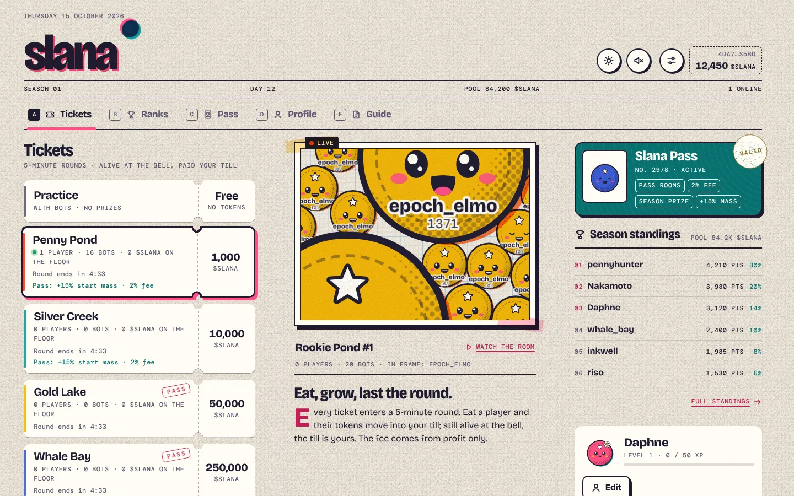 | 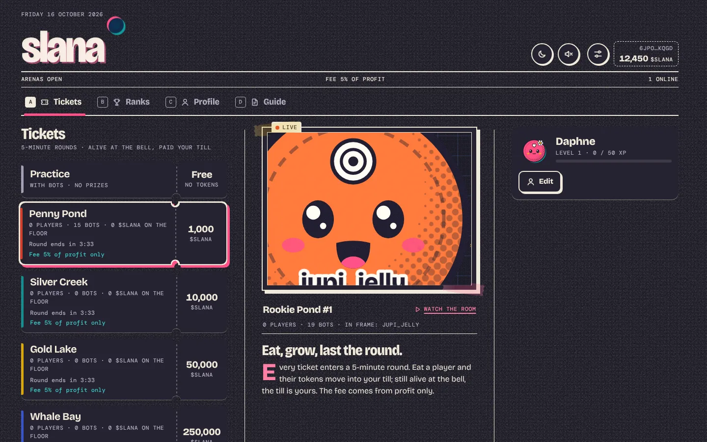 |
| **Ticket check** | **Ticket issued** |
| 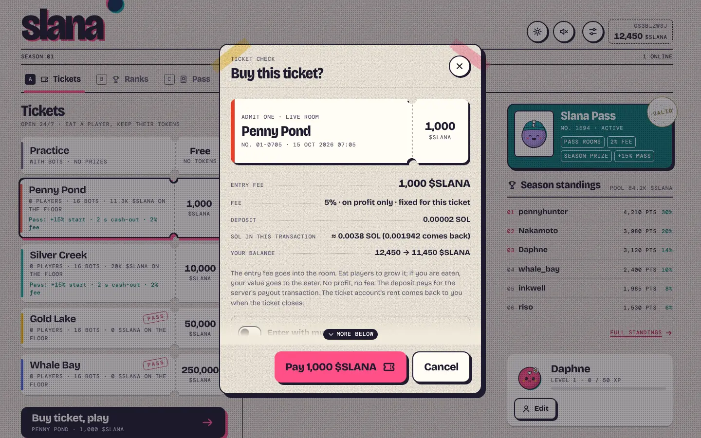 | 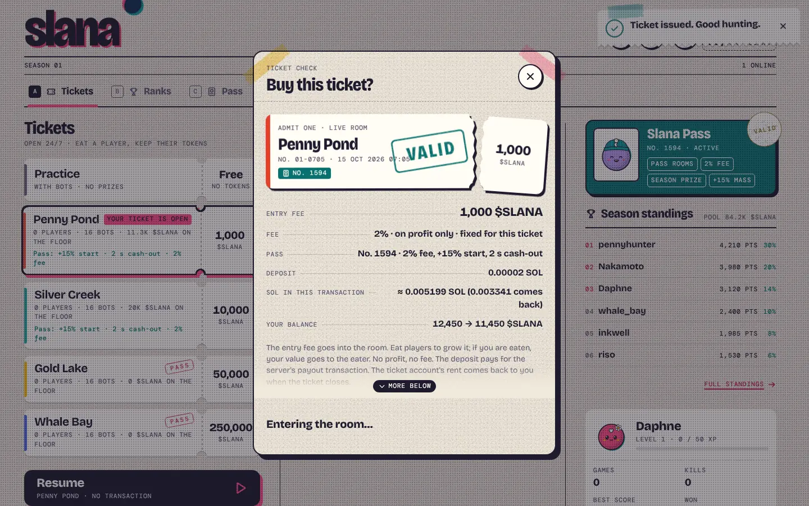 |
| **Arena** | **Night theme** |
| 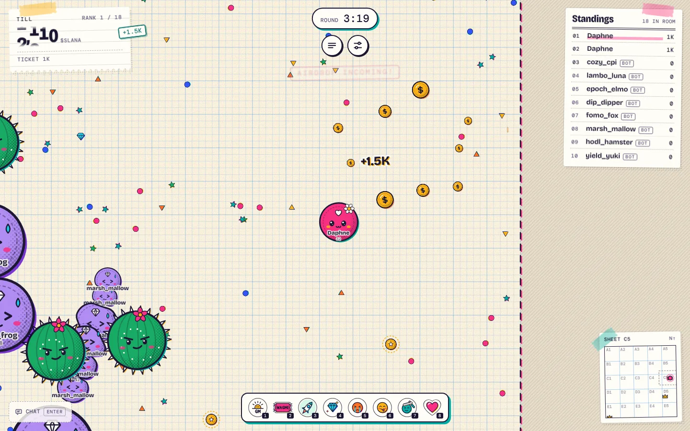 | 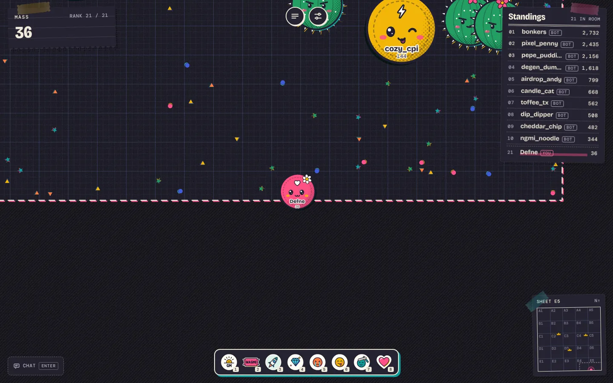 |
| **Round over receipt** | **Eaten** |
| 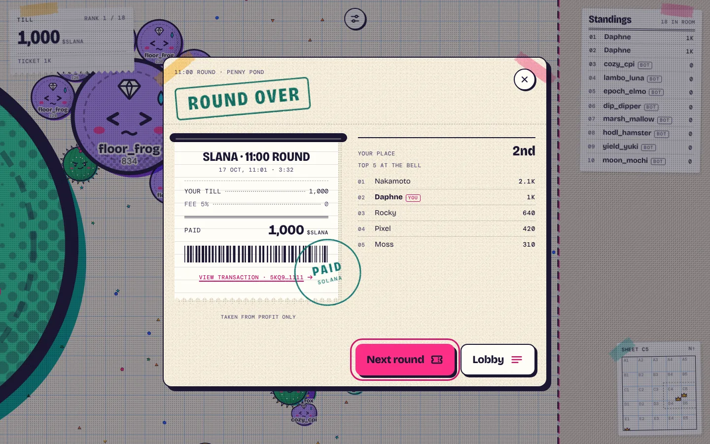 | 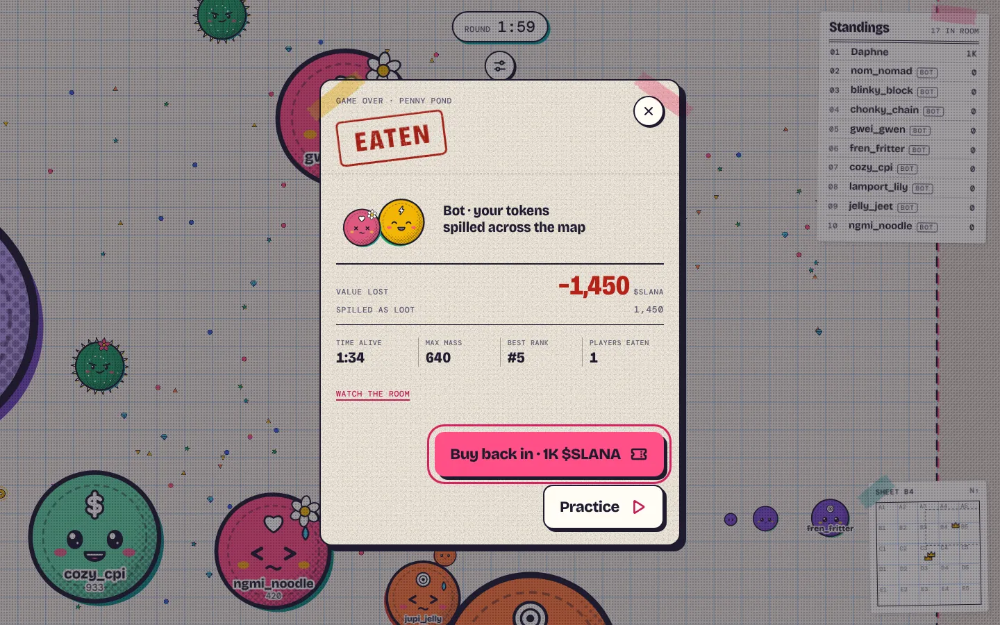 |
| **Standings** | **Guide** |
| 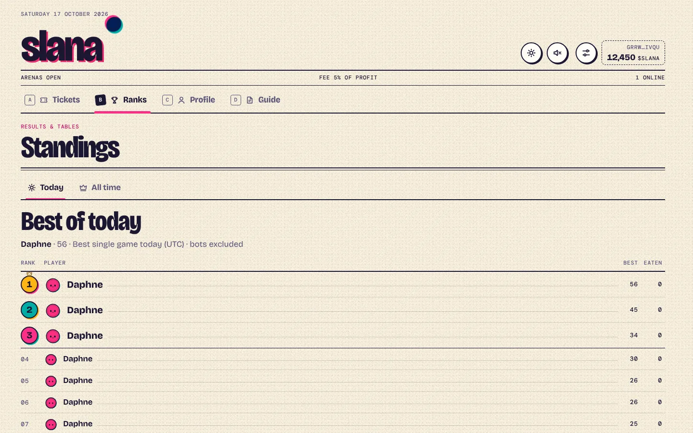 | 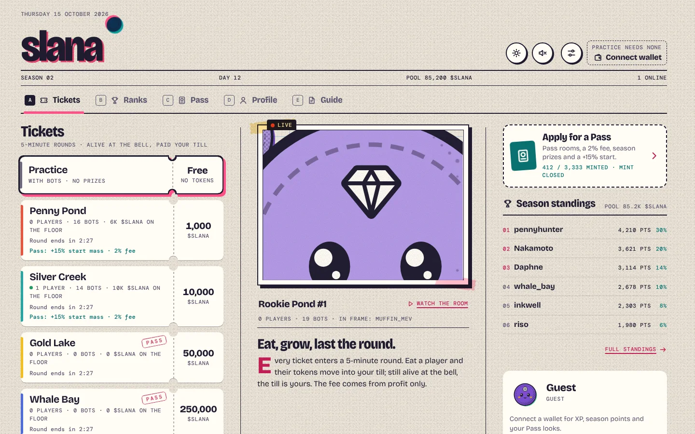 |

| Phone: lobby | Ticket | Game | Standings |
| --- | --- | --- | --- |
| 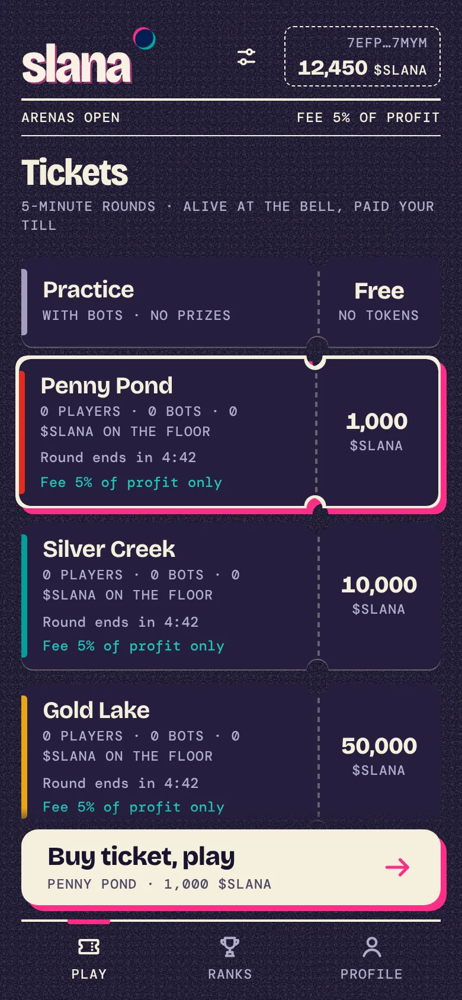 | 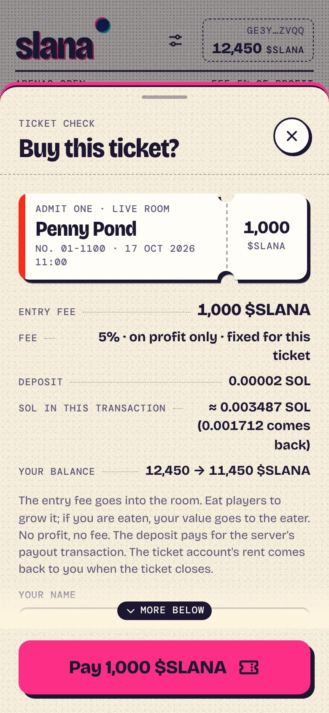 | 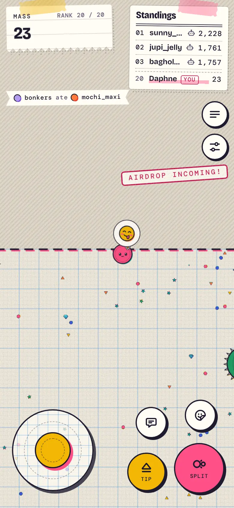 | 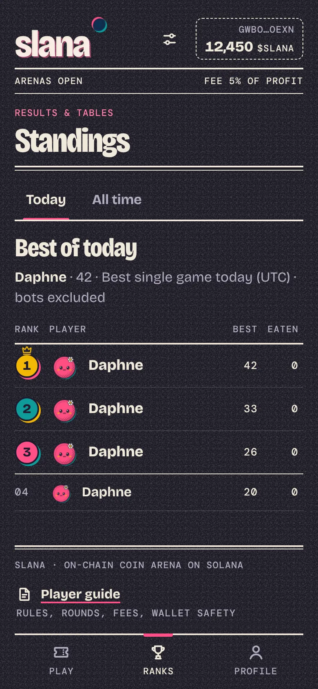 |

| Phone: lobby (paper) | Eaten | Guide (night) | Before the token is set |
| --- | --- | --- | --- |
| 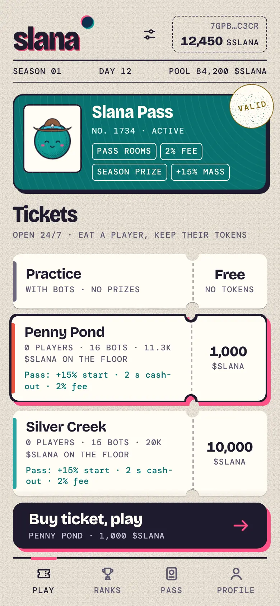 | 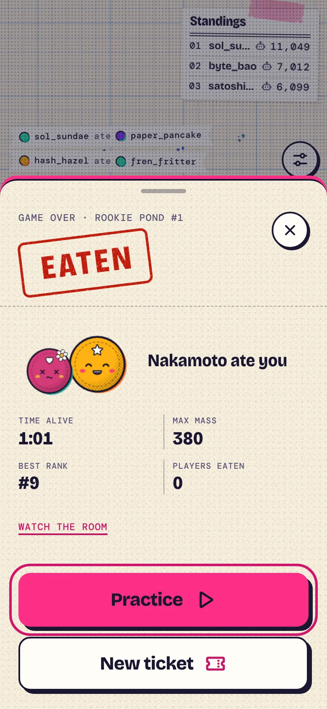 | 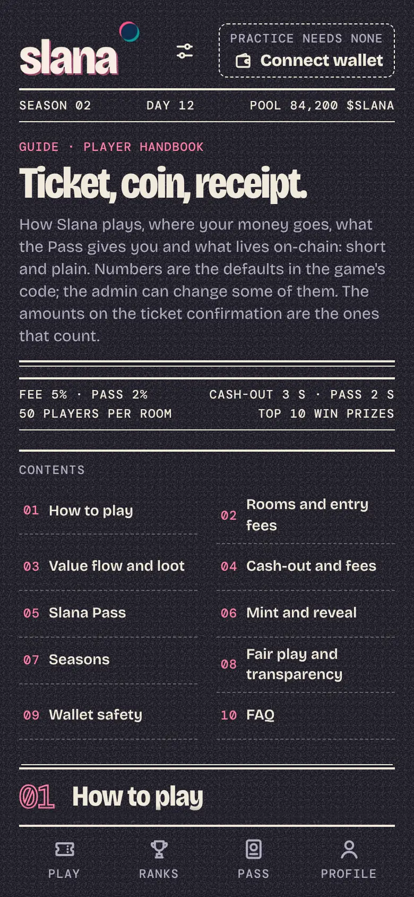 | 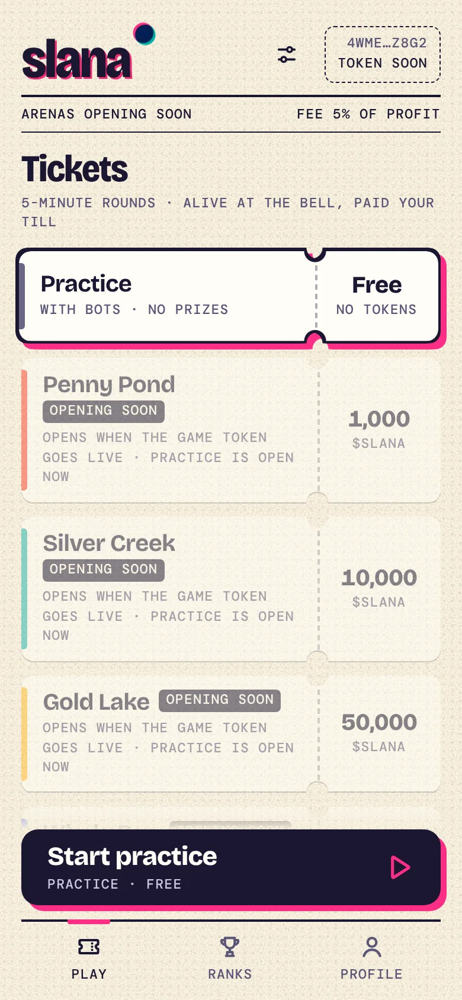 |

The screenshots are taken with the `apps/web/scripts/{lobby,gameview,docs}.mjs` tours on the `DEV_FAKE_CHAIN=1`
development stack (signing transactions in a browser cannot be automated). The localnet end-to-end test proves the real
chain path: `scripts/localnet.sh --no-token` + `pnpm -F @slana/server e2e` (see [OPERATIONS](docs/OPERATIONS.md)).

## How to play

- **Practice:** free; no wallet or token needed. Played with bots; no prizes and nothing on-chain. There are Rookie
  and Pro leagues.
- **Arenas:** each is an account on-chain. Ticket = a fixed entry fee that goes to the arena's vault (a program account).
  In the game your value starts at the entry fee; when you eat someone, the mass share of their value moves to you. Bots
  are worth 0; when a bot eats a player, the value spills across the map as **loot** that only real players can collect.
- **Rounds, no cash-out:** arenas play 5-minute rounds on the wall clock (round *n* is `[n*300 s, (n+1)*300 s)` of
  Unix time, the same for every arena). Nobody leaves with money before the bell: when it rings, everyone alive is paid
  their value on-chain and a new round opens at once. Joins (including a bought-back ticket after being eaten) close in
  the last 60 s; a ticket bought then is held and joins the next round. Floor loot left at the bell is **burned**
  (`sweep_loot`).
- **The fee** is a flat **5 % of profit** (the admin can change it, at most 10 %), taken only from what you win above your
  entry fee. It is paid in full to the fee wallet, which defaults to the admin wallet. The owner burns tokens off-chain
  by hand; the program has no treasury, no season pool and no burn split. The rate is fixed on-chain when you buy the
  ticket.
- **The token is set after deploy.** The program is deployed and initialized without a mint. The admin sets the $SLANA
  mint once with `pnpm admin set-token --mint <CA>`; until then the lobby shows the arenas as "Opening soon" and only
  practice is open. The server and the web pick the token up from the chain with no restart.
- **Standings** are an off-chain leaderboard (Today and All time, best single game); they carry no prizes.

The player guide is inside the game: **`/docs`** (or the **Guide** tab in the lobby). Default arenas
(`pnpm admin create-arena --defaults`): Penny Pond 1,000, Silver Creek 10,000, Gold Lake 50,000, Whale Bay 250,000
$SLANA. All four are open to everyone.

| Control | Desktop | Phone |
|---|---|---|
| Move | Mouse | Joystick |
| Split | `Space` | Split button |
| Drop mass | `W` (can be held) | Tip button |
| Chat / sticker | `Enter` / `1`–`8` | Chat / sticker buttons |
| Next player while spectating | `Q` | |

## Architecture

Real-time physics (30 Hz) cannot run on-chain. **Hybrid** model: the game loop runs on the authoritative Node server;
money, tickets and fees live in the Solana program. Details, the money-flow diagram and the invariants:
[docs/ARCHITECTURE.md](docs/ARCHITECTURE.md).

| Folder | Contents |
|---|---|
| `programs/slana-ref` | Anchor 1.2.1 reference (not deployed; the IDL source and the conformance oracle): token arenas (SPL Token / Token-2022), sessions, the flat fee, loot burn, `set_token_mint` + LiteSVM tests |
| `programs/slana-lean` | The deployed Pinocchio program (`target/deploy/slana_lean.so`, 39,032 bytes, size gate 71,000), wire-compatible with the reference; `scripts/build-lean.sh` |
| `packages/shared` | Game rules, binary protocol (v4), arena data, token formatting |
| `packages/sdk` | TypeScript client (PDAs, instructions, account reads, fee math) + **admin CLI** (`pnpm admin`) |
| `packages/art` | The risograph coin drawing used by the web renderer |
| `apps/server` | Game server: rooms and instances, bots, loot, the journal, the payout queue, the token watcher |
| `apps/web` | Game client: the "Paper Ticket" design system, lobby, ticket flow, standings, player guide |

Docs: [project overview](docs/PROJECT.md) · [design (Slana Simple)](docs/superpowers/specs/2026-10-16-slana-simple-design.md) ·
[setup and deployment](docs/DEPLOY.md) · [operations](docs/OPERATIONS.md) · [architecture](docs/ARCHITECTURE.md)

## Run it

Needs Node 22+ and pnpm 10 (`corepack enable`). Three commands cover everything; each one checks Node, pnpm, the
installed dependencies and the ports (8787, 5173; localnet also 8899/8900) first and says what to fix. Ctrl+C stops every
process it started.

```bash
pnpm install
pnpm demo            # the stack from the walkthrough videos: http://localhost:5173
pnpm demo:localnet   # the same UI on a real local validator (real transactions)
pnpm demo:record     # re-records the walkthrough video (add --quick for a short smoke run)
```

### `pnpm demo`

Starts the game server with `NODE_ENV=development DEV_FAKE_CHAIN=1 DEV_FAKE_TOKEN=1` (an in-memory fake chain: free arena
tickets, simulated settlements, seeded standings, the game token already set) and the web dev server, then prints
**http://localhost:5173**. Sign-in works with no extra environment: the dev proxy keeps the browser's host. Each run
starts from a fresh journal (`out/demo-data/`).

- **Wallet.** Any Wallet Standard wallet (Phantom, Solflare, Backpack) can sign in; the login message is free and no funds
  are needed. With no wallet extension, `pnpm demo --browser` opens a Chromium with a built-in Dev Wallet (a local keypair,
  `out/dev-wallet.json`; needs a display).
- **Name.** Set a player name in the lobby before buying a ticket.
- **Buying a ticket and playing.** Pick Penny Pond in the lobby, buy the ticket and play until the round bell (5 minutes; `ROUND_SECONDS=90 pnpm demo` shortens it); the payout is simulated.
- **Before the token is set.** `DEV_FAKE_TOKEN=0 pnpm demo` starts with the token unset: the four arenas read "Opening soon"
  and only practice plays. `curl -X POST localhost:8787/api/dev/token` sets it, like `pnpm admin set-token`; the open
  page flips to open arenas with no reload.
- **Practice only.** `pnpm dev` runs the server without any chain (practice rooms with bots, no wallet needed).

The fake chain is development only: it needs an explicit `NODE_ENV=development` and refuses to start while `PROGRAM_ID`
or `SERVER_KEYPAIR` is set. See `apps/server/.env.example`.

### `pnpm demo:localnet`

Same UI against a real `solana-test-validator`: real tickets, settlements and loot burns. It builds what is
missing, then starts everything:

1. `target/deploy/slana_lean.so`, via `scripts/build-lean.sh` (needs the Agave/Solana build tools: `cargo-build-sbf`).
2. The production build of the game server (`pnpm -F @slana/server build`).
3. `scripts/localnet.sh`: validator, program, test token, `init`, `set-token`, default arenas, and
   `.localnet/server.env`. The program keypair is not needed (the address comes from the SDK IDL).
4. The server with that env file and the web dev server. `PUBLIC_URL` is set to the web origin so the sign-in message
   names `localhost:5173`.

It needs the Agave CLI (`solana`, `solana-test-validator`, `solana-keygen`, `spl-token`) on the PATH or in `/opt/solana/bin`.
Ctrl+C also stops the validator (`scripts/localnet.sh --stop`). A localnet run keeps no state between runs: every run
starts from a fresh ledger.

**Wallet and funds.** Either:

- **Phantom on localhost.** Settings, Developer Settings, turn on Testnet Mode and choose Solana Localnet (RPC
  `http://127.0.0.1:8899`). Then fund the address.
- **A local keypair (Dev Wallet).** `pnpm demo:localnet --browser` opens a Chromium with a Dev Wallet whose key is
  `.localnet/dev-wallet.json`, and funds it automatically.

Fund any address with SOL and `$SLANA` (the test mint is capped, so tokens are sent from the admin wallet):

```bash
scripts/localnet-fund.sh <WALLET_ADDRESS> [sol=10] [slana=1000]
# SOL only:  solana airdrop 10 <WALLET_ADDRESS> --url http://127.0.0.1:8899
```

Admin commands work as usual (`pnpm admin status`).

### `pnpm demo:record`

Records the walkthrough (lobby, wallet, practice, a Penny Pond ticket, arena, the round bell and receipt, standings, profile, guide)
with a visible cursor and chapter captions, and encodes it to **`out/videos/slana-walkthrough.mp4`** plus a highlights
reel (`out/videos/` is gitignored). It starts the fake-chain stack by itself and stops it afterwards; to record a stack you
already run, add `--url http://localhost:5173/`. Needs ffmpeg on the PATH (`FFMPEG=<binary>` overrides) and Chromium:
Playwright's own (`pnpm -F @slana/web exec playwright install chromium`) or `CHROME_PATH=<binary>`. A full run takes a
few minutes; `pnpm demo:record --quick` records a shorter clip (lobby, wallet, ticket, arena) as `slana-quick.mp4`.
The videos carry the game's sound (effects and music, captured from the dev build's master bus); the announcer speaks
through the OS speech engine and is not in the recording. `--no-audio` records silent videos.

## Running with the chain

Step by step (deploy, `init`, `set-token`, arenas, server, Docker, mainnet costs): **[docs/DEPLOY.md](docs/DEPLOY.md)**.
Day-to-day work (the fee wallet, loot burn, pausing, key rotation, backups): **[docs/OPERATIONS.md](docs/OPERATIONS.md)**.
Every admin command: `pnpm admin help`.

The order is fixed: **deploy, then `init`, then (later) `set-token`, then `create-arena --defaults`**.

```bash
scripts/deploy-lean.sh mainnet-beta target/deploy/slana-keypair.json --keypair keys/deployer.json
pnpm admin init --keypair <admin keypair> --server <server pubkey>  # no mint; the fee wallet defaults to the admin
pnpm admin set-token --mint <CA>                                 # once; also creates the fee wallet's token account
pnpm admin create-arena --defaults                               # four arenas; the server lists them within about 60 s
```

`set-token` can be run only once, and the program has no way to change the mint afterwards: a wrong contract address
means closing the program and redeploying it (see OPERATIONS, "Emergency stop / close").

### Program build and deploy

The deployed program is the Pinocchio build `programs/slana-lean` (39,032 bytes, size gate 71,000). The Anchor crate
`programs/slana-ref` is only the IDL source and the conformance oracle in the tests, and is **never deployed**.

```bash
anchor build --ignore-keys && pnpm -F @slana/sdk sync-idl     # IDL (and the reference slana.so used by the tests)
bash scripts/build-lean.sh                                    # target/deploy/slana_lean.so, prints size and rent
scripts/deploy-lean.sh devnet target/deploy/slana-keypair.json --keypair keys/deployer.json
# refuses a keypair that is not the program id, then moves the upgrade authority to the admin wallet (scripts/admin.env)
scripts/close-program.sh <cluster-url> <admin-keypair>   # emergency: permanently closes the program, see docs/OPERATIONS.md
```

Never use `anchor deploy`: it would ship the ~450 KB reference. The lean program locks
272,866,800 lamports (about ◎0.2729) of ProgramData rent, and the deploy briefly needs about ◎0.55 because of the
temporary buffer. The full cost table is in [docs/DEPLOY.md](docs/DEPLOY.md#10-mainnet-costs).

### Localnet and end-to-end test

`scripts/localnet.sh` sets up a clean local cluster: `solana-test-validator` with the Slana program loaded, a Token-2022
test mint (6 decimals, no freeze authority, 1 billion tokens to the admin, then minting disabled), `init`, `set-token`
and the default arenas; it writes the server environment to `.localnet/server.env`. `scripts/localnet.sh --no-token`
stops after `init` (the mint exists but is not set), which is the state the end-to-end test starts from. Requirements:
`scripts/build-lean.sh` (`slana_lean.so`) and the Agave CLI (`spl-token` included). `.localnet/` is never committed.

```bash
scripts/build-lean.sh && scripts/localnet.sh        # or just: pnpm demo:localnet
scripts/localnet.sh --no-token && pnpm -F @slana/server e2e   # the end-to-end test; about 2-3 minutes
scripts/localnet.sh --stop
```

The test uses the real chain (not the fake chain) and starts and stops its own game server. In order: the program is
initialized without a mint; the server reports `tokenReady: false`, refuses an arena join with `token_not_set` and still
plays practice; the real `pnpm admin set-token` runs and the server picks the token up with no restart; `pnpm admin
create-arena --defaults` runs and the arena appears; four real tickets are bought (a hunter, a prey, a feeder and the fee
wallet itself); a player is eaten and the feeder's value spills as loot; at the bell each fee equals the SDK's
`splitPayout`, the fee wallet's token account grows by exactly the sum of the fees, the fee wallet's own ticket is
finalized and collected with `refund_session`, and the floor loot is burned (the supply drops by exactly tickets minus
payouts).

```bash
docker build -t slana .
docker run -p 8787:8787 -v slana-data:/data --env-file apps/server/.env slana   # → http://localhost:8787
```

## Tests

```bash
pnpm -r typecheck
pnpm -r test                        # shared, sdk, art, server, web (Vitest)
pnpm -F @slana/web build
scripts/test-program.sh             # program: LiteSVM suite against slana.so (ref) and slana_lean.so (lean)
```

Extra tools: `pnpm -F @slana/server sim` (bot balance), `pnpm -F @slana/web shot <url> <png>` (screenshot).

## Trust model

- Entry fees sit in the arena vaults (program accounts); a payout cannot exceed the vault, the fee is taken only from
  profit and is capped at 10 %. The fee rate, entry fee and deposit shown to the player when buying a ticket are upper
  bounds on-chain.
- The payout has two phases (R24): the server always writes the outcome on-chain. If the player has no token account or
  the account refuses the payout, the amount stays in the vault as `owed`, and the player takes exactly that amount at
  any time with "Collect payout". A losing player cannot spoil the outcome by closing their token account, nor get the
  entry fee back. A ticket the server never settled can be refunded by the player themselves after 24 hours.
- The game's outcome (who ate whom, the value at the bell, the score) **trusts the authoritative server**. The server key
  can only close open tickets and, through `sweep_loot`, **burn** round-end floor loot from an arena vault (never more than
  the vault holds, the same trust as a payout); it cannot touch the fee wallet or the settings. Since the admin can
  replace the server key, this trust is in the end trust in the admin.
- The fee goes to one wallet, the fee wallet (the admin by default). It must keep its token account for the game
  token: if that account is closed or unusable, every settlement is held until it is recreated.
- The token mint is set once and cannot be changed (a wrong contract address means redeploying).

---

## Summary

**Slana** is an on-chain, coin-themed Agar.io on Solana.

- **Practice** is free: no wallet, no token, bots only, Rookie and Pro leagues, nothing on-chain.
- **Arenas** are on-chain accounts with a fixed entry fee in **$SLANA**: Penny Pond 1,000, Silver Creek 10,000, Gold Lake
  50,000, Whale Bay 250,000, all open to everyone. Your in-game value starts at the entry fee; eating a player moves their
  value to you. Bots are worth 0; when a bot eats a player, the value spills as loot that only real players can collect.
  Rooms are sharded into instances of 50 players and run 24/7.
- **Rounds** (5 minutes, wall-clock, no cash-out) end with the payout of everyone alive on-chain; floor loot is burned
  through the server-signed `sweep_loot`. The fee is a flat **5 % of profit** (at most 10 %), paid in full to the fee
  wallet, which defaults to the admin; the owner burns tokens off-chain by hand. The rate is fixed on-chain when the
  ticket is bought.
- **The token is set after deploy** with `pnpm admin set-token --mint <CA>` (once). Until then the arenas show "Opening
  soon" and only practice is open; the server and the web follow the chain with no restart.
- **Architecture:** a hybrid model. The authoritative Node server runs the 30 Hz simulation and settles tickets on-chain;
  the Solana program holds the money rules. The deployed program is a Pinocchio build (`programs/slana-lean`, 39,032
  bytes, about ◎0.2729 of rent). It is wire-compatible with the Anchor reference (`programs/slana-ref`), which supplies
  the IDL and is checked against it by the same LiteSVM suite, but is never deployed. Build with
  `bash scripts/build-lean.sh`, deploy with `scripts/deploy-lean.sh <cluster-url> <keypair>`,
  never `anchor deploy`. See [docs/ARCHITECTURE.md](docs/ARCHITECTURE.md).

```bash
corepack enable && pnpm install && pnpm dev     # http://localhost:5173, practice, no wallet needed
```

The player guide is in the app at `/docs`. Deployment and operations are in [docs/DEPLOY.md](docs/DEPLOY.md) and
[docs/OPERATIONS.md](docs/OPERATIONS.md); architecture in [docs/ARCHITECTURE.md](docs/ARCHITECTURE.md). The program
has **not been audited**, and real-money games may need a licence where you operate.

License: [MIT](LICENSE)
