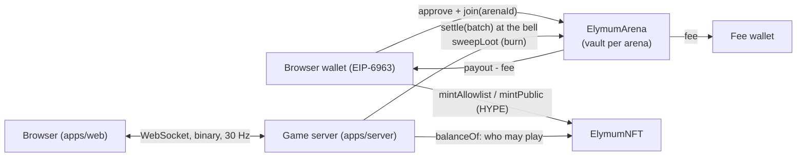

# Elymum

**You are small change with a big appetite.** Elymum is a cute coin-eats-coin arena game on
Elysium, Kinetiq's EVM L2 (an Arbitrum Orbit chain that settles to HyperEVM, gas token HYPE).
You are a coin: eat food and smaller coins, run from bigger ones, and when the five-minute bell rings
whatever you swallowed is paid out on chain.

The product flow is WL → Mint → Play: people apply for the whitelist, mint an Elymum NFT for
$1 in HYPE, and the game opens for holders. The money rules live in two Solidity contracts; the
game itself runs on an authoritative server; the owner deploys and runs everything from their own
wallet in `/admin`.

Status: the contracts and the whole mint system are ready and run from `/admin`; the public site
collects WL applications for now. Elysium mainnet launches on Nov 9: until Kinetiq publishes its RPC
and explorer, everything runs on Elysium Testnet (chain id 99801). The contracts have not been
audited, and a game played with a token of real value may need a licence where you operate.

The single source of truth for the system and the interface is
[`docs/specs/2026-10-29-elymum-on-elysium.md`](docs/specs/2026-10-29-elymum-on-elysium.md); the visual
reference is [`docs/design/storybook-reference.html`](docs/design/storybook-reference.html) (the "Ring
Storybook" language).

## Screenshots

The old screenshots were removed with the redesign. The screenshot tours in `apps/web/scripts`
(`lobby.mjs`, `docs.mjs`, `gameview.mjs`, `shot.mjs`) regenerate them against `pnpm demo`; they will be
added back under `docs/images/` once the Ring Storybook UI has landed. Until then,
[`docs/design/storybook-reference.png`](docs/design/storybook-reference.png) shows the look.

## Key features

- Real-time arena game: a 30 Hz authoritative server (physics, bots, rounds) and a canvas client with
  split, eject, viruses, power-ups and floor loot.
- Rounds, not cash-outs: paid arenas play 5-minute wall-clock rounds. Join late or buy back in;
  everyone alive at the bell is paid their value, minus a flat 5 % fee on profit only.
- Four arenas on the ring: Asphodel Meadow (1,000), Lethe Shore (10,000), Golden Bough (50,000) and
  Isles of the Blessed (250,000 `$ELYMUM`), all open to everyone.
- On-chain money in one contract: `ElymumArena` holds the entry fees in per-arena vaults; a payout
  can never exceed the vault, a settlement cannot replay, players refund unsettled tickets themselves
  after 24 h, floor loot is only ever burned.
- Elymum NFT: an ERC-721 with an allowlist (Merkle root) and a public phase, priced at $1 in
  HYPE (synced from `/admin` or kept there by the server's price keeper within the owner's bounds).
- Sign-In with Ethereum (EIP-4361) for every wallet that speaks EIP-6963 (MetaMask, Rabby, Coinbase
  Wallet, OKX and the rest), smart wallets included (ERC-1271 / 6492).
- Owner-run admin panel: deploy both contracts from your wallet, register them, set the token,
  create arenas, publish the allowlist, open the mint, review the WL and collabs, integrity flags,
  bans and held payouts. Every transaction is previewed before the wallet prompt.
- Practice and bots: two leagues of practice rooms with bots; nothing touches the chain.

## How it works



1. A player signs in with SIWE (free, no transaction), approves the game token and calls `join` on the
   arena: the entry fee moves into that arena's vault and a session opens.
2. The server seats the ticket. Value moves between players off chain as they eat each other; a
   crash-safe journal keeps the books (live values + floor loot + pending payouts = entry fees − payouts).
3. At the bell the server settles every live ticket of the arena in one `settle` batch. The fee
   (5 % of profit by default, at most 10 %) goes to the fee wallet; floor loot is burned with `sweepLoot`.
4. If the server never settles a ticket, the player calls `refund` after 24 h. If a payout transfer
   fails, the session is finalized with what is `owed` and the player collects it with `refund`.

Details: [docs/ARCHITECTURE.md](docs/ARCHITECTURE.md).

## Tech stack

| Layer | Stack |
|---|---|
| Contracts | Solidity 0.8.28 (Shanghai), OpenZeppelin 5.6.1, Hardhat 3, forge-std tests (unit + fuzz) |
| Client SDK / admin CLI | TypeScript, viem |
| Game server | Node 22, `ws`, viem, a binary protocol, a crash-safe JSON journal |
| Web | Vite + React, canvas renderer, motion, synthesized WebAudio; Fraunces, DM Sans, Geist Mono |
| Tooling | pnpm workspaces, Vitest, Playwright, Docker, GitHub Actions |

## Project structure

| Path | What it is |
|---|---|
| `packages/contracts` | `ElymumArena`, `ElymumNFT`, `TestToken`; the committed `src/artifacts.ts` (ABIs, bytecode, pinned runtime code hashes) |
| `packages/sdk` | viem client: reads, call builders, deploy helpers, Merkle tree, HYPE price, the admin CLI (`pnpm admin`) |
| `packages/shared` | Game rules, protocol, chains table, arenas, SIWE message, palette |
| `packages/art` | Coin drawing shared by the web renderer and the films |
| `apps/server` | The game server (rooms, bots, rounds, ledger, journal, chain gateway, site and admin API, integrity) |
| `apps/web` | The client: landing, `/wl`, `/collab`, `/mint`, `/play`, `/docs`, `/admin` |
| `scripts/` | `demo.mjs`, `localnet.mjs`, `localnet-fund.mjs`, `dev-browser.mjs`, `record-walkthrough.mjs` and the Dev Wallet |
| `brand/` | The brand kit generator and its PNGs (X avatar and banner, OG card, favicons, posts, stickers, arena posters) |
| `media/` | Film pipelines (promo, gameplay, how-to-play, mint film, roadmap chomp) |
| `docs/` | [PROJECT](docs/PROJECT.md), [ARCHITECTURE](docs/ARCHITECTURE.md), [DEPLOY](docs/DEPLOY.md), [OPERATIONS](docs/OPERATIONS.md), the spec and the design reference |

## Getting started

Requirements: Node 22+, pnpm 10 (`corepack enable`).

```bash
pnpm install
pnpm demo                       # everything on a fake chain: lobby, sign-in, tickets, rounds, bell
DEV_FAKE_TOKEN=0 pnpm demo      # the same with the game token unset ("Opening soon" until POST /api/dev/token)
ROUND_SECONDS=90 pnpm demo      # shorter rounds, to see the bell sooner
pnpm demo --browser             # also open a Chromium with the Dev Wallet (needs a display)
```

`pnpm demo` starts the server with `NODE_ENV=development DEV_FAKE_CHAIN=1 DEV_FAKE_TOKEN=1` and the web
dev server on http://localhost:5173. Any EVM wallet signs in (no funds needed).

### A real local chain

```bash
pnpm demo:localnet              # hardhat node + contracts deployed with the SDK + the production server
pnpm demo:localnet --browser    # ... and the Dev Wallet as the contract owner (Hardhat account #0)
node scripts/localnet-fund.mjs 0xYourAddress     # 10 HYPE + 100,000 test tokens
```

`demo:localnet` starts `hardhat node` (chain id 31337), deploys `TestToken`, `ElymumArena` and
`ElymumNFT` from Hardhat account #0 (the owner and admin), sets the token, creates the four arenas,
opens the mint and runs the built server with `EVM_RPC_URL`, `SERVER_PRIVATE_KEY` (Hardhat account #1),
`ARENA_ADDRESS`, `NFT_ADDRESS` and `ADMIN_WALLETS`. To run the chain alone: `pnpm localnet`
(`--no-token` stops before `setToken`, like a fresh deploy); the server env is written to
`.localnet/server.env`.

### Tests

```bash
pnpm typecheck && pnpm test     # every package
pnpm contracts:build            # compile + export packages/contracts/src/artifacts.ts (commit it)
pnpm contracts:test             # forge-std unit and fuzz tests
pnpm -F @elymum/server e2e      # a real hardhat node + the real server: deploy, register, setToken, play, settle
```

CI (`.github/workflows/ci.yml`) runs an English-only guard, builds the contracts and fails when the
exported artifacts are out of date, runs every package's typecheck and tests, builds the server and
the web, and builds the Docker image.

### Deploying

Deploy the server (Docker, e.g. on Render), then deploy the contracts from your own wallet in
`/admin`: Deploy Arena → Deploy NFT → register both → set the token (when it exists) → create the
arenas → publish the allowlist → open the mint. Step by step: [docs/DEPLOY.md](docs/DEPLOY.md).
Day-to-day running (gas for the server key, the allowlist, the $1 price, pausing, ownership):
[docs/OPERATIONS.md](docs/OPERATIONS.md).

## Security and trust model

- Players buy tickets, collect what they are owed and refund unsettled tickets after 24 h. They
  cannot settle tickets or undo a result.
- The server key settles tickets (any payout up to the arena's vault) and burns floor loot. It cannot
  move tokens to a wallet of its choice, change the config or touch the fee wallet. Because the owner can
  replace it, trusting the server means trusting the owner. Protect it; it only needs a little HYPE.
- The owner (Ownable2Step) sets the token once, the fee (at most 10 %), the fee wallet, the server
  authority, arenas and pause; on the NFT, the phase, the allowlist root, the price within the bounds,
  limits, metadata and withdrawals. The owner cannot change an open ticket's fee or the token once set.
- The game outcome is trusted: who ate whom is decided by the server. Integrity detectors flag
  collusion and bot-like play for review; an optional auto-hold keeps high-risk payouts for a decision.

More: [docs/ARCHITECTURE.md#trust-model](docs/ARCHITECTURE.md#trust-model).

## Documentation

[Project overview](docs/PROJECT.md) · [Architecture](docs/ARCHITECTURE.md) · [Deploy](docs/DEPLOY.md) ·
[Operations](docs/OPERATIONS.md) · [Spec: Elymum on Elysium](docs/specs/2026-10-29-elymum-on-elysium.md) ·
[Brand kit](brand/README.md) · [Films](media/README.md)

## License

MIT, see [LICENSE](LICENSE).
