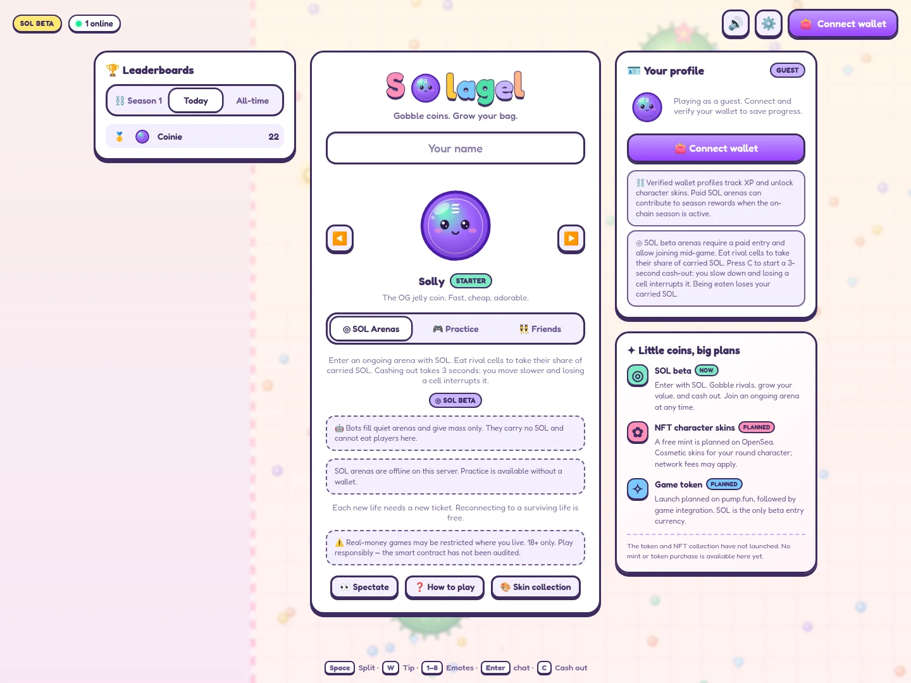

# 🪙 Solagel

A jelly-coin survival arena on Solana. Join a running pond, grow, split and eat smaller opponents. The English interface keeps Solagel's original pastel colors, bold purple outlines and animated round characters.



## Release status

| Phase | Economy | Character skins |
| --- | --- | --- |
| **SOL beta — implemented** | SOL entry tickets, player-to-player SOL value transfers, on-chain cash-out | Starter and XP skins; future skins are previews |
| **NFT launch — planned** | SOL beta continues until the token economy is separately implemented and verified | Free character-skin mint planned on OpenSea; cosmetic only |
| **Token launch — planned** | Token creation planned on pump.fun, followed by an explicit game integration | Verified collection ownership will unlock cosmetic skins |

**No Solagel token or NFT collection is launched or configured in this codebase.** There are no token sales, mint buttons, placeholder asset addresses or conversions of beta balances into future tokens. Legacy premium skin ownership remains usable, but new SOL skin purchases are disabled. A free NFT mint means no mint price; network fees may still apply.

The release metadata is exported from `packages/shared/src/release.ts` and exposed at `/api/config`. It describes the current release, not a switch that enables unfinished assets. OpenSea mint-chain support, the collection contract and a ownership-verification approach must be confirmed before launch; a Solana wallet alone cannot prove ownership of an NFT on another chain.

## The arena rules

- Public arenas run continuously. Players can join mid-game; no round countdown or synchronized start is required.
- **SOL arenas** use on-chain tickets. Default tiers are 0.01 / 0.05 / 0.1 SOL. Each new life needs a new ticket; reconnecting to a surviving life does not.
- Eating an opponent's cells transfers a proportional share of their **in-game SOL balance**, not their wallet balance. Kills transfer the remainder. Mass and SOL balance are separate.
- Cash-out channels for 3 seconds. You remain vulnerable; damage interrupts it. The displayed amount is an estimate until the matching session's chain settlement confirms. The configured fee applies to profit only.
- New spawns receive a short shield and safe-spawn placement. Quiet arenas fill with clearly identified bots; bots leave as humans arrive.
- **Paid-arena bots provide mass only.** They carry no SOL, cannot eat human cells, cannot cash out, and cannot create rewards. A player alone with bots cannot earn SOL from them.
- **Practice and friends' rooms** are free, have no stake or direct monetary rewards, and award no prize-bearing season points. Practice bots can eat humans. Verified practice can earn XP and regular stats.
- NFT skins are planned to be cosmetic: no size, speed or payout advantage.

### Tickets, recovery and refunds

A purchased ticket is initially **unused**. Before spawning the player, the server journals its liability and confirms `activate_session` on-chain. Once activated, the session must settle against its recorded earned balance; its original buy-in can no longer be independently refunded. This prevents losing players reclaiming funds already won by opponents.

An **unused** ticket can be self-refunded after 24 hours. The server can settle abandoned unused tickets after 15 minutes. Activated tickets depend on the durable settlement journal and server availability. On restart, journaled balances are queued for settlement; uncertain claims are retained for retry. Missing or corrupt accounting must be investigated rather than replaced with original buy-in refunds.

Disconnecting leaves your cells in the arena during the reconnect grace period. They remain vulnerable. Use cash-out for a deliberate exit. Navigating to the menu or switching identity during a paid life first requests cash-out.

## Run locally

Requires Node.js 22+ and the repository's pinned pnpm version.

```bash
corepack enable
corepack pnpm install --frozen-lockfile
corepack pnpm dev
```

Open **http://localhost:5173**. The server runs on port 8787. With no deployed program and server signing key, SOL entry is visibly unavailable; practice, bots, private rooms and spectating remain playable.

Environment examples: [server](apps/server/.env.example), [web](apps/web/.env.example). Scripts consume process environment variables; load your environment file explicitly when starting a process.

| Action | Desktop | Mobile |
| --- | --- | --- |
| Move | Mouse | Joystick |
| Split | Space | Split |
| Eject mass | W | Tip |
| Cash out | C | Cash-out button |
| Chat / emotes | Enter / 1–8 | On-screen controls |
| Spectate next | Q | Next |

## Architecture

```text
React + Canvas browser ⇄ WebSocket ⇄ authoritative Node game server
          │                              │
          └──── wallet transactions ──────┼── activation + settlement
                                         ▼
                              Solana Anchor program
```

The server runs physics at 30 Hz. Solana holds tickets, funds, profiles and season rewards. Game-result accuracy trusts the authoritative server. Only captured SOL profit contributes to the prize-bearing season leaderboard: `floor(max(payout − buyIn, 0) / 1000)` points, using lamports before the profit fee. Bot/food mass, returned buy-ins and practice earn no prize points; the top ten eligible players share the configured pool.

| Directory | Purpose |
| --- | --- |
| `apps/web` | English React lobby, canvas rendering, wallet and ticket flows |
| `apps/server` | Simulation, bots, room admission, auth and durable settlement |
| `packages/shared` | Rules, protocol, skins and release metadata |
| `packages/sdk` | Solana instructions, account decoders and admin CLI |
| `programs/solagel` | Anchor escrow, activation, settlement and profile program |

## Verification and deployment

```bash
corepack pnpm typecheck
corepack pnpm test
corepack pnpm build
anchor build --ignore-keys
cargo test -p solagel
```

See [verification results](docs/VERIFICATION.md) and [deployment and recovery](docs/DEPLOY.md). The activation change **changes the Session account layout**. Drain and settle all existing sessions before upgrading an existing deployment, regenerate the IDL, and deploy matching server/client builds together. Never point this build at the old program layout with live tickets.

The on-chain program has not had an independent security audit. A real-wallet SOL test requires a configured local validator or devnet program, RPC endpoint, funded server authority and player wallet; the default practice server does not validate real settlement.

Historical design documents in `docs/superpowers` describe the pre-beta implementation and are not the current product rules.

[MIT License](LICENSE)
