# Slana

**Solana üzerinde zincir üstü, coin temalı bir Agar.io.** Odalara $SLANA ile bilet kesilir, her odanın sabit bir giriş
bedeli vardır ve **yediğin oyuncunun tokenleri sana geçer**. Slana Pass (ücretsiz mint edilen bir NFT) Pass odalarını
açar, kesintiyi düşürür ve sezon ödüllerine hak kazandırır. Para kuralları zincirde, oyun yetkili bir sunucuda çalışır.

*An on-chain, coin-themed Agar.io on Solana: tickets in $SLANA, eat a player and take their tokens, a free-mint Slana Pass.
English summary below.*

> **Uyarı / Warning.** Gerçek değerli bir tokenle oynanan bir oyundur; bulunduğunuz ülkede lisans gerektirebilir.
> Akıllı kontrat **bağımsız bir denetimden geçmemiştir**. Real-money play may need a licence where you operate; the
> program has **not been audited**.

---

## Ekran görüntüleri

v2, "Kâğıt Bilet" tasarımı: masaüstü ve telefon, TR / EN, kâğıt ve gece teması. Tüm görseller `docs/images/` içinde.

| Lobi (masaüstü, kâğıt) | Lobi (masaüstü, gece) |
| --- | --- |
| 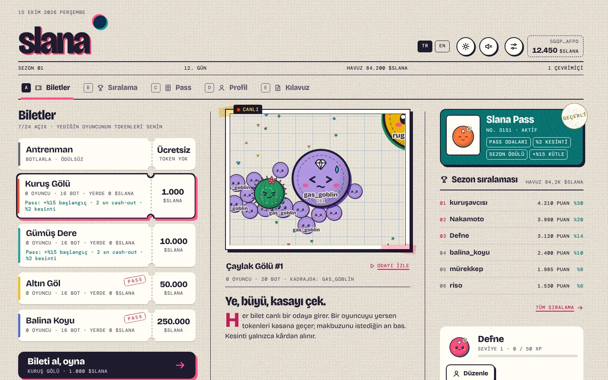 | 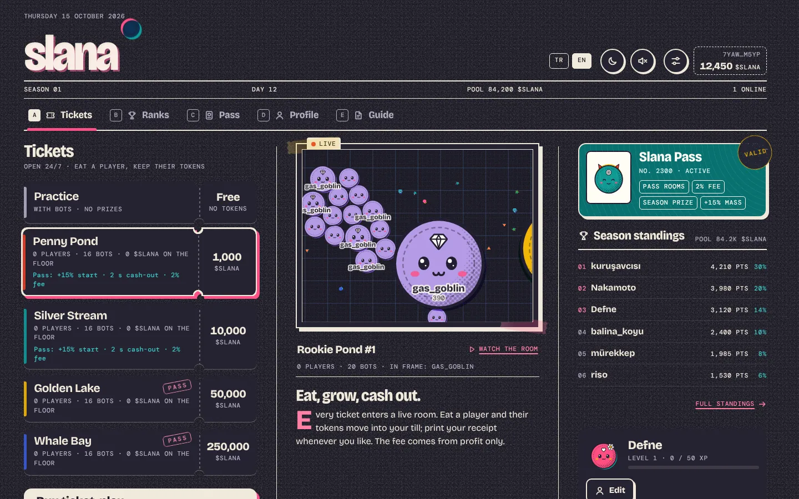 |
| **Bilet kontrolü** | **Bilet kesildi** |
| 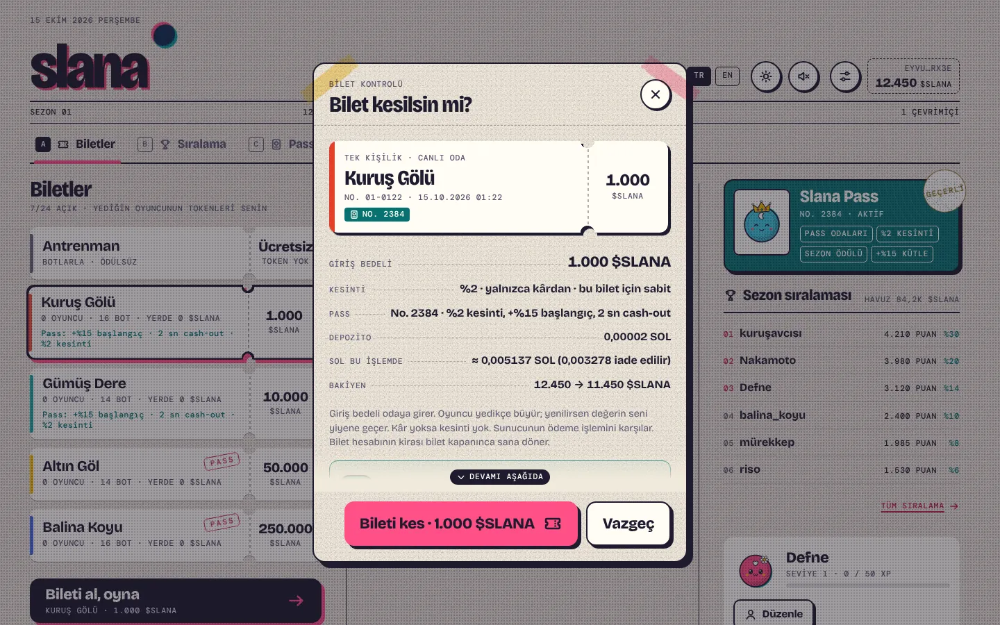 | 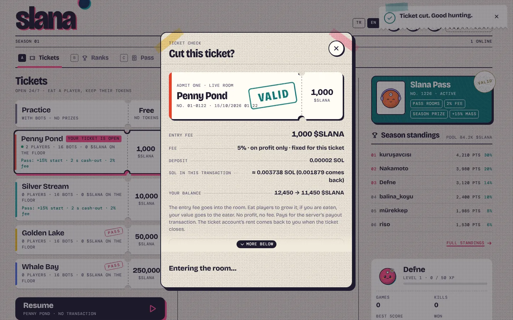 |
| **Arena** | **Gece teması** |
|  |  |
| **Cash-out makbuzu** | **Yenildin** |
|  |  |
| **Slana Pass** | **Mint** |
| 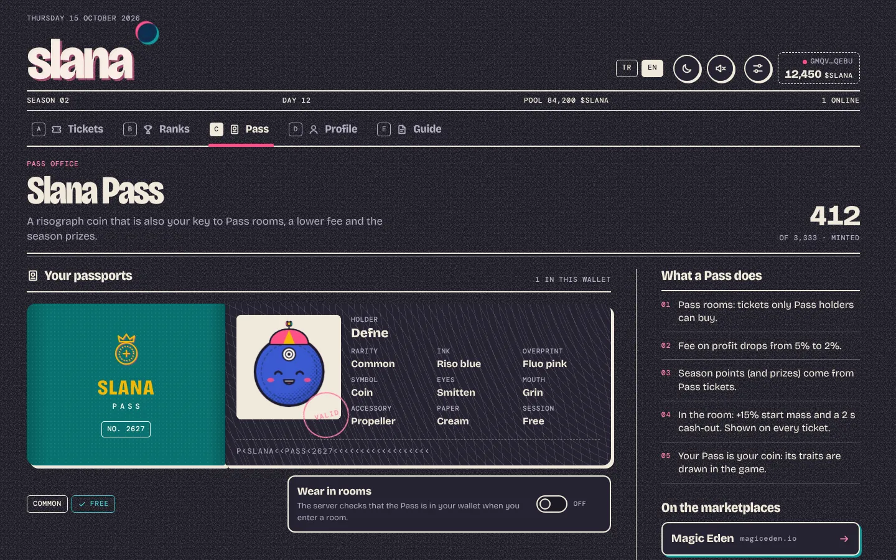 |  |
| **Sıralama** | **Kılavuz** |
| 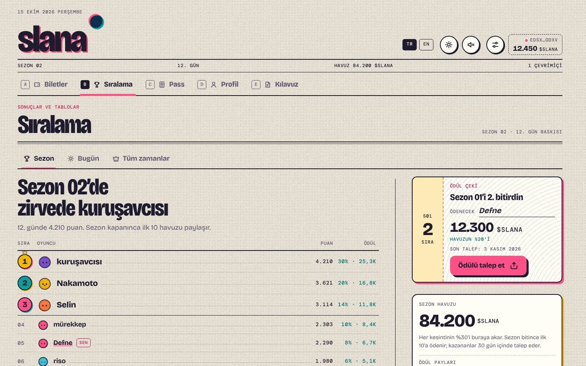 | 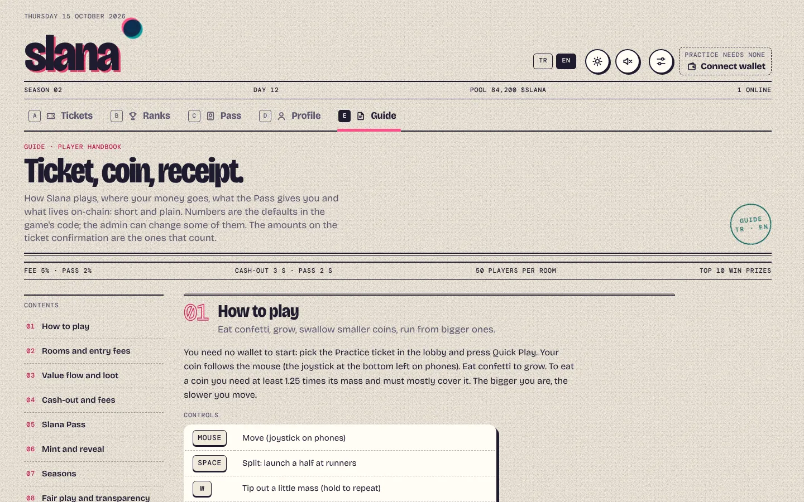 |

| Telefon: lobi | Bilet | Oyun | Pass | Sıralama |
| --- | --- | --- | --- | --- |
| 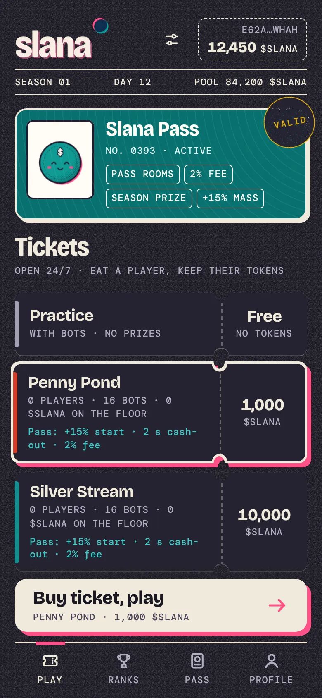 | 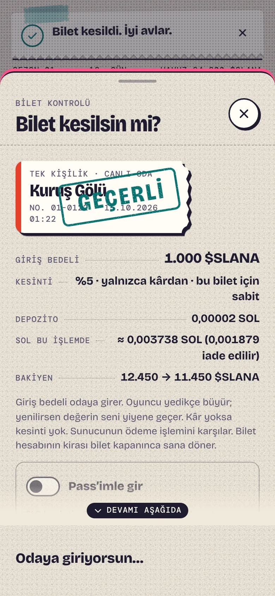 |  | 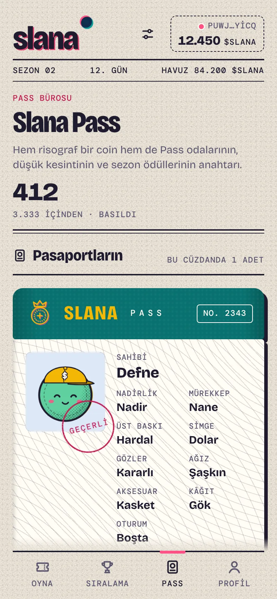 | 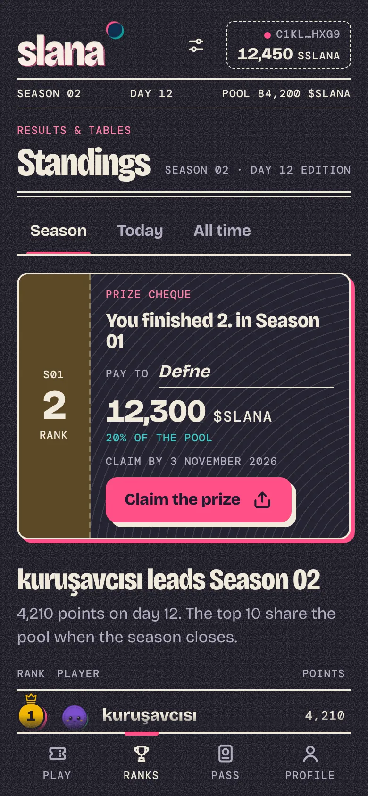 |

| Telefon: lobi (kâğıt) | Yenildin | Mint teslim | Kılavuz (gece) |
| --- | --- | --- | --- |
| 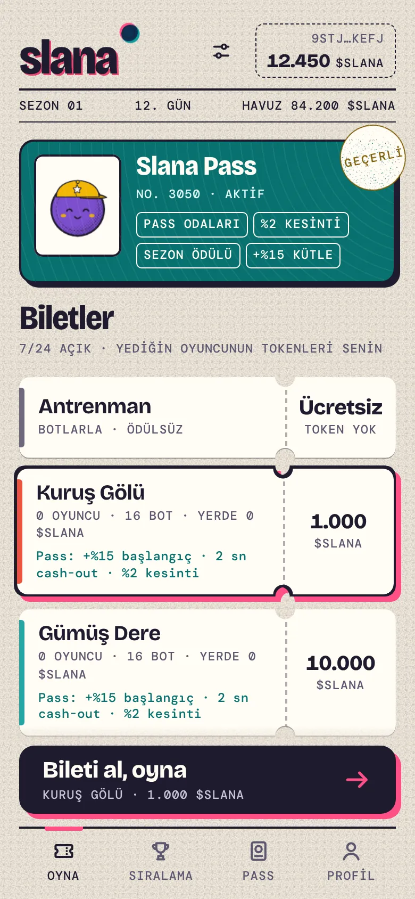 |  |  | 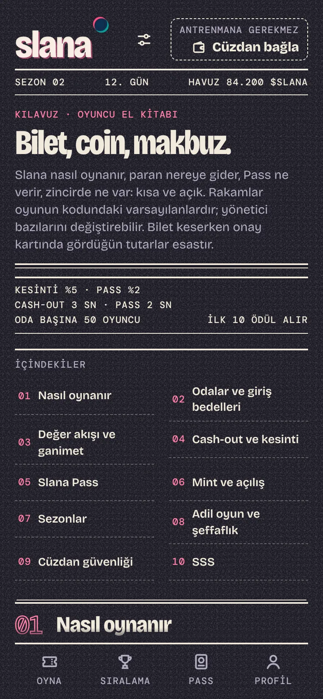 |

| Pass açıldı | Sezon ödülü talebi |
| --- | --- |
|  |  |

Ekran görüntüleri `apps/web/scripts/{lobby,gameview,pass,docs}.mjs` turlarıyla, `DEV_FAKE_CHAIN=1` geliştirme
yığınında alınır (tarayıcıda işlem imzalatmak otomatikleştirilemediği için). Gerçek zincir yolunu localnet uçtan uca
testi kanıtlar: `scripts/localnet.sh` + `pnpm -F @slana/server e2e` (bkz. [OPERATIONS](docs/OPERATIONS.md)).

## Nasıl oynanır

- **Antrenman:** ücretsiz; cüzdan, token ve NFT gerekmez. Botlarla oynanır; ödül ve zincir kaydı yoktur. Çaylak ve Usta
  ligleri vardır.
- **Arenalar:** zincirde birer hesap. Bilet = sabit giriş bedeli, arenanın kasasına (program hesabı) gider. Oyunda değerin
  giriş bedeliyle başlar; birini yediğinde onun değerinin kütle payı sana geçer. Botların değeri 0'dır; bir bot oyuncu
  yerse değer haritaya **ganimet** olarak saçılır ve yalnızca gerçek oyuncular toplayabilir.
- **Cash-out:** `C` ile 3 sn (Pass'li bilette 2 sn) hayatta kal; sunucu ödemeyi zincire gönderir. **Kesinti yalnızca
  kârdan**: varsayılan %5, Pass ile %2; %50 hazine, %30 sezon havuzu, %20 yakım.
- **Slana Pass:** Metaplex Core NFT, ücretsiz mint (yalnızca kira ve ağ ücreti), arz 3.333, cüzdan başı 1, commit–reveal
  ile adil açılış. Avantajlar: Pass odaları, %2 kesinti, sezon puanı/ödülü ve **oyun içi güç** (+%15 başlangıç kütlesi,
  2 sn cash-out). Bu güç biletlerde ve kılavuzda açıkça yazar.
- **Sezonlar:** puan yalnızca Pass'li biletlerden; zincirde ilk 20 tablo, ilk 10 havuzu %30 / %20 / %14 / %10 / %8 /
  %6 / %4,5 / %3 / %2,5 / %2 paylaşır; talep süresi 30 gün.

Oyuncu kılavuzu oyunun içinde: **`/docs`** (ya da lobide **Kılavuz** sekmesi), TR ve EN. Varsayılan arenalar
(`pnpm admin create-arena --defaults`): Kuruş Gölü 1.000, Gümüş Dere 10.000, Altın Göl 50.000 (Pass), Balina Koyu
250.000 (Pass) $SLANA.

| Kontrol | Masaüstü | Telefon |
|---|---|---|
| Hareket | Fare | Joystick |
| Bölün | `Space` | Böl düğmesi |
| Kütle bırak | `W` (basılı tutulabilir) | Bahşiş düğmesi |
| Cash-out (arenada) | `C` | Cash-out düğmesi |
| Sohbet / çıkartma | `Enter` / `1`–`8` | Sohbet / çıkartma düğmeleri |
| İzlerken sıradaki oyuncu | `Q` | |

## Mimari

Gerçek zamanlı fizik (30 Hz) zincirde çalışamaz. **Hibrit** model: oyun döngüsü yetkili Node sunucusunda; para, bilet,
kesinti, Pass, sezon ve ödüller Solana programında. Ayrıntı, para akışı diyagramı ve değişmezler:
[docs/ARCHITECTURE.md](docs/ARCHITECTURE.md).

| Klasör | İçerik |
|---|---|
| `programs/slana-ref` | Anchor 1.2.1 referansı (dağıtılmaz; IDL kaynağı ve uyum kahini): token arenaları (SPL Token / Token-2022), oturumlar, kesinti/yakım, sezonlar, Slana Pass (Core CPI, commit–reveal) + LiteSVM testleri |
| `programs/slana-lean` | Dağıtılan Pinocchio programı (`target/deploy/slana_lean.so`, ≤ 71.000 bayt), referansla tel uyumlu; `scripts/build-lean.sh` |
| `packages/shared` | Oyun kuralları, ikili protokol, arena verisi, token biçimlendirme |
| `packages/sdk` | TypeScript istemci (PDA'lar, talimatlar, hesap okuma, kesinti matematiği) + **admin CLI** (`pnpm admin`) |
| `packages/art` | Pass özellikleri `passTraits(finalSeed, n, supply)` (`finalSeed = sha256(tohum ‖ tohum açıklandıktan ~150 slot sonraki slotun hash'i)`), risograf coin/Pass çizimi, `pnpm pass:*` üretim aracı |
| `apps/server` | Oyun sunucusu: odalar ve örnekler, botlar, ganimet, günlük (journal), ödeme kuyruğu, Pass metadata uç noktaları |
| `apps/web` | Oyun istemcisi: "Kâğıt Bilet" tasarım sistemi, lobi, bilet akışı, Pass ofisi, sıralama, oyuncu kılavuzu |

Dokümanlar: [tasarım dokümanı (v2)](docs/superpowers/specs/2026-10-14-slana-design.md) ·
[kurulum ve dağıtım](docs/DEPLOY.md) · [operasyon](docs/OPERATIONS.md) · [mimari](docs/ARCHITECTURE.md) ·
[Pass görselleri](docs/PASS-ART.md)

## Hızlı başlangıç (zincirsiz)

Node 22+ ve pnpm 10 gerekir.

```bash
corepack enable
pnpm install
pnpm dev          # oyun sunucusu :8787 + web :5173
```

**http://localhost:5173**: cüzdan gerekmez, antrenmanda botlarla hemen oynanır. `PROGRAM_ID`, `SOLANA_RPC_URL` ve
`SERVER_KEYPAIR` verilmezse sunucu zincirsiz (yalnızca antrenman) çalışır.

Arayüz geliştirmek için sahte zincir: `NODE_ENV=development DEV_FAKE_CHAIN=1 pnpm dev:server` her cüzdana bedava arena
biletleri ve açılmış bir Pass verir, ödemeleri taklit eder. Yalnızca geliştirme içindir; `PROGRAM_ID` ya da
`SERVER_KEYPAIR` tanımlıyken başlamaz.

## Zincir ile çalıştırma

Adım adım (program, token, Pass koleksiyonu, mint, arenalar, sunucu, Docker, mainnet maliyeti):
**[docs/DEPLOY.md](docs/DEPLOY.md)**. Günlük işler (sezon, açılış, hazine, durdurma, anahtar değişimi, yedek):
**[docs/OPERATIONS.md](docs/OPERATIONS.md)**. Bütün yönetici komutları: `pnpm admin help`.

### Program build and deploy

The deployed program is the Pinocchio build `programs/slana-lean` (59,344 bytes, size gate 71,000). The Anchor crate
`programs/slana-ref` is only the IDL source and the conformance oracle in the tests, and is **never deployed**.

```bash
anchor build --ignore-keys && pnpm -F @slana/sdk sync-idl     # IDL (and the reference slana.so used by the tests)
bash scripts/build-lean.sh                                    # target/deploy/slana_lean.so, prints size and rent
solana program deploy target/deploy/slana_lean.so --program-id target/deploy/slana-keypair.json
```

Never use `anchor deploy`: it would ship the ~679 KB reference. The lean program locks
414,238,320 lamports (≈ ◎0.414) of ProgramData rent, and the deploy briefly needs about ◎0.83 because of the temporary
buffer. The full cost table is in [docs/DEPLOY.md](docs/DEPLOY.md#13-mainnet-maliyetleri).

### Localnet ve uçtan uca test

`scripts/localnet.sh` temiz bir yerel küme kurar: Slana programı ve Metaplex Core yüklü `solana-test-validator`,
Token-2022 test mint'i (6 ondalık, dondurma yetkisi yok, 1 milyar token yöneticiye, sonra basım kapalı), `init`,
Pass koleksiyonu, gizli tohum taahhüdü (`.localnet/pass-seed.json`), açık mint ve varsayılan arenalar; sunucu ortamını
`.localnet/server.env` dosyasına yazar. Gerekenler: `anchor build` + `scripts/build-lean.sh` (`slana_lean.so`), Agave CLI (`spl-token` dahil) ve
`target/programs/mpl_core.so` (yoksa `scripts/fetch-programs.sh` indirir). `.localnet/` asla commit edilmez.

```bash
anchor build --ignore-keys && scripts/build-lean.sh && scripts/localnet.sh
cd apps/server && env $(cat ../../.localnet/server.env | xargs) \
  STALE_SESSION_AFTER_S=5 ARENA_BOT_TARGET=0 ARENA_BOT_MIN=0 ARENA_BOT_MAX=0 npx tsx src/index.ts
pnpm -F @slana/server e2e          # başka bir terminalde; ~2 dk
scripts/localnet.sh --stop
```

Test gerçek zinciri kullanır (sahte zincir değil): cüzdanlara SOL ve $SLANA, iki Pass mint'i, web'in bilet işlemiyle
Pass odasına giriş, ücret artışında oturumun sabit kesintisi, oyunda bir oyuncuyu yiyip değerini alma, ölüm ve cash-out
ödemeleri (kârın %2'si kesinti, yakımın arzdan düşmesi), sezon tablosu, mint kapanışı → açılış → sunucunun entropi
yakalaması ve açılmış metadata, token hesabı kapalı oynanmamış biletin hesap olmadan sonuçlandırılıp (`owed`) oyuncunun
"Ödemeni al" işlemiyle bekleme süresi olmadan alınması (R24), sezon sonu ve ödül
talebi. Sonunda her işlemin harcadığı compute unit'leri web limitleriyle, hesap boyutlarını web'in kira hesabıyla
karşılaştırır. Pass mint'i ve sezon kalıcı olarak kapandığından her koşu temiz bir `scripts/localnet.sh` ister.

```bash
docker build -t slana .
docker run -p 8787:8787 -v slana-data:/data --env-file apps/server/.env slana   # → http://localhost:8787
```

## Testler

```bash
pnpm -r typecheck
pnpm -r test                        # shared, sdk, art, server, web (Vitest)
pnpm -F @slana/web build
scripts/fetch-programs.sh           # Metaplex Core .so → target/programs (bir kez; repoya girmez)
scripts/test-program.sh             # program: LiteSVM suite against slana.so (ref) and slana_lean.so (lean)
```

Ek araçlar: `pnpm -F @slana/server sim` (bot dengesi), `pnpm -F @slana/web shot <url> <png>` (ekran görüntüsü),
`pnpm pass:preview` (Pass önizleme ızgarası).

## Güven modeli

- Giriş bedelleri arena kasalarında (program hesapları) durur; ödeme kasayı aşamaz, kesinti yalnızca kârdan alınır ve
  %10 ile sınırlıdır. Oyuncu bilet alırken gösterilen kesinti oranı, giriş bedeli ve depozito zincirde üst sınırdır.
- Ödeme iki aşamalıdır (R24): sunucu sonucu her zaman zincire yazar. Oyuncunun token hesabı yoksa ya da ödemeyi
  reddediyorsa tutar kasada `owed` olarak kalır ve oyuncu "Ödemeni al" ile istediği an tam o tutarı alır. Kaybeden bir
  oyuncu token hesabını kapatarak sonucu bozamaz, giriş bedelini geri alamaz. Sunucunun hiç sonuçlandırmadığı bir bileti
  oyuncu 24 saat sonra kendisi iade alır.
- Oyunun sonucu (kim kimi yedi, cash-out anındaki değer, skor) **yetkili sunucuya güvenir**. Sunucu anahtarı yalnızca açık
  biletleri kapatabilir; hazineye, sezon kasasına ve ayarlara dokunamaz. Yönetici sunucu anahtarını değiştirebildiği için
  bu güven sonuçta yöneticiye güvendir.
- Pass'in oyun içi gücü sunucu ayarıdır (`PASS_START_MASS_MUL`, `PASS_CASHOUT_MS`) ve açıkça duyurulur.

---

## English summary

**Slana** is an on-chain, coin-themed Agar.io on Solana.

- **Practice** is free: no wallet, no token, bots only, Rookie and Pro leagues, nothing on-chain.
- **Arenas** are on-chain accounts with a fixed entry fee in **$SLANA**. Your in-game value starts at the entry fee;
  eating a player moves their value to you. Bots are worth 0; when a bot eats a player, the value spills as loot that only
  real players can collect. Rooms are sharded into instances of 50 players and run 24/7.
- **Cash-out** (`C`, 3 s, 2 s with a Pass) sends the payout on-chain. The fee is charged **on profit only**: 5 % by
  default, 2 % with a Pass, split 50 % treasury / 30 % season pool / 20 % burned. The rate is fixed on-chain when the
  ticket is bought.
- **Slana Pass** is a Metaplex Core NFT with a free mint (rent and network fee only), supply 3,333, one per wallet and a
  commit–reveal trait seed: after the mint closes the seed is published, then the hash of a slot ~150 slots later is
  captured by anyone (server, web, CLI) and mixed in. Nobody, the team included, can know traits while Passes can be
  minted, and everyone learns them at the same moment; the supply is fixed once the mint opens. Perks: Pass rooms, the 2 % fee, season points and prizes, and **in-game power** (+15 % start
  mass, 2 s cash-out), disclosed on every ticket and in the guide.
- **Seasons:** points come only from Pass tickets; the on-chain top 20 is kept and the top 10 share the pool; 30 days to
  claim.
- **Architecture:** a hybrid model. The authoritative Node server runs the 30 Hz simulation and settles tickets on-chain;
  the Solana program holds the money rules. The deployed program is a Pinocchio build (`programs/slana-lean`, 59,344
  bytes, ≈ ◎0.414 of rent). It is wire-compatible with the Anchor reference (`programs/slana-ref`), which supplies the
  IDL and is checked against it by the same LiteSVM suite, but is never deployed. Build with
  `bash scripts/build-lean.sh`, deploy with `solana program deploy target/deploy/slana_lean.so --program-id <keypair>`,
  never `anchor deploy`. See [docs/ARCHITECTURE.md](docs/ARCHITECTURE.md).

```bash
corepack enable && pnpm install && pnpm dev     # http://localhost:5173, practice, no wallet needed
```

The player guide is in the app at `/docs` (TR and EN). Deployment and operations are in [docs/DEPLOY.md](docs/DEPLOY.md)
and [docs/OPERATIONS.md](docs/OPERATIONS.md) (Turkish); the architecture and Pass art docs are in English. The program
has **not been audited**, and real-money games may need a licence where you operate.

Lisans / License: [MIT](LICENSE)
