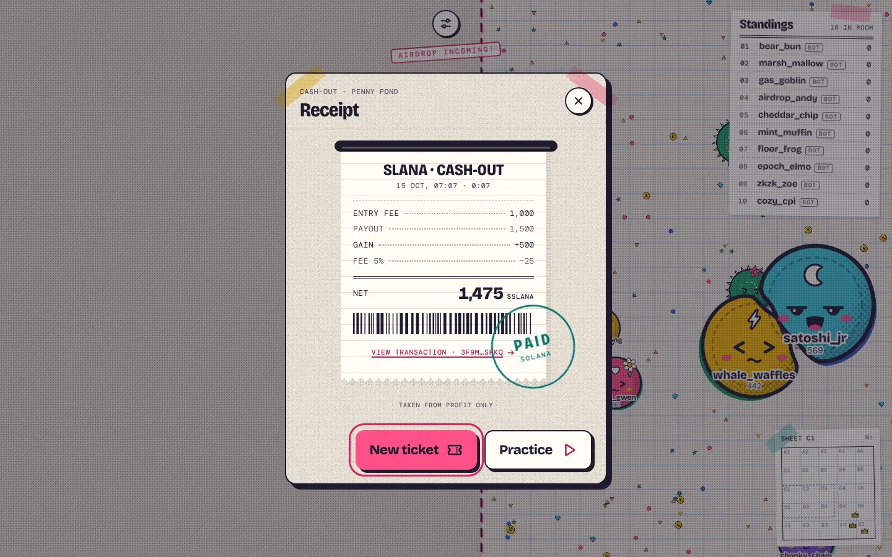
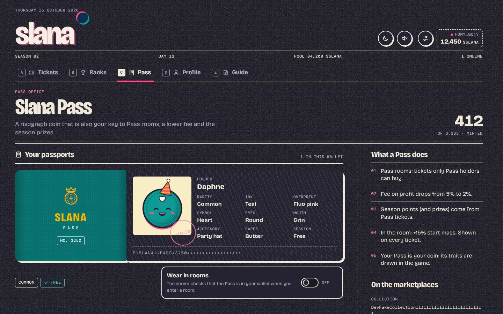
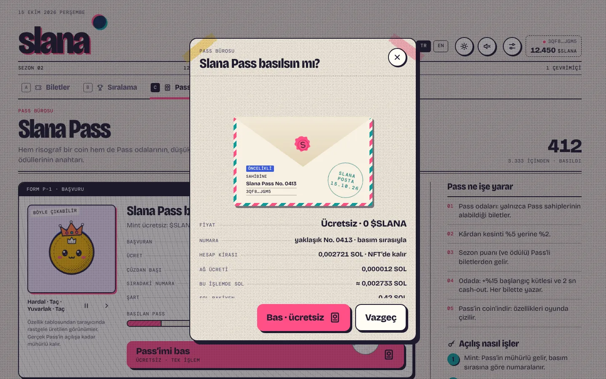
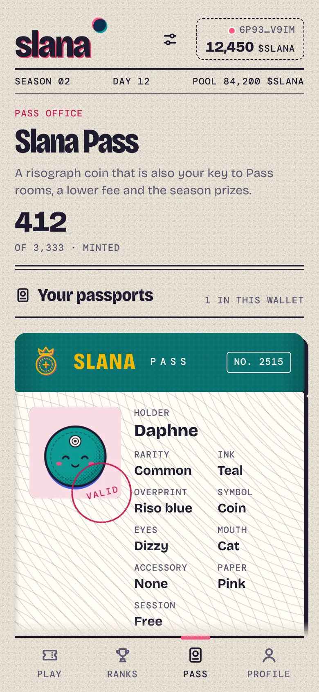
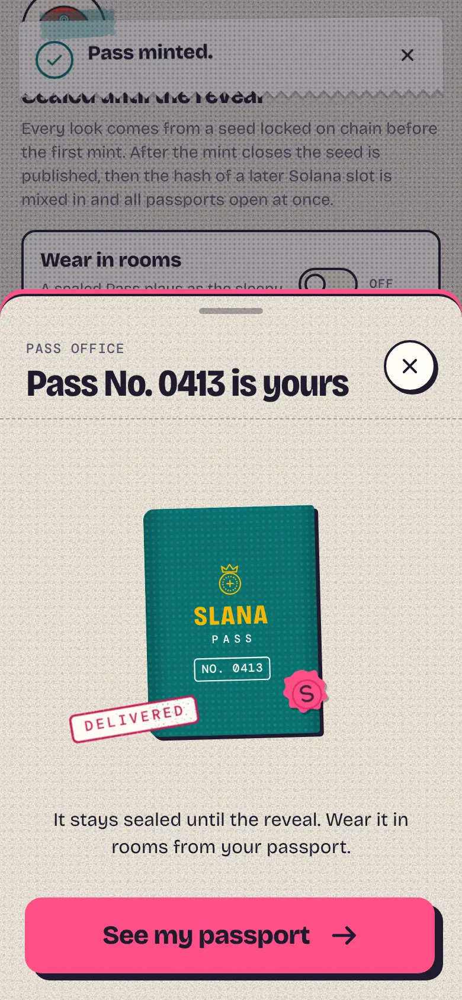
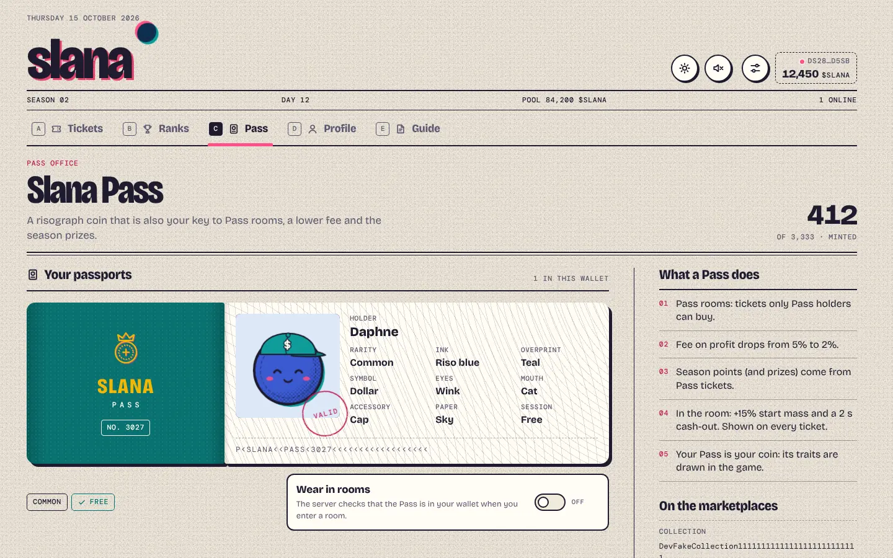
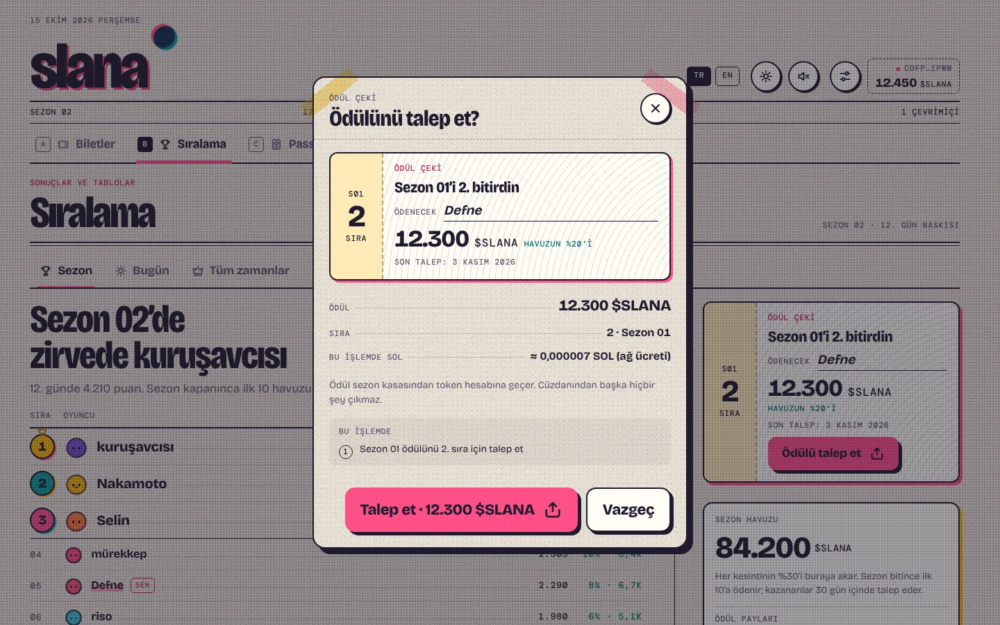

# Slana

**An on-chain, coin-themed Agar.io on Solana.** Rooms take tickets in $SLANA, every room has a fixed entry fee and
**the tokens of the player you eat move to you**. The Slana Pass (a free-mint NFT) opens the Pass rooms, lowers the fee
and qualifies for season prizes. The money rules run on-chain, the game runs on an authoritative server.

> **Warning.** This is a game played with a token of real value; it may need a licence where you operate. The smart
> contract **has not been audited**.

---

## Screenshots

v2, the "Paper Ticket" design: desktop and phone, paper and night themes. All images are in `docs/images/`.

| Lobby (desktop, paper) | Lobby (desktop, night) |
| --- | --- |
|  |  |
| **Ticket check** | **Ticket issued** |
|  |  |
| **Arena** | **Night theme** |
|  |  |
| **Cash-out receipt** | **Eaten** |
|  |  |
| **Slana Pass** | **Mint** |
|  |  |
| **Standings** | **Guide** |
|  |  |

| Phone: lobby | Ticket | Game | Pass | Standings |
| --- | --- | --- | --- | --- |
|  |  |  |  |  |

| Phone: lobby (paper) | Eaten | Mint delivered | Guide (night) |
| --- | --- | --- | --- |
|  |  |  |  |

| Pass revealed | Season prize claim |
| --- | --- |
|  |  |

The screenshots are taken with the `apps/web/scripts/{lobby,gameview,pass,docs}.mjs` tours on the `DEV_FAKE_CHAIN=1`
development stack (signing transactions in a browser cannot be automated). The localnet end-to-end test proves the real
chain path: `scripts/localnet.sh` + `pnpm -F @slana/server e2e` (see [OPERATIONS](docs/OPERATIONS.md)).

## How to play

- **Practice:** free; no wallet, token or NFT needed. Played with bots; no prizes and nothing on-chain. There are Rookie
  and Pro leagues.
- **Arenas:** each is an account on-chain. Ticket = a fixed entry fee that goes to the arena's vault (a program account).
  In the game your value starts at the entry fee; when you eat someone, the mass share of their value moves to you. Bots
  are worth 0; when a bot eats a player, the value spills across the map as **loot** that only real players can collect.
- **Cash-out:** survive 3 s with `C` (2 s on a Pass ticket); the server sends the payout on-chain. **The fee is taken
  only from profit**: 5 % by default, 2 % with a Pass; 50 % treasury, 30 % season pool, 20 % burned.
- **Slana Pass:** a Metaplex Core NFT, free mint (rent and network fee only), supply 3,333, 1 per wallet, a fair reveal
  through commit–reveal. Perks: Pass rooms, the 2 % fee, season points/prizes and **in-game power** (+15 % start mass,
  2 s cash-out). This power is stated plainly on the tickets and in the guide.
- **Seasons:** points come only from Pass tickets; the top 20 table is kept on-chain, the top 10 share the pool
  30 % / 20 % / 14 % / 10 % / 8 % / 6 % / 4.5 % / 3 % / 2.5 % / 2 %; the claim window is 30 days.

The player guide is inside the game: **`/docs`** (or the **Guide** tab in the lobby). Default arenas
(`pnpm admin create-arena --defaults`): Penny Pond 1,000, Silver Creek 10,000, Gold Lake 50,000 (Pass), Whale Bay
250,000 (Pass) $SLANA.

| Control | Desktop | Phone |
|---|---|---|
| Move | Mouse | Joystick |
| Split | `Space` | Split button |
| Drop mass | `W` (can be held) | Tip button |
| Cash-out (in an arena) | `C` | Cash-out button |
| Chat / sticker | `Enter` / `1`–`8` | Chat / sticker buttons |
| Next player while spectating | `Q` | |

## Architecture

Real-time physics (30 Hz) cannot run on-chain. **Hybrid** model: the game loop runs on the authoritative Node server;
money, tickets, fees, the Pass, seasons and prizes live in the Solana program. Details, the money-flow diagram and the
invariants: [docs/ARCHITECTURE.md](docs/ARCHITECTURE.md).

| Folder | Contents |
|---|---|
| `programs/slana-ref` | Anchor 1.2.1 reference (not deployed; the IDL source and the conformance oracle): token arenas (SPL Token / Token-2022), sessions, fee/burn, seasons, Slana Pass (Core CPI, commit–reveal) + LiteSVM tests |
| `programs/slana-lean` | The deployed Pinocchio program (`target/deploy/slana_lean.so`, ≤ 71,000 bytes), wire-compatible with the reference; `scripts/build-lean.sh` |
| `packages/shared` | Game rules, binary protocol, arena data, token formatting |
| `packages/sdk` | TypeScript client (PDAs, instructions, account reads, fee math) + **admin CLI** (`pnpm admin`) |
| `packages/art` | Pass traits `passTraits(finalSeed, n, supply)` (`finalSeed = sha256(seed ‖ hash of the slot ~150 slots after the seed is revealed)`), risograph coin/Pass drawing, the `pnpm pass:*` generator |
| `apps/server` | Game server: rooms and instances, bots, loot, the journal, the payout queue, Pass metadata endpoints |
| `apps/web` | Game client: the "Paper Ticket" design system, lobby, ticket flow, Pass office, standings, player guide |

Docs: [design document (v2)](docs/superpowers/specs/2026-10-14-slana-design.md) ·
[setup and deployment](docs/DEPLOY.md) · [operations](docs/OPERATIONS.md) · [architecture](docs/ARCHITECTURE.md) ·
[Pass art](docs/PASS-ART.md)

## Quick start (no chain)

Needs Node 22+ and pnpm 10.

```bash
corepack enable
pnpm install
pnpm dev          # game server :8787 + web :5173
```

**http://localhost:5173**: no wallet needed, play practice with bots right away. Without `PROGRAM_ID`, `SOLANA_RPC_URL`
and `SERVER_KEYPAIR` the server runs without a chain (practice only).

Fake chain for UI work: `NODE_ENV=development DEV_FAKE_CHAIN=1 pnpm dev:server` gives every wallet free arena tickets
and a revealed Pass, and simulates the payouts. Development only; it refuses to start while `PROGRAM_ID` or
`SERVER_KEYPAIR` is set.

## Running with the chain

Step by step (program, token, Pass collection, mint, arenas, server, Docker, mainnet costs):
**[docs/DEPLOY.md](docs/DEPLOY.md)**. Day-to-day work (seasons, the reveal, the treasury, pausing, key rotation,
backups): **[docs/OPERATIONS.md](docs/OPERATIONS.md)**. Every admin command: `pnpm admin help`.

### Program build and deploy

The deployed program is the Pinocchio build `programs/slana-lean` (59,344 bytes, size gate 71,000). The Anchor crate
`programs/slana-ref` is only the IDL source and the conformance oracle in the tests, and is **never deployed**.

```bash
anchor build --ignore-keys && pnpm -F @slana/sdk sync-idl     # IDL (and the reference slana.so used by the tests)
bash scripts/build-lean.sh                                    # target/deploy/slana_lean.so, prints size and rent
scripts/deploy-lean.sh devnet target/deploy/slana-keypair.json   # refuses a keypair that is not the program id
```

Never use `anchor deploy`: it would ship the ~679 KB reference. The lean program locks
414,238,320 lamports (≈ ◎0.414) of ProgramData rent, and the deploy briefly needs about ◎0.83 because of the temporary
buffer. The full cost table is in [docs/DEPLOY.md](docs/DEPLOY.md#13-mainnet-costs).

### Localnet and end-to-end test

`scripts/localnet.sh` sets up a clean local cluster: `solana-test-validator` with the Slana program and Metaplex Core
loaded, a Token-2022 test mint (6 decimals, no freeze authority, 1 billion tokens to the admin, then minting disabled),
`init`, the Pass collection, the secret seed commitment (`.localnet/pass-seed.json`), an open mint and the default
arenas; it writes the server environment to `.localnet/server.env`. Requirements: `anchor build` +
`scripts/build-lean.sh` (`slana_lean.so`), the Agave CLI (`spl-token` included) and `target/programs/mpl_core.so`
(`scripts/fetch-programs.sh` downloads it if missing). `.localnet/` is never committed.

```bash
anchor build --ignore-keys && scripts/build-lean.sh && scripts/localnet.sh
cd apps/server && env $(cat ../../.localnet/server.env | xargs) \
  STALE_SESSION_AFTER_S=5 ARENA_BOT_TARGET=0 ARENA_BOT_MIN=0 ARENA_BOT_MAX=0 npx tsx src/index.ts
pnpm -F @slana/server e2e          # in another terminal; ~2 min
scripts/localnet.sh --stop
```

The test uses the real chain (not the fake chain): SOL and $SLANA for the wallets, two Pass mints, entering a Pass room
with the web's ticket transaction, the session's fixed fee when the fee is raised, eating a player in the game and taking
their value, death and cash-out payouts (2 % of the profit as the fee, the burn leaving the supply), the season table,
mint close → reveal → the server's entropy capture and the revealed metadata, a never-played ticket whose token account
was closed being settled without the account (`owed`) and collected by the player's "Collect payout" transaction with no
waiting time (R24), the season end and the prize claim. At the end it compares the compute units each transaction used
with the web limits, and the account sizes with the web's rent math. Because the Pass mint and the season close for
good, every run needs a fresh `scripts/localnet.sh`.

```bash
docker build -t slana .
docker run -p 8787:8787 -v slana-data:/data --env-file apps/server/.env slana   # → http://localhost:8787
```

## Tests

```bash
pnpm -r typecheck
pnpm -r test                        # shared, sdk, art, server, web (Vitest)
pnpm -F @slana/web build
scripts/fetch-programs.sh           # Metaplex Core .so → target/programs (once; never enters the repo)
scripts/test-program.sh             # program: LiteSVM suite against slana.so (ref) and slana_lean.so (lean)
```

Extra tools: `pnpm -F @slana/server sim` (bot balance), `pnpm -F @slana/web shot <url> <png>` (screenshot),
`pnpm pass:preview` (Pass preview grid).

## Trust model

- Entry fees sit in the arena vaults (program accounts); a payout cannot exceed the vault, the fee is taken only from
  profit and is capped at 10 %. The fee rate, entry fee and deposit shown to the player when buying a ticket are upper
  bounds on-chain.
- The payout has two phases (R24): the server always writes the outcome on-chain. If the player has no token account or
  the account refuses the payout, the amount stays in the vault as `owed`, and the player takes exactly that amount at
  any time with "Collect payout". A losing player cannot spoil the outcome by closing their token account, nor get the
  entry fee back. A ticket the server never settled can be refunded by the player themselves after 24 hours.
- The game's outcome (who ate whom, the value at cash-out, the score) **trusts the authoritative server**. The server key
  can only close open tickets; it cannot touch the treasury, the season vault or the settings. Since the admin can
  replace the server key, this trust is in the end trust in the admin.
- The Pass's in-game power is a server setting (`PASS_START_MASS_MUL`, `PASS_CASHOUT_MS`) and is disclosed openly.

---

## Summary

**Slana** is an on-chain, coin-themed Agar.io on Solana.

- **Practice** is free: no wallet, no token, bots only, Rookie and Pro leagues, nothing on-chain.
- **Arenas** are on-chain accounts with a fixed entry fee in **$SLANA**. Your in-game value starts at the entry fee;
  eating a player moves their value to you. Bots are worth 0; when a bot eats a player, the value spills as loot that only
  real players can collect. Rooms are sharded into instances of 50 players and run 24/7.
- **Cash-out** (`C`, 3 s, 2 s with a Pass) sends the payout on-chain. The fee is charged **on profit only**: 5 % by
  default, 2 % with a Pass, split 50 % treasury / 30 % season pool / 20 % burned. The rate is fixed on-chain when the
  ticket is bought.
- **Slana Pass** is a Metaplex Core NFT with a free mint (rent and network fee only), supply 3,333, one per wallet and a
  commit–reveal trait seed: after the mint closes the seed is published, then the hash of a slot ~150 slots later is
  captured by anyone (server, web, CLI) and mixed in. Nobody, the team included, can know traits while Passes can be
  minted, and everyone learns them at the same moment; the supply is fixed once the mint opens. Perks: Pass rooms, the 2 % fee, season points and prizes, and **in-game power** (+15 % start
  mass, 2 s cash-out), disclosed on every ticket and in the guide.
- **Seasons:** points come only from Pass tickets; the on-chain top 20 is kept and the top 10 share the pool; 30 days to
  claim.
- **Architecture:** a hybrid model. The authoritative Node server runs the 30 Hz simulation and settles tickets on-chain;
  the Solana program holds the money rules. The deployed program is a Pinocchio build (`programs/slana-lean`, 59,344
  bytes, ≈ ◎0.414 of rent). It is wire-compatible with the Anchor reference (`programs/slana-ref`), which supplies the
  IDL and is checked against it by the same LiteSVM suite, but is never deployed. Build with
  `bash scripts/build-lean.sh`, deploy with `scripts/deploy-lean.sh <cluster-url> <keypair>`,
  never `anchor deploy`. See [docs/ARCHITECTURE.md](docs/ARCHITECTURE.md).

```bash
corepack enable && pnpm install && pnpm dev     # http://localhost:5173, practice, no wallet needed
```

The player guide is in the app at `/docs`. Deployment and operations are in [docs/DEPLOY.md](docs/DEPLOY.md) and
[docs/OPERATIONS.md](docs/OPERATIONS.md); architecture and Pass art in [docs/ARCHITECTURE.md](docs/ARCHITECTURE.md) and
[docs/PASS-ART.md](docs/PASS-ART.md). The program
has **not been audited**, and real-money games may need a licence where you operate.

License: [MIT](LICENSE)
