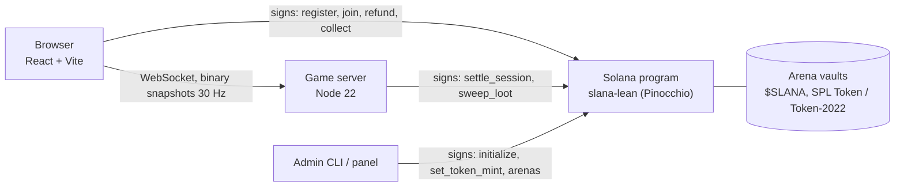

# Slana

**A coin-themed, real-time multiplayer Agar.io with on-chain stakes on Solana.**

[](https://github.com/furkan3152/Solagel/actions/workflows/ci.yml)
[](LICENSE)

Slana (this repository is named Solagel) is a browser game where you play a coin: eat food and smaller coins, split,
dodge bigger players. Paid arenas take a fixed ticket in the $SLANA token and **the value of a player you eat moves to
you**; when the 5-minute round bell rings, everyone still alive is paid out on-chain. Real-time physics at 30 Hz cannot
run on a blockchain, so Slana is a **hybrid**: an authoritative Node server runs the game, and a small Solana program
holds the money rules (ticket vaults, settlements, the fee and loot burns) so a payout can never exceed what the arena
actually holds.

- **Website:** [slana.io](https://slana.io) (landing page, NFT allowlist and collab applications).
- **Status:** the program is deployed on Solana mainnet-beta but not initialized yet; paid arenas open once the $SLANA
  token is set. Until then the game is in a closed beta (see [docs/PROJECT.md](docs/PROJECT.md#7-live-deployment)).
- The smart contract **has not been audited**, and a game played with a token of real value may need a licence where
  you operate.

## Screenshots

The "Paper Ticket" design system, desktop and phone, paper and night themes (all images in `docs/images/`).

| Lobby | Arena |
| --- | --- |
|  |  |
| **Ticket issued** | **Round-over receipt** |
|  |  |
| **Night theme** | **Standings** |
|  |  |

| Phone: lobby | Ticket | Game | Standings |
| --- | --- | --- | --- |
|  |  |  |  |

Screenshots are produced by the Playwright tours in `apps/web/scripts/` against the fake-chain development stack.

## Key features

- **Free practice mode:** no wallet, no token, bots only, Rookie and Pro leagues, nothing on-chain.
- **On-chain arenas:** four arenas (Penny Pond 1,000 to Whale Bay 250,000 $SLANA) with a fixed entry fee held in a
  program-owned vault; eating a player transfers their value to you.
- **Wall-clock rounds, no cash-out:** 5-minute rounds shared by every arena; at the bell everyone alive is settled
  on-chain, and floor loot left on the map is burned.
- **Fee on profit only:** a flat 5 % of winnings above the entry fee (capped at 10 % on-chain), fixed when the ticket is
  bought.
- **Safe payouts:** a two-phase settlement keeps an unpayable amount in the vault as `owed` for the player to collect;
  a ticket the server never settles can be refunded by the player after 24 hours.
- **Lean on-chain program:** a Pinocchio (`no_std`, no allocator) program of 39,032 bytes that is wire-compatible with
  an Anchor reference implementation and tested against it.
- **Operations tooling:** an admin CLI, an `/admin` panel with mainnet safety rails, cheat and collusion detection, a
  persistent money journal, and recorded walkthrough and promo videos generated from the real UI.

## How it works



- The **server** is authoritative for the simulation (movement, eating, splits, bots, loot) and keeps an in-game value
  ledger and a journal; at the bell it settles every live ticket on-chain.
- The **program** enforces the money rules: tickets go into the arena vault, a payout can never exceed the vault, the fee
  comes only from profit, and the token mint can be set exactly once.
- Two program crates exist on purpose: `programs/slana-ref` (Anchor 1.2.1) is the IDL source and conformance oracle and
  is **never deployed**; `programs/slana-lean` (Pinocchio 0.11) is the deployed program. The same LiteSVM suite runs
  against both, and CI enforces a size gate and `clippy::arithmetic_side_effects` on the lean crate.

Details, the money-flow diagram and the invariants: [docs/ARCHITECTURE.md](docs/ARCHITECTURE.md).

## Tech stack

| Layer | Technology |
| --- | --- |
| On-chain | Rust, Pinocchio 0.11 (deployed), Anchor 1.2.1 (reference + IDL), SPL Token / Token-2022, LiteSVM tests |
| Server | Node 22, TypeScript, `ws` (binary protocol v4), `@solana/web3.js`, tsup |
| Web | React, Vite, Zustand, Motion, Solana Wallet Adapter (Wallet Standard), Vitest, Playwright |
| Tooling | pnpm workspaces, GitHub Actions, Docker (single container: server + static web) |

## Project structure

| Path | Contents |
| --- | --- |
| `programs/slana-lean` | The deployed Pinocchio program (`target/deploy/slana_lean.so`) |
| `programs/slana-ref` | Anchor reference (IDL source and test oracle) + the LiteSVM test suite |
| `packages/shared` | Game rules, binary protocol, arena metadata, token formatting |
| `packages/sdk` | TypeScript client (PDAs, instruction builders, account reads, fee math) and the admin CLI (`pnpm admin`) |
| `packages/art` | The risograph coin renderer used by the web client |
| `apps/server` | Game server: rooms and instances, bots, loot, journal, payout queue, token watcher, site API |
| `apps/web` | Game client: lobby, ticket flow, HUD, standings, in-game player guide (`/docs`), admin panel |
| `scripts/` | Build, deploy, localnet and demo scripts |
| `docs/` | Project overview, architecture, deployment, operations, design specs |
| `brand/`, `media/` | Brand assets and the scripted gameplay / promo video pipelines |

## Getting started

**Prerequisites:** Node 22+ and pnpm 10 (`corepack enable`). The on-chain parts additionally need Rust, the Agave
(Solana) CLI with `cargo-build-sbf`, and the Anchor CLI 1.2.1.

```bash
pnpm install
pnpm dev             # practice only, no chain: server on :8787, web on http://localhost:5173
pnpm demo            # full UI on an in-memory fake chain (free tickets, simulated payouts)
pnpm demo:localnet   # the same UI against a real solana-test-validator (real transactions)
```

- `pnpm demo` starts the server with `NODE_ENV=development DEV_FAKE_CHAIN=1 DEV_FAKE_TOKEN=1`. Any Wallet Standard
  wallet (Phantom, Solflare, Backpack) can sign in for free; `pnpm demo --browser` opens a Chromium with a built-in
  dev wallet. The fake chain refuses to start in production or when `PROGRAM_ID` / `SERVER_KEYPAIR` is set.
- `pnpm demo:localnet` builds what is missing, starts a validator with the program, a test token and the default arenas,
  then runs the server and web against it. Fund a wallet with `scripts/localnet-fund.sh <ADDRESS>`.
- `pnpm demo:record` re-records the walkthrough video with Playwright and ffmpeg.

**Configuration.** Copy `apps/server/.env.example` to `apps/server/.env` (and `apps/web/.env.example` for the web build).
Key variables: `SOLANA_CLUSTER`, `SOLANA_RPC_URL`, `PROGRAM_ID`, `SERVER_KEYPAIR`, `AUTH_SECRET`, `PUBLIC_URL`,
`DATA_DIR`. Without `PROGRAM_ID` the server runs in practice-only mode.

**Docker:**

```bash
docker build -t slana .
docker run -p 8787:8787 -v slana-data:/data --env-file apps/server/.env slana   # http://localhost:8787
```

### Tests

```bash
pnpm -r typecheck
pnpm -r test                 # Vitest: shared, sdk, art, server, web
pnpm -F @slana/web build
scripts/test-program.sh      # LiteSVM suite against the Anchor reference and the lean program
scripts/localnet.sh --no-token && pnpm -F @slana/server e2e   # end-to-end on a real local validator
```

The end-to-end test runs the real admin CLI and real tickets on a local validator: it initializes without a token, sets
the token, creates arenas, buys four tickets, has a player eaten, and checks at the bell that every fee matches the SDK
math, the fee wallet grows by exactly the fees, and burned loot reduces supply by exactly tickets minus payouts.

### Deploying the program

The order is fixed: **deploy, then `init`, then (later) `set-token`, then `create-arena --defaults`**. Build with
`bash scripts/build-lean.sh` and deploy with `scripts/deploy-lean.sh`, never `anchor deploy` (it would ship
the much larger Anchor reference). Full runbook and mainnet costs: [docs/DEPLOY.md](docs/DEPLOY.md); day-to-day operations (fee wallet,
loot burn, pausing, key rotation, backups, integrity): [docs/OPERATIONS.md](docs/OPERATIONS.md).

## Security and trust model

- **Non-custodial for players:** players sign their own tickets, refunds and collections from their wallet. Entry fees
  sit in program-owned arena vaults, never in a server wallet.
- **Bounded server trust:** the game outcome (who ate whom, value at the bell) trusts the authoritative server, but the
  server key can only settle open tickets and burn round-end floor loot from a vault; it cannot touch the fee wallet or
  the settings. The admin can rotate the server key.
- **Bounded fees:** the fee rate shown at ticket purchase is an on-chain upper bound and can never exceed 10 %.
- **Immutable token:** the mint is set once and cannot be changed afterwards.
- **Admin panel safety:** the program id is pinned in the bundle, the cluster is derived from the RPC genesis hash,
  every transaction is previewed before the wallet prompt, and the token address must be typed twice.
- **Keys:** never commit keypairs or `.env` files; `.gitignore` covers `.env*`, `*-keypair.json`, `*.keypair.json`,
  `id.json`, `keys/`, `*.pem` and `*.key`.

## Documentation

[Project overview](docs/PROJECT.md) · [Architecture](docs/ARCHITECTURE.md) · [Deployment](docs/DEPLOY.md) ·
[Operations](docs/OPERATIONS.md) · [Design (Slana Simple)](docs/superpowers/specs/2026-10-16-slana-simple-design.md) ·
[Brand](brand/README.md)

## License

[MIT](LICENSE)

---

Built by Furkan Akdogan ([@furkan3152](https://github.com/furkan3152)).
