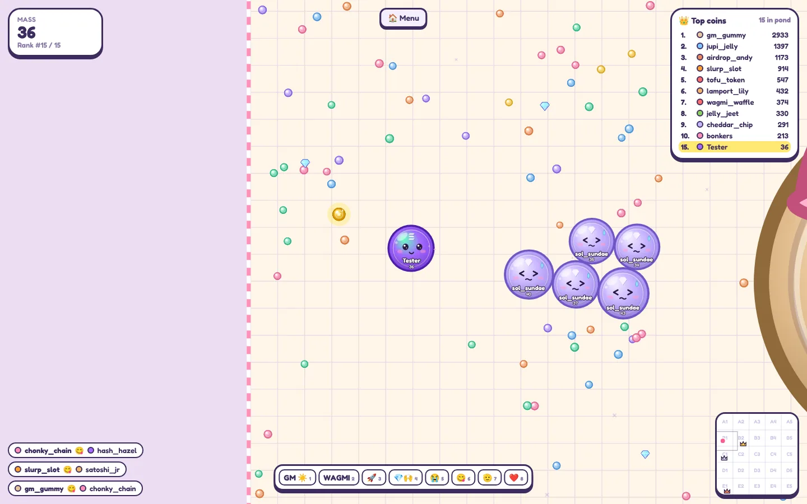
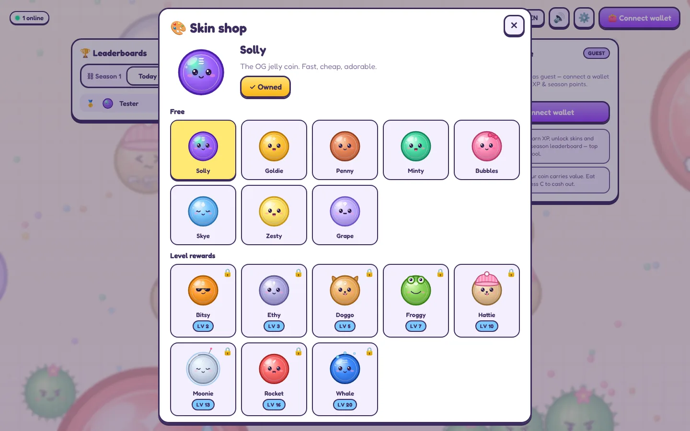
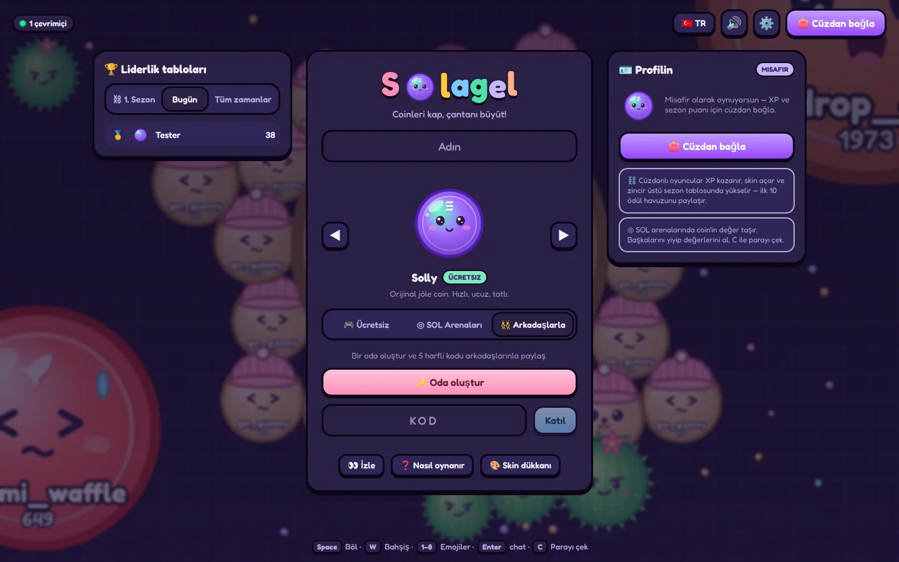
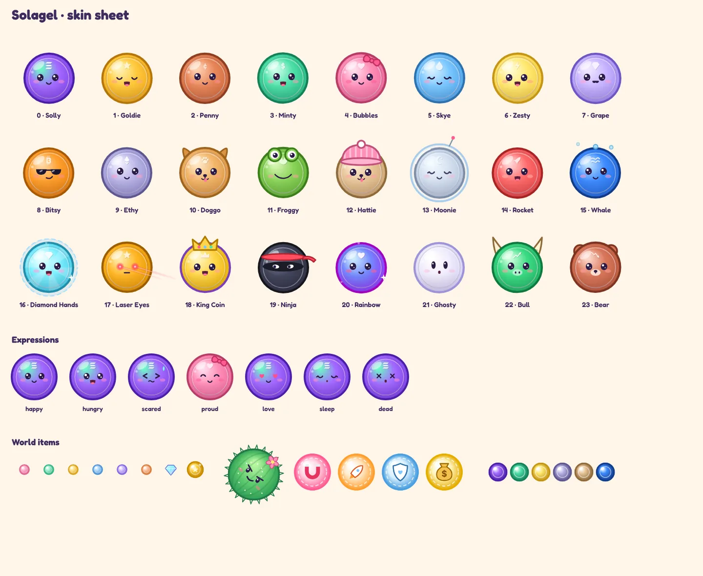
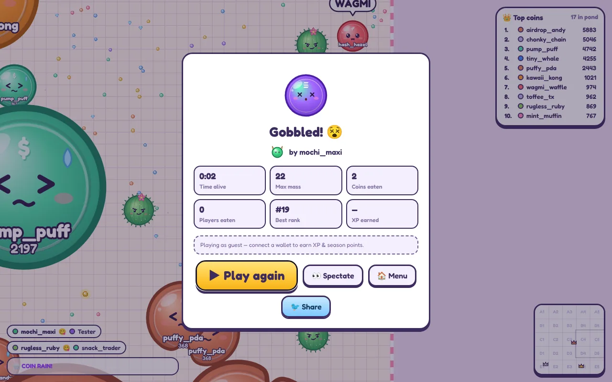
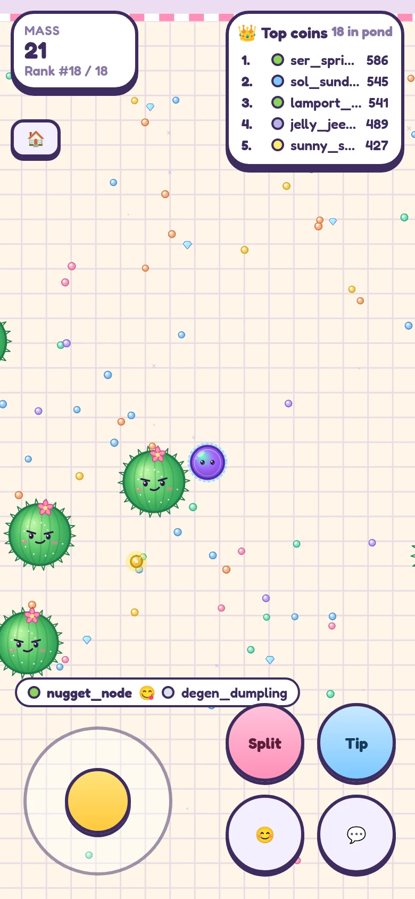

# 🪙 Slana

**Solana üzerinde sevimli, coin temalı, on-chain bir Agar.io.** Jöle gibi sallanan coin'ler lamport toplar, birbirini yer,
SOL'lü arenalarda rakiplerinin değerini kapar. Sezon sıralaması ve ödüller zincirde tutulur.

*A cute, coin-themed, on-chain Agar.io for Solana. English summary below ⬇️*


| Oyun | Skin mağazası | Karanlık tema (TR) |
|---|---|---|
|  |  |  |
| **24 coin skin'i** | **Oyun sonu** | **Mobil** |
|  |  |  |

---

## ✨ Özellikler

**Oyun**
- Agar.io'nun klasik mekanikleri: bölünme (Space), kütle fırlatma (W), birleşme, yavaşlayan büyük hücreler, kütle erimesi.
- **Rug Kaktüsü 🌵** (virüs): büyükken çarparsan parçalanırsın, küçükken arkasına saklanırsın, 7 kez beslenince yeni kaktüs fırlatır.
- **Güçlendirmeler:** 🧲 Mıknatıs (yemleri çeker), 🚀 Pump (hız), 🛡️ HODL Kalkanı, 💰 Mega Çanta (anında kütle).
  Ara sıra tüm haritaya **coin yağmuru** yağar.
- Yeni oyunculara 3 sn doğuş kalkanı; botlar ilk 25 sn yeni gelenlere saldırmaz.
- **Ücretsiz Oyun** (cüzdansız), **Arkadaş Odaları** (5 haneli kodla özel oda), **SOL Arenaları** (gerçek SOL ile giriş).
- İzleyici modu, 8 emoji/emote (GM ☀️, WAGMI, 💎🙌…), filtreli sohbet (link/dolandırıcılık/küfür engeli).

**Zeki botlar 🤖** — oyuncu azken odayı doldurur, oyuncu geldikçe çekilir. Her botun bir oyun tarzı (toplayıcı, avcı,
ürkek, dengeli) ve beceri seviyesi (%45 kolay, %40 orta, %15 zor) vardır: 24 yönlü "context steering" ile tehditten kaçar,
avın gideceği yeri tahmin edip kovalar, bölünerek avlar, kaktüsün arkasına saklanır; zor botlar kaktüs bile fırlatır.
Birbirlerine emote atarlar ve zamanla "emekli olup" yerlerini yeni botlara bırakırlar. SOL arenalarında bot **yoktur**.

**Tasarım** — her şey özgün: 24 coin karakteri (göz bebekleri hedefe bakar, yüz ifadeleri değişir: aç, korkmuş, gururlu…),
jöle fiziği, aksesuarlar (taç, şapka, roket…), pastel "lamport" yemler, mücevherler, altın coin'ler. Açık/karanlık tema,
**Türkçe/İngilizce**, sentezlenmiş ses efektleri, mobil dokunmatik kontroller.

**Sıralamalar 🏆**
- Canlı oda sıralaması (her saniye), **Bugün** ve **Tüm zamanlar** listeleri (sunucu).
- **On-chain sezon sıralaması** (ilk 20) + **ödül havuzu**: sezon sonunda ilk 10, havuzdan
  %30 / %20 / %14 / %10 / %8 / %6 / %4.5 / %3 / %2.5 / %2 pay alır (talep süresi 30 gün).

**On-chain (Anchor programı `slana`)**
- **Profil:** isim, kuşanılan skin, XP/seviye, oyun sayısı, en iyi skor — hepsi zincirde.
- **Skin'ler:** 8 ücretsiz, 8 seviye kilitli (seviye 2–20), 8 premium (SOL ile satın alınır, zincirde sahiplik).
- **SOL arenaları:** ◎0.01 / ◎0.05 / ◎0.1 giriş. Birini yediğinde onun değerinin payını alırsın; istediğin an
  **3 sn cash-out** yapıp değerini cüzdanına çekersin. Arena hesabı aynı zamanda kasadır, ödeme kasayı aşamaz.
- **Ücret yalnızca kârdan** (varsayılan %5, en fazla %10) ve yarısı otomatik olarak sezon ödül havuzuna akar.
- Güvenlik ağları: oturum benzersiz `session_id` taşır (eski ödeme yeni oturuma uygulanamaz), sunucu çökerse
  oyuncular otomatik cash-out'a alınır (kalıcı günlük), 24 saat ödenmemiş bileti oyuncu kendisi iade alabilir,
  hiç oynanmamış biletler 15 dk sonra iade edilir.

## 🏗️ Mimari

Gerçek zamanlı fizik (30 Hz) Solana'da çalışamaz (≈400 ms slot, işlem ücreti). Bu yüzden **hibrit** bir model kullanılır:
oyun döngüsü yetkili bir oyun sunucusunda, **para, kimlik, istatistik, sezon ve ödüller zincirde**.

```
Web istemci (Vite + React + Canvas)  ⇄  WebSocket (ikili delta snapshot)  ⇄  Oyun sunucusu (Node 22)
        │ cüzdanla imzalı tx: profil, skin, arenaya giriş                     │ sunucu imzalı tx:
        ▼                                                                   ▼ settle_session, record_game
                         Solana programı `slana` (Anchor 1.2.1)
          Config · PlayerProfile · Arena (kasa) · Session · Season (sıralama + ödül havuzu)
```

| Klasör | İçerik |
|---|---|
| `programs/slana` | Anchor programı (16 instruction) + LiteSVM testleri |
| `packages/shared` | Oyun kuralları, formüller, ikili protokol, skin kataloğu, emote/arena verisi |
| `packages/sdk` | TypeScript istemci (PDA'lar, instruction builder'lar, hesap okuyucular, hata çözümleme) + **admin CLI** |
| `apps/server` | Oyun sunucusu: simülasyon, odalar, botlar, cüzdan girişi, settlement kuyruğu, REST |
| `apps/web` | Oyun istemcisi: coin renderer, lobi, HUD, cüzdan entegrasyonu, i18n |
| `docs/` | [Tasarım dokümanı](docs/superpowers/specs/2026-10-14-slana-design.md), [dağıtım rehberi](docs/DEPLOY.md) |

## 🚀 Hızlı başlangıç (zincirsiz)

Node 22+ gerekir.

```bash
corepack enable
pnpm install
pnpm dev          # oyun sunucusu :8787 + web :5173
```

→ **http://localhost:5173** — cüzdan gerekmez; botlarla hemen oynanır. Zincir ayarlanmadığında sunucu yalnızca
ücretsiz modda çalışır.

| Kontrol | Masaüstü | Mobil |
|---|---|---|
| Hareket | Fare | Sol alttaki joystick |
| Bölün | `Space` | **Böl** |
| Kütle fırlat ("bahşiş") | `W` (basılı tutulabilir) | **Bahşiş** |
| Cash-out (SOL arenası) | `C` | 💸 |
| Sohbet / emote | `Enter` / `1`–`8` | 💬 / 😊 |
| İzlerken sonraki oyuncu | `Q` | ⏭ düğmesi |

## ⛓️ Yerel blockchain ile deneme (localnet)

Gerekenler: Rust (repo `rust-toolchain.toml` ile 1.97.1 seçer), Agave CLI 4.3, Anchor CLI 1.2.1 (`npm i -g @anchor-lang/cli@1.2.1`).

```bash
anchor build                      # programı derle (target/deploy)
scripts/localnet.sh               # validator + program + config + 3 arena (anahtarlar .localnet/ içinde)

# oyun sunucusu, localnet ayarlarıyla
cd apps/server && env $(cat ../../.localnet/server.env | xargs) npx tsx src/index.ts
# başka bir terminalde
pnpm dev:web

# uçtan uca test: profil → arenaya giriş → oyun → cash-out → on-chain ödeme → sezon sıralaması
pnpm -F @slana/server e2e ws://127.0.0.1:8787/ws
scripts/localnet.sh --stop
```

Tarayıcıda denemek için cüzdanınızı özel RPC `http://127.0.0.1:8899` adresine yönlendirin ve
`solana airdrop 5 <adres> --url http://127.0.0.1:8899` ile SOL yükleyin.

> Kendi program anahtarınızla (`anchor keys sync`) derlerseniz IDL'i SDK'ya kopyalayın: `pnpm -F @slana/sdk sync-idl`.

## 🌐 Devnet / Mainnet

Adım adım rehber: **[docs/DEPLOY.md](docs/DEPLOY.md)** — program anahtarı, devnet denemesi, mainnet maliyeti
(≈ ◎3 kalıcı kira), `pnpm admin` komutları (init, arena, sezon, acil durdurma), multisig yetkileri, Docker ile barındırma.

```bash
docker build -t slana . && docker run -p 8787:8787 -v slana-data:/data slana   # → http://localhost:8787 (ücretsiz mod)
```

## 🧪 Testler

```bash
pnpm test                         # shared + sdk + server (Vitest)
pnpm typecheck
pnpm -F @slana/web build
anchor build && cargo test -p slana   # program (LiteSVM)
```

| Paket | Kapsam |
|---|---|
| program | 23 test: giriş/ödeme/ücret hesabı, yetki kontrolleri, iade, sezon ödülleri, eski ödemenin yeni oturuma uygulanamaması… |
| sdk | 30 test: PDA'lar, hesap çözümleme, ücret matematiği (program ile birebir), hata çözümleme |
| server | 62 test: simülasyon kuralları, botlar, stake muhasebesi, çökme kurtarma, zincir işçisi, WebSocket entegrasyonu |
| shared | 21 test: ikili codec, formüller, metin temizleme |

Ek araçlar: `pnpm -F @slana/server sim` (bot dengesi simülasyonu), `pnpm -F @slana/web shot <url> <png>` (ekran görüntüsü).

## ⚖️ Güven modeli ve uyarılar

- Para hareketlerinin tamamı zincirde ve denetlenebilir; oyun sonucunun doğruluğu ise **yetkili oyun sunucusuna güvenir**
  (gerçek zamanlı oyunlar için standart hibrit model). Sunucu anahtarı yalnızca kasadaki parayı oturumlar arasında
  paylaştırabilir; kasadan fazlasını ödeyemez, hazineyi değiştiremez.
- Akıllı kontrat **bağımsız bir denetimden geçmemiştir**. Mainnet'te gerçek parayla açmadan önce denetim yaptırın ve
  küçük limitlerle başlayın.
- SOL ile oynanan arenalar bazı ülkelerde **lisans gerektirebilir**. `STAKE_ENABLED=false` ile yalnızca ücretsiz mod açılabilir.

---

## 🇬🇧 English summary

**Slana** is a cute, coin-themed Agar.io with a Solana on-chain layer.

- **Gameplay:** split, eject, merge, "Rug Cactus" viruses, power-ups (Magnet, Pump, HODL Shield, Mega Bag), coin rain,
  spectating, emotes, filtered chat, private rooms with 5-character codes.
- **Smart bots** fill rooms when few humans are online: context-steering AI with play styles (farmer, hunter, coward,
  balanced) and skill levels (flee, lead and chase prey, split-kill, hide behind cacti; hard bots shoot cacti). They make
  room as humans join and never play in SOL arenas.
- **Original art:** 24 jelly coin characters with expressive faces, accessories and wobbly physics. Light/dark themes,
  Turkish/English UI, synthesized sounds, mobile touch controls.
- **Leaderboards:** live room board, daily and all-time boards, and an **on-chain season leaderboard** (top 20) whose
  prize pool pays the top 10.
- **On-chain (Anchor):** profiles (name, skin, XP/level, stats), premium skins bought with SOL, **SOL arenas**
  (◎0.01 / 0.05 / 0.1 buy-ins; eat players to take their value, cash out any time in 3 s), a fee charged on profit only
  (default 5 %, half of it funds the season prize pool), crash-safe settlement journal, 24 h self-refunds.
- **Architecture:** a hybrid model. The authoritative Node game server runs the 30 Hz simulation and settles results
  on-chain. Money, identity, stats, seasons and prizes live in the Solana program.

```bash
corepack enable && pnpm install && pnpm dev     # http://localhost:5173, free play, no wallet needed
```

Localnet end-to-end test, devnet/mainnet deployment and operations are described above and in
[docs/DEPLOY.md](docs/DEPLOY.md) (in Turkish). The program has **not been audited**, and real-money games may need a licence
where you operate.

Lisans / License: [MIT](LICENSE)
