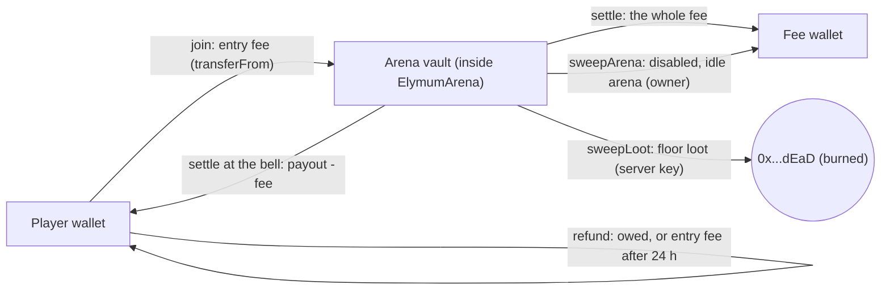

# Elymum architecture

Elymum is a hybrid: an authoritative game server runs the real-time world, and two Solidity contracts on
**Elysium** (Kinetiq's EVM L2, gas token HYPE) hold the money rules. The browser signs its own
transactions (ticket, refund, mint); the server key signs only settlements and loot burns. The spec
behind this page is [`specs/2026-10-29-elymum-on-elysium.md`](specs/2026-10-29-elymum-on-elysium.md).

```
Browser (apps/web) --WebSocket, binary, 30 Hz--> Game server (apps/server) --settle / sweepLoot--> ElymumArena
     |  \__ approve + join / refund (player wallet) ____________________________________________/
     \_____ mintAllowlist / mintPublic (HYPE) ----------------------------------------------------> ElymumNFT
                                     Game server --balanceOf (who may play), setPrice (keeper)--> ElymumNFT
```

## Components

| Component | Where | Role |
|---|---|---|
| `ElymumArena` | `packages/contracts/contracts/ElymumArena.sol` | Arenas, vaults, tickets (sessions), settlements, refunds, loot burns. Ownable2Step, ReentrancyGuard, SafeERC20 |
| `ElymumNFT` | `packages/contracts/contracts/ElymumNFT.sol` | The Elymum NFT: allowlist (Merkle) and public mint at a HYPE price, royalties, metadata. ERC721 + ERC2981 + Ownable2Step |
| `TestToken` | `packages/contracts/contracts/TestToken.sol` | A faucet ERC-20 for localnet and Elysium Testnet only |
| Artifacts | `packages/contracts/src/artifacts.ts` | ABIs (`as const`), creation bytecode, `runtimeCodeHash`; written by `scripts/export-artifacts.mjs`, committed, checked in CI |
| SDK | `packages/sdk` | viem reads, call builders (`ContractCall`), deploy helpers, call previews, Merkle tree, HYPE/USD price, the admin CLI |
| Shared | `packages/shared` | Rules, protocol, the chains table (`chains.ts`), arenas, the SIWE message, the palette |
| Game server | `apps/server` | Rooms, bots, rounds, the off-chain ledger, the journal, the chain gateway (`chain/evm.ts`), the price keeper, site and admin API, integrity |
| Web | `apps/web` | The client and `/admin`; wallets through EIP-6963 (`src/wallet`) and viem |

**No `immutable` variables** in the deployable contracts: the runtime bytecode is the same for every
deployment, so its `keccak256` is pinned in the artifacts and the server refuses to register (or run
against) an address whose code hash differs.

## Chains

| Key | Chain id | RPC | Explorer |
|---|---|---|---|
| `elysium-testnet` | 99801 | `https://testnet-rpc.elysium.kinetiq.xyz` | `https://explorer-elysium-testnet.t.conduit.xyz` |
| `elysium` | read from the RPC | `EVM_RPC_URL` (published by Kinetiq at the Nov 9 launch) | `EXPLORER_URL` |
| `localnet` | 31337 | `http://127.0.0.1:8545` (`hardhat node`) | none |

The native currency is always HYPE (18 decimals). **The server's RPC is the source of truth**: at start the
server reads `eth_chainId` from `EVM_RPC_URL` and publishes `{ chainId, name, rpcUrl, explorerUrl }` in
`/api/config`. The web never assumes a chain id; it asks the wallet to switch to (or add) exactly that
chain. (viem's built-in `elysiumTestnet` export is an unrelated chain and is not used.)

## Money flow



### Ticket lifecycle

1. **Join.** The web checks the allowance and sends `approve` (exact amount) only when it is short, then
   `join(arenaId)`. The contract pulls the entry fee with a balance-delta check (fee-on-transfer tokens are
   refused), opens a session with a global id (starting at 1) and fixes the fee rate (`feeBps`) for it.
   One open session per player per arena.
2. **Play.** The server seats the ticket. Value moves between players off chain (`stake/ledger.ts`).
3. **Settle.** At the bell, or when a player is eaten or the ticket goes stale, the server queues a
   settlement in the journal. Due items of an arena go out as **one `settle(Settlement[])` batch** (chunked
   at 40). Each item is applied or **skipped with an event** (`SettleSkipped`: unknown arena, session
   mismatch, already finalized, vault too small) instead of reverting the batch. The server reads every
   session back afterwards: a skipped or reverted item is retried with backoff; an item whose session id no
   longer matches was settled by someone else.
4. **Two-phase payout.** The fee goes to the fee wallet (a failing fee transfer reverts the batch). The
   player transfer uses `trySafeTransfer`; if it fails the session is **finalized** with `owed`, and the
   player collects it with `refund`.
5. **Refund.** A finalized session: `refund` pays `owed`. An unsettled session older than 24 h: `refund`
   pays `min(entryFee, vault)`.

### Fees

```
profit = max(0, payout - entryFee)
fee    = floor(profit * feeBps / 10 000)     feeBps fixed at join; 500 (5 %) by default, at most 1 000 (10 %)
player = payout - fee
```

Example: entry 1,000, value at the bell 2,000 → profit 1,000 → fee 50 to the fee wallet → the player gets
1,950. A loss or break-even pays no fee.

## Invariants

On chain (`ElymumArena`, custom errors, forge-std unit and fuzz tests):

1. A payout never exceeds the arena's vault (`InsufficientVault`, or `SettleSkipped` reason 4 inside a batch).
2. One open session per player per arena (`SessionExists`).
3. No replayed settlement: the item's `sessionId` must match the open session (`SettleSkipped` reason 2).
4. Fees only on profit, at the rate fixed at join, capped at 10 % (`InvalidFee`).
5. The whole fee goes to the fee wallet; a failing fee transfer reverts the batch.
6. Floor loot is only burned: `sweepLoot(arenaId, sweepId, amount)` sends to `0x...dEaD`, needs a strictly
   increasing `sweepId` (`SweepIdNotIncreasing`) and is capped by the vault.
7. The token is set once (`TokenAlreadySet`); arenas and joins need it (`TokenNotSet`). `rescue` can never
   move the game token (`CannotRescueGameToken`).
8. Pause blocks joins only; settlements, refunds and collects keep working.
9. `sweepArena` only for a disabled arena with no open sessions (`ArenaEnabled`, `ArenaHasOpenSessions`);
   the vault goes to the fee wallet.

`ElymumNFT`:

- The allowlist leaf is `keccak256(bytes.concat(keccak256(abi.encode(account))))` with sorted-pair hashing
  (OpenZeppelin `MerkleProof`); per-wallet limits for each phase; `maxSupply` can only go down and never
  below `totalSupply`; payment `>= price * qty` with the excess refunded in the same call; `withdraw` sends
  the whole balance to the treasury; `freezeMetadata` is forever; royalties at most 10 %.
- The price keeper may call `setPrice` only inside `[minPrice, maxPrice]` set by the owner
  (`PriceOutOfBounds`, `NotPriceSetter`).

Off chain (the server, tests in `apps/server/test`):

10. Value conservation per arena: Σ live values + Σ floor loot + Σ pending payouts (+ Σ forfeited) =
    Σ entry fees − Σ paid. The journal (`DATA_DIR/journal.json`) is written with write-to-temp + rename.
11. Bots carry no value and never pick up loot.
12. Crash recovery: live tickets found in the journal at start are settled at their last journaled value;
    loot is restored. An arena whose vault does not cover what the journal owes it stays disabled
    (`!!! arena #N KEPT DISABLED`).
13. One arena contract per journal: while the journal owes money on an arena contract, the server refuses
    to switch to another one (`POST /api/admin/contracts` answers 409 `wrong_state`).
14. Stale tickets: a ticket nobody played for `STALE_SESSION_AFTER_S` (15 min) is settled at its entry fee.
    While a quarantined journal (`journal.json.corrupt-*`) exists the stale sweeper stays off.

## Trust model

| Actor | Can | Cannot |
|---|---|---|
| Player | buy tickets, collect `owed`, refund an unsettled ticket after 24 h, mint NFTs, edit the profile | settle a ticket, undo a result, move other players' tokens |
| Server key (`serverAuthority`, optionally the NFT `priceKeeper`) | settle any open session with any payout up to the vault; burn floor loot up to the vault; re-price the NFT inside the owner's bounds | move tokens to a wallet of its choice, touch the fee wallet or the config, open tickets, price the NFT outside the bounds |
| Owner (Ownable2Step) | arena: set the token once, fee (≤ 10 %), fee wallet, server authority, pause, create/update/sweep arenas, rescue non-game tokens; NFT: phase, root, price, bounds, keeper, limits, supply (down only), metadata, royalty, treasury, owner mint, withdraw | change the token once set, change an open ticket's fee, take an arena vault directly |
| Fee wallet | receives the fees and a swept arena's vault | nothing else on chain |
| Server operator | rooms, bots, round length (`ROUND_SECONDS`, `ROUND_JOIN_CLOSE_SECONDS`), who may play (`GAME_ACCESS`) | anything on chain except through the server key |

Consequences, stated plainly in the player guide:

- **The game outcome is trusted.** A buggy or malicious server could split a vault wrongly between that
  arena's players or burn the wrong amount of it (never more than the vault). The owner can replace the
  server key, so trusting the server means trusting the owner. **Protect the server key.**
- **The token is trusted once**: it can never change, so a wrong address means deploying a new arena.
- The contracts are not upgradeable. Ownership moves only in two steps (`transferOwnership`, then
  `acceptOwnership` from the new owner).
- Collusion, multi-accounting and scripted input are detected off chain and shown to the owner
  (OPERATIONS.md, "Integrity"). An optional auto-hold keeps a high-risk payout in the journal until the owner
  releases it or settles it at 0.

## Server internals

- **Config** (`config.ts`): `EVM_RPC_URL`, `PUBLIC_RPC_URL`, `CHAIN_NAME`, `EXPLORER_URL`, `ARENA_ADDRESS`,
  `NFT_ADDRESS`, `SERVER_PRIVATE_KEY` (`auto` | 0x hex | a file path; `auto` keeps the key in
  `DATA_DIR/server-key.json`, mode 0600), `ADMIN_WALLETS` (no default), `GAME_ACCESS`, `MINT_USD_CENTS`,
  `HYPE_PRICE_URL`, `TOKEN_SYMBOL`, `STAKE_ENABLED`, `STAKE_ARENA_IDS`, `STALE_SESSION_AFTER_S`,
  `LOG_CHUNK_BLOCKS`, `DEV_FAKE_CHAIN`, `DEV_FAKE_TOKEN`. See `apps/server/.env.example`.
- **Contracts registry** (`site/contracts.ts`): `DATA_DIR/contracts.json`, written by `POST
  /api/admin/contracts` after a deploy from `/admin`. The server checks the code hash, that the owner is the
  signed-in admin and, for the arena, that the server authority is the server key. `ARENA_ADDRESS` /
  `NFT_ADDRESS` override it. A newly registered arena is picked up without a restart.
- **Chain gateway** (`chain/evm.ts`): reads `config()` every 30 s until the token is set, then pushes `chain` to
  every client (the lobby flips from "Opening soon" to open arenas without a reload); lists arenas; runs the
  settlement worker (batches, read-back reconciliation, backoff), the loot burn with a monotonic `sweepId`
  kept in the journal, and the stale sweeper. Gas is paid by the server key in HYPE; below 0.01 HYPE it logs a
  warning and `/admin` shows it. Journal keys are `<arenaId>:<player lowercase>:<sessionId>`.
- **Price keeper** (`chain/price-keeper.ts`): when the owner has set the server key as the NFT's `priceKeeper`
  and set bounds, every 5 minutes it reads HYPE/USD from Hyperliquid's info API (`allMids`, key `HYPE`) and
  re-prices to `MINT_USD_CENTS` (default 100) when the price is off by more than 2 %, clamped into the bounds.
- **Sign-in (SIWE, EIP-4361)**: `/api/auth/nonce` issues the message (domain = the `PUBLIC_URL` host, the
  server's chain id, statement "Sign in to Elymum. This is free and sends no transaction."); nonces are single
  use and expire after 10 minutes. Verification uses viem `verifyMessage`, falling back to the public client
  for ERC-1271 / 6492 smart wallets. Addresses are stored checksummed.
- **Who may play** (`gameAccess`: `admins` | `holders` | `public`; `GAME_ACCESS` overrides): holders are
  wallets with `balanceOf > 0` on the NFT (cached 60 s) plus the admins.
- **Mint API**: `GET /api/site/mint` (contract state, HYPE/USD, price in USD, holders, game access),
  `GET /api/site/mint/proof?wallet=` (`{ eligible, proof, root, onchainRoot }`), `POST|GET
  /api/admin/mint/allowlist` (snapshot of approved WL wallets + submitted collab wallets, EVM only, sorted;
  the diff against current approvals), `GET /api/admin/mint/price`.
- **NFT metadata**: `GET /api/nft/<id>` (JSON, minted ids only), `/api/nft/<id>.svg` (a deterministic emblem),
  `/api/nft/contract` (contractURI).
- **Rooms** (`rooms/manager.ts`): practice instances (Rookie and Pro leagues, 40 humans), arena instances
  `arena-<id>-<n>` of `ARENA_INSTANCE_CAP` (50) humans on the same vault; rounds of 300 s aligned to Unix
  time, joins closed in the final 60 s.
- **Other REST**: `/api/health`, `/api/rooms`, `/api/leaderboard`, `/api/config`, `/api/pending?wallet=`,
  `/api/profile` (names and skins live on the server), the site API `/api/site/*` and the admin API
  `/api/admin/*`. With `WEB_DIST` the server also serves the web build.
- **Dev fake chain** (`chain/dev-fake.ts`, `DEV_FAKE_CHAIN=1` with `NODE_ENV=development` only): an in-memory
  chain with free tickets and simulated settlements, for `pnpm demo` and the screenshot tours. It refuses to
  start next to `EVM_RPC_URL` or `SERVER_PRIVATE_KEY`.
