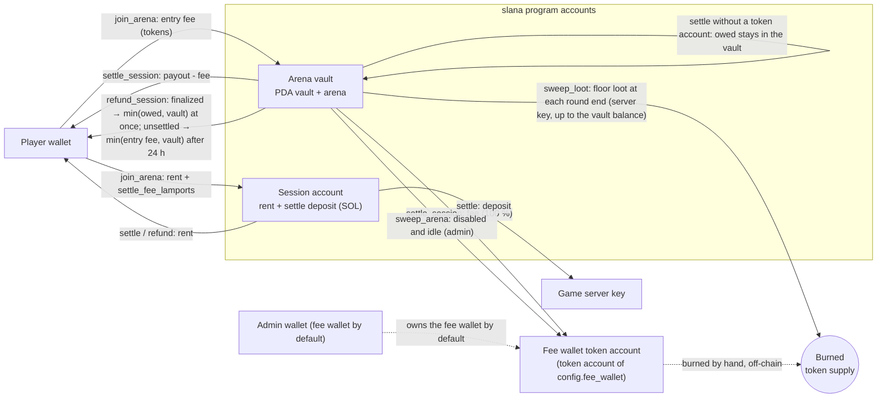
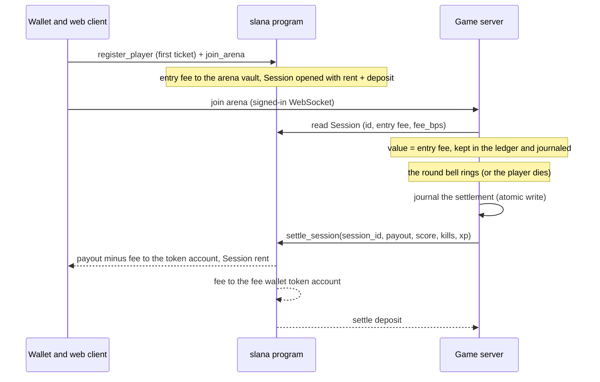

# Slana architecture

*Summary: Slana is a hybrid game. The physics runs on the authoritative game server, the money rules in the Solana
program. This document covers the money flow, the invariants and the trust model. Product decisions:
[Slana Simple design](specs/2026-10-16-slana-simple-design.md).*

Every number below is quoted from the code: program constants from `programs/slana-ref/src/constants.rs`, admin defaults
from `packages/sdk/src/constants.ts` (`pnpm admin init`), game rules from `packages/shared/src/constants.ts` (`RULES`,
`CAPACITY`) and server timings from `apps/server/src`.

## Components

| Part | Runs | Holds |
|---|---|---|
| `programs/slana-ref` (Anchor 1.2.1 reference, never deployed) / `programs/slana-lean` (Pinocchio, deployed) | Solana | Config (including the game token, set once), arena vaults, sessions, the flat fee, floor-loot burn |
| `apps/server` (Node 22) | your host | 30 Hz simulation, rooms and instances, bots, in-game value ledger, loot, journal, settlement queue, token watcher |
| `apps/web` (Vite + React) | browser | lobby, ticket flow, HUD, standings, player guide (`/docs`) |
| `packages/sdk` | everywhere | PDAs, instruction builders, account views, fee math (`splitPayout`, mirrors `logic::split_payout`), admin CLI |
| `packages/art` | browser | the risograph coin drawing used by the web renderer |
| `packages/shared` | everywhere | rules, binary protocol, arena metadata, token formatting |

The browser talks to the server over a WebSocket (binary snapshots, 30 ticks per second) and signs its own transactions
(register, join, create token account, refund and collect) against the RPC. The server key signs `settle_session` and `sweep_loot`. The admin signs `initialize`, `set_token_mint` and the arena instructions with `pnpm admin`.

## The on-chain program: two crates, one deployed

The money rules exist twice, as two crates that must behave identically on the wire:

| Crate | Built by | Output | Role |
|---|---|---|---|
| `programs/slana-ref` (Anchor 1.2.1, lib name `slana`) | `anchor build --ignore-keys` | `target/deploy/slana.so` (~679 KB) and the IDL | **Reference, never deployed.** The IDL (`pnpm -F @slana/sdk sync-idl` → `packages/sdk/src/idl`) and so every TS type come from it. In the tests it is the conformance oracle. |
| `programs/slana-lean` (Pinocchio 0.11, `no_std`, no allocator, no `core::fmt`, no floats) | `bash scripts/build-lean.sh` (`cargo build-sbf`) | `target/deploy/slana_lean.so` (39,032 bytes) | **The deployed program**, at the same program id. It dispatches on the 8-byte Anchor discriminators and reads/writes accounts at fixed offsets. It reproduces the reference's account checks, error codes (6000+ and the Anchor built-ins it raises) and events. |

Wire compatibility means the following match: instruction discriminators and Borsh arguments, account order and
signer/writable flags, account discriminators, layouts and sizes, PDA seeds, error codes and event bytes. Anchor's
`Instruction: <Name>` log lines are not part of it, and the lean program does not print them. Clients identify
instructions by discriminator, never by log text.

Deploy only `slana_lean.so`, with `scripts/deploy-lean.sh <cluster-url> <keypair>` (it refuses a keypair that is not
the program id, then runs `solana program deploy target/deploy/slana_lean.so --program-id <keypair>`). Never
use `anchor deploy`, because it would ship the reference. The lean crate keeps its own copy of the program id
(`ID` in `programs/slana-lean/src/lib.rs`), and a unit test pins it to the reference's `declare_id!`.

**Conformance testing.** The LiteSVM suite lives in `programs/slana-ref/tests` and always builds its instructions
with the reference's Anchor types. `SLANA_IMPL` selects which `.so` is loaded at the program id:

- `ref` loads `slana.so`;
- `lean`, the default, loads `slana_lean.so`.

`scripts/test-program.sh` runs the whole suite under both, and CI fails if either fails. The suite covers every
instruction. Beyond the outcomes, it compares:

- the exact error code of each constraint failure, including Anchor's check order;
- the account bytes written by lean against the reference's re-serialization (`layout.rs`);
- the event bytes against `Event::data()`;
- the compute units per instruction (`cu.rs`, printed side by side in CI).

The lean crate's host tests (`cargo test -p slana-lean`) check:

- the discriminators against `sha256("global:<name>")`, the reference and the IDL;
- the constants and error codes;
- differential tests of the money math (`mul_bps`, `split_payout`) against the reference functions;
- the account layouts and event encodings.

Finally, the localnet e2e (`pnpm -F @slana/server e2e`) runs the deployed lean `.so` on a real `solana-test-validator`
with the game server and the web's own transaction builders.

**Size gate.** `programs/slana-ref/tests/size.rs` fails when `slana_lean.so` exceeds 71,000 bytes, or when its
ProgramData rent, `(len + 45 + 128) × 6960` lamports, exceeds ◎0.5. CI runs it on every push. Today the program is
39,032 bytes, which is 272,866,800 lamports ≈ ◎0.2729. The reference (454,704 bytes) would lock about ◎3.17. The size settings are
per-package overrides in the root `Cargo.toml`:

- `opt-level = "z"` for the lean crate and the Pinocchio crates;
- `overflow-checks = false` for the lean crate only, because its value arithmetic uses explicit `checked_*` (clippy's
  `arithmetic_side_effects` is denied outside tests).

Fat LTO and one codegen unit come from the shared release profile. The reference build is unaffected. Deploy and rent figures are in [DEPLOY.md](DEPLOY.md).

## Money flow



Inside a room the value moves between players without touching the chain:

- A ticket's value starts at its entry fee (`Session.entry_fee`).
- Eating a cell moves `floor(V · m / M)` of the victim's value to the eater (`ArenaLedger.transfer`); the last cell moves
  everything left.
- Bots are worth 0. When a bot eats (part of) a player, the same share leaves the player as loot
  (`ArenaLedger.spill`), split into `clamp(ceil(V / (entry_fee × 0.25)), 3, 24)` pieces that add up exactly
  (`RULES.lootPieces*`). Loot never despawns and only real players collect it.
- Paid arenas play timed rounds on the wall clock (`RULES.roundMs` 300 s, `RULES.roundJoinCloseMs` 60 s; the server's
  `ROUND_SECONDS` / `ROUND_JOIN_CLOSE_SECONDS`, the close window capped at half a round). There is no cash-out: the
  `cashout` message is refused (`no_cashout`) and an AFK player stays in the arena until eaten or until the bell. At the
  bell every live ticket (connected or AFK) ends in one `settle_session` with `payout` = the ledger value (reason
  `round`), a death ends in one with payout 0, and an admin kick or a server shutdown settle at the current value. The
  6 h age limit (`MAX_STAKE_SESSION_AGE_S`) and the crash-recovery path remain as safety nets.
- At the bell the floor loot is collected, cleared, and journaled as one `sweep` item (`sweep:<roomId>:<round>`) in the
  same atomic write that queues the settlements. The chain worker executes it with `sweep_loot(amount)` (the amount is burned
  from the arena vault, the supply drops, `LootBurned` event). A sweep is resent only after its blockhash has provably expired, so
  it cannot be paid twice.

### Ticket lifecycle



## Fees

`logic::split_payout` (mirrored by `splitPayout` in the SDK, tested to agree):

```
profit = max(0, payout − entry_fee)
fee    = floor(profit × bps / 10 000)        bps = Session.fee_bps, fixed at join (Config.fee_bps at that moment)
player = payout − fee
```

The whole fee goes to the fee wallet's token account (`fee_wallet_token`): no treasury, no season pool, no burn split.

Defaults (`pnpm admin init`): `fee_bps` 500, `settle_fee_lamports` 20 000. Bounds: `fee_bps ≤ MAX_FEE_BPS` (1000),
`settle_fee_lamports ≤ MAX_SETTLE_FEE_LAMPORTS` (1 000 000). A fee change in `update_config` applies to tickets bought
after it; open sessions keep their `fee_bps`. The fee wallet is read from the config at settlement.

Worked example (the player guide shows it as a receipt): entry 1 000, value at the bell 2 000 → profit 1 000 → fee 50 (to
the fee wallet), player 1 950.

## Invariants

On-chain (enforced by the program):

1. **A payout never exceeds the vault.** `settle_session` requires `vault.amount ≥ payout` (`InsufficientPot`);
   `refund_session` pays `min(owed, vault.amount)` for a finalized session and `min(entry_fee, vault.amount)` for an
   unsettled one.
2. **One open ticket per player per arena**: the Session PDA is `["session", arena, player]`.
3. **No replayed payouts**: `settle_session` requires `session_id == Session.id` (ids come from `Config.total_sessions`,
   PDAs are reused).
4. **Fees only on profit, bounded and fixed at purchase** (see Fees): `Session.fee_bps` is written by the join and is the
   only rate `settle_session` uses. The join takes what the player was shown and fails rather than charge more:
   `max_fee_bps` (`FeeAboveLimit`), `max_entry_fee` (`EntryFeeAboveLimit`) and `max_settle_fee`
   (`SettleFeeAboveLimit`). The whole fee goes to the fee wallet.
5. **The deposit pays the settler**: a Session holds rent + `settle_fee`; settle moves `settle_fee` to the server and closes
   the rest to the player (at once, or when a finalized session is collected); the refund of an unsettled session
   returns everything to the player after `SESSION_REFUND_TIMEOUT_SECS` (24 h).
5b. **Two-phase settle, no free-roll** (R24): `settle_session` takes the player token account as an optional
   account. It always applies the game result (the fee to the fee wallet, stats, settle deposit to the server). With
   the account the player share is paid and the session closes; without it (missing, closed, or refusing the transfer,
   e.g. a Token-2022 MemoTransfer requirement) the session is kept with `finalized = true` and `owed` = the player share,
   and `Arena.open_sessions` is not decremented, so `sweep_arena` cannot take owed tokens.
   A finalized session cannot be settled again (`SessionFinalized`), and `refund_session` pays exactly `min(owed,
   vault)` at once and closes it. A loser who closes their token account therefore gets nothing back: the result is
   final, and the 24 h entry-fee refund exists only for sessions the server never settled. A new join on that arena
   fails ("already in use") until the payout is collected; the server refuses to seat a finalized session
   (`payout_waiting`).
6. **The fee goes only to the fee wallet**: `settle_session` and `sweep_arena` require a `fee_wallet_token` account that is of
   `config.token_mint`, owned by `config.fee_wallet` and by `config.token_program` (it must be passed even when the fee
   is 0). A wrong account fails the whole instruction, so a settlement can never pay the fee elsewhere. There is no
   on-chain burn at settlement.
7. **Floor loot is burned, never moved**: `sweep_loot(amount)` (server key) burns `amount` from the arena vault
   (`InsufficientPot` above the vault balance; `0` is a no-op) and emits `LootBurned`. `sweep_arena` (admin) needs the arena
   disabled and idle and moves the whole vault to the fee wallet.
8. **Score and XP are clamped** (`MAX_SCORE_PER_GAME` 1 000 000, `MAX_XP_PER_GAME` 2 000). There are no season points.
9. **The token is set once, after deploy**: `initialize` stores no mint (`token_mint` = the default key, decimals 0).
   `set_token_mint` (admin) is accepted once, only while the mint is unset (`TokenAlreadySet`), and stores the mint, its
   token program and its decimals. Until then `create_arena` and `join_arena` fail with `TokenNotSet`. Mints with a freeze
   authority and Token-2022 mints with any of `DENIED_MINT_EXTENSIONS` (transfer fee, transfer hook, permanent delegate,
   non-transferable, default account state, confidential transfer and its fee / mint-burn variants, pausable, mint close
   authority) are refused. A wrong mint cannot be fixed: the program has to be closed and redeployed.
10. **Pause blocks joins only**: `paused` stops `join_arena`; settlements and refunds keep working.

Off-chain (enforced by the server, covered by tests in `apps/server/test`):

11. **Value conservation per arena**: Σ live ledger values + Σ loot + Σ pending payouts = Σ entry fees of the arena's
    joined tickets − Σ settled payouts (`conservation.test.ts`). The journal (`DATA_DIR/journal.json`) is written with
    write-to-temp + rename whenever a settlement is queued and at most once per second while values or loot change, so the
    file on disk always satisfies the same equation. With invariant 1 the vault always covers the server's books: the vault
    also holds the entry fees of tickets that were bought but not yet played.
12. **Bots carry no value**: they never enter the ledger, eating one gives mass only, and they never pick up loot
    (`loot.test.ts` "bots never pick loot", `bots.test.ts` "bots ignore loot").
13. **Crash recovery**: live tickets found in the journal at start are queued for automatic settlement at their last journaled value; loot is restored into
    the arena's first instance.
    Before an arena is attached (its first instance created), its vault must hold at least what the journal owes it
    (loot + pending payouts + live tickets); otherwise the server keeps it disabled and logs `!!! arena #N KEPT
    DISABLED` (`RoomManager.vaultCovers`, `matchmaking.test.ts`). This catches an arena swept while loot was journaled.
14. **No server-paid player rent; settle never waits for the player** (R24, replaces the R10 wait queue): when the
    player's token account is missing the worker settles at once without it (the session is finalized with `owed`);
    after `TOKEN_FAILURES_BEFORE_FINALIZE` (3) failures caused by the account itself (owner changed, MemoTransfer, closed
    between check and send) it does the same. The web shows "Collect payout" (`refund_session` plus an idempotent,
    player-paid token-account creation, one transaction, no waiting time). The stale sweeper and the arena join skip
    finalized sessions. On `AccountNotInitialized` / `AccountOwnedByWrongProgram` the worker re-reads the session and
    drops the item only when the session is gone or re-opened (I2).
15. **Stale sweeper after a journal quarantine** (M9): while a `journal.json.corrupt-*` file exists, the sweeper stays off
    until the operator sets `STALE_SWEEP_ACK=1` (or moves the file away): sessions whose real result was in the lost
    journal must not be refunded at the buy-in.

## Trust model

| Actor | Can | Cannot |
|---|---|---|
| Player | buy tickets, collect a finalized payout (any time, exactly `owed`), refund a ticket the server never settled (after 24 h), edit the profile | settle a ticket, undo a settled result (a closed or blocked token account only delays their own payout), move other players' tokens |
| Server key (`Config.server_authority`) | close any open ticket with any `payout ≤ vault` and any score / kills / XP (clamped); burn up to the vault balance from an arena vault with `sweep_loot` (the same trust as a payout; no other destination) | touch the fee wallet or the config, take tokens out of a vault to a wallet, open tickets |
| Admin (`Config.admin`) | set the token once; change the fee (≤ 10 %), the deposit, pause; replace the server key, the admin or the fee wallet; create, update, disable and sweep arenas (`sweep_arena`: only when disabled and idle; into the fee wallet) | change the token after it is set; take an arena vault directly; set a fee above 10 % or change an open ticket's fee |
| Fee wallet | receives the whole fee and a swept arena's vault; burns tokens off-chain by hand | nothing on-chain beyond holding what it receives |
| Upgrade authority | replace the program code | (nothing is out of reach) |
| Server operator | rooms, bots, matchmaking, round length (`ROUND_SECONDS`, `ROUND_JOIN_CLOSE_SECONDS`) | anything on-chain except through the server key |

Consequences, stated plainly in the player guide:

- The game outcome is trusted. A buggy or malicious server can split an arena's vault wrongly between that arena's
  players, or burn the wrong amount of an arena vault with `sweep_loot` (never more than the vault; owed or live-ticket
  tokens are not protected on-chain from a malicious server key, exactly as with payouts). Because the admin can replace
  the server key, trusting the server means trusting the admin. **Protect the server key.**
- The token is trusted once: the admin chooses the mint with `set_token_mint` and it can never change, so a wrong contract
  address means redeploying. The program refuses mints with a freeze authority and risky Token-2022 extensions.
- The fee wallet's token account matters for liveness: if it is closed or unusable, the server holds every settlement
  (a loud `!!!` log) until the account is recreated. The program itself never lets the fee go anywhere else.
- The upgrade authority is the strongest key: it is the admin wallet (`scripts/admin-wallet.conf`); a multisig is optional later. The program is never made immutable, so the admin can close it at any time (OPERATIONS.md, "Emergency stop / close").
- Collusion (feeding a second wallet), multi-accounting and scripted input are detected off chain and shown to the admin
  for review (OPERATIONS.md, "Integrity"). An optional auto-hold keeps a high-risk payout in the journal (`held`) until
  the admin releases it or settles it at 0; a forfeit stays in the vault and is journaled, so invariant 11 reads
  Σ live + Σ loot + Σ pending + Σ forfeited = Σ entry fees − Σ paid. The program is unchanged.

## Server internals

- **Rooms** (`rooms/manager.ts`): practice instances `practice-rookie-N` / `practice-pro-N` (`PRACTICE_CAPACITY`, 40
  humans); Pro for profiles at level ≥ 5 and, for 24 h, for IPs whose Rookie game passed 3 000 mass or 8 kills. Arena
  instances `arena-<id>-<n>` hold `ARENA_INSTANCE_CAP` (50) humans; a new instance opens on the same vault when all are
  full. The arena list is re-read from the chain every 30 s (and cached for another 30 s, so a new arena can take up to about 60 s to appear).
- **Settlement worker** (`chain/solana.ts`): drains the journal queue (at most 4 in flight), retries transient failures
  with backoff (up to 5 min), drops permanent ones (`SessionMismatch`, `SessionFinalized`, a session that is really
  gone), settles without the player's token account when it is missing or keeps refusing (R24), and every 5 min queues a
  refund at the entry fee for tickets nobody played for 15 min (`STALE_SESSION_AFTER_S`; never finalized sessions, and
  not at all after a journal quarantine until `STALE_SWEEP_ACK=1`). It warns when the server key holds less than
  0.05 SOL.
- **Token watcher** (`chain/solana.ts`): the program config is read at start and every 30 s. While `token_mint` is unset
  (`tokenReady` false) the server plays practice only: it lists no arenas, answers arena joins with `token_not_set`,
  and holds settlements and sweeps. The first read that finds the mint clears the arena cache, logs `game token set —
  mint …`, and pushes a `chain` message (protocol v4) to every connected client, so the web flips from "Opening soon" to
  open arenas with no reload and no restart. A server that already finds the token at boot announces nothing.
- **Fee wallet guard**: before every settlement the worker checks the fee wallet's token account (exists, token program
  owns it, game mint, owned by `config.fee_wallet`, initialized, not frozen). An unusable account holds every item with
  a `!!!` log (about once a minute) and never counts against the player; settlements resume by themselves.
- **Other REST**: `/api/health`, `/api/rooms`, `/api/leaderboard`, `/api/config`, `/api/auth/nonce`,
  `/api/pending?wallet=` (settlements the server is still sending; finalized sessions to collect are read from the chain by
  the web). With `WEB_DIST` the server also serves the web build and falls back to `index.html` for client routes such
  as `/docs`.
- **Wallet sign-in (SIWS)**: `/api/auth/nonce` returns the message and its fields; the domain is the `PUBLIC_URL` host
  (else the request host), with `URI:` and `Chain ID: solana:<cluster>` lines. The server checks every line against the
  issued nonce; the web rebuilds the message from the fields and signs only that, and only for its own host or the game
  server's. Outstanding nonces are capped (`MAX_NONCES`, oldest evicted).
