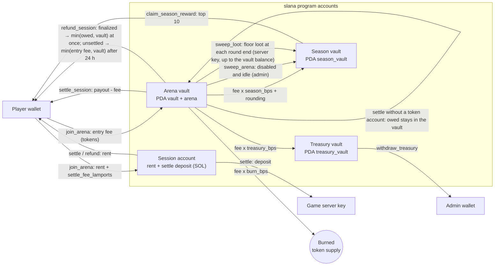
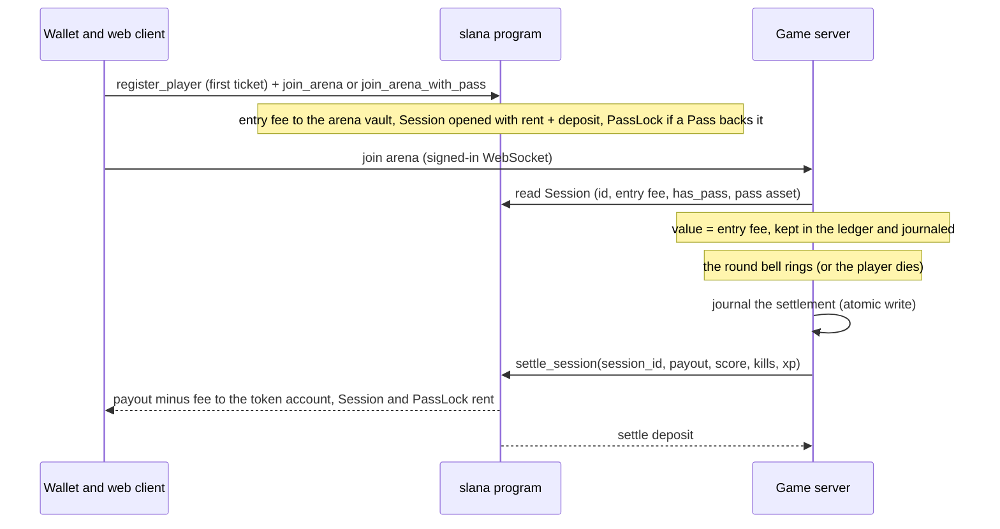

# Slana architecture

*Summary: Slana is a hybrid game. The physics runs on the authoritative game server, the money rules in the Solana
program. This document covers the money flow, the invariants and the trust model. Product design:
[design document](superpowers/specs/2026-10-14-slana-design.md).*

Every number below is quoted from the code: program constants from `programs/slana-ref/src/constants.rs`, admin defaults
from `packages/sdk/src/constants.ts` (`pnpm admin init`), game rules from `packages/shared/src/constants.ts` (`RULES`,
`CAPACITY`) and server timings from `apps/server/src`.

## Components

| Part | Runs | Holds |
|---|---|---|
| `programs/slana-ref` (Anchor 1.2.1 reference, never deployed) / `programs/slana-lean` (Pinocchio, deployed) | Solana | Config, arena vaults, sessions, fees, burn, season table and prize pool, Slana Pass collection, mint and reveal |
| `apps/server` (Node 22) | your host | 30 Hz simulation, rooms and instances, bots, in-game value ledger, loot, journal, settlement queue, Pass metadata |
| `apps/web` (Vite + React) | browser | lobby, ticket flow, HUD, Pass office, standings, player guide (`/docs`) |
| `packages/sdk` | everywhere | PDAs, instruction builders, account views, fee math (`splitPayout`, mirrors `logic::split_payout`), admin CLI |
| `packages/art` | everywhere | `passTraits(finalSeed, n, supply)` (`finalSeed = Config.pass_final_seed`), coin and Pass drawing, `pnpm pass:*` CLI |
| `packages/shared` | everywhere | rules, binary protocol, arena metadata, token formatting |

The browser talks to the server over a WebSocket (binary snapshots, 30 ticks per second) and signs its own transactions
(register, join, create token account, mint, claim, refund) against the RPC. The server signs only `settle_session`.

## The on-chain program: two crates, one deployed

The money rules exist twice, as two crates that must behave identically on the wire:

| Crate | Built by | Output | Role |
|---|---|---|---|
| `programs/slana-ref` (Anchor 1.2.1, lib name `slana`) | `anchor build --ignore-keys` | `target/deploy/slana.so` (~679 KB) and the IDL | **Reference, never deployed.** The IDL (`pnpm -F @slana/sdk sync-idl` → `packages/sdk/src/idl`) and so every TS type come from it. In the tests it is the conformance oracle. |
| `programs/slana-lean` (Pinocchio 0.11, `no_std`, no allocator, no `core::fmt`, no floats) | `bash scripts/build-lean.sh` (`cargo build-sbf`) | `target/deploy/slana_lean.so` (59,896 bytes) | **The deployed program**, at the same program id. It dispatches on the 8-byte Anchor discriminators and reads/writes accounts at fixed offsets. It reproduces the reference's account checks, error codes (6000+ and the Anchor built-ins it raises), events and the `Pass entropy: slot … hash …` log line. |

Wire compatibility means the following match: instruction discriminators and Borsh arguments, account order and
signer/writable flags, account discriminators, layouts and sizes, PDA seeds, error codes and event bytes. Anchor's
`Instruction: <Name>` log lines are not part of it, and the lean program does not print them. Clients identify
instructions by discriminator, never by log text.

Deploy only `slana_lean.so`, with `scripts/deploy-lean.sh <cluster-url> <keypair>` (it refuses a keypair that is not
the program id, then runs `solana program deploy target/deploy/slana_lean.so --program-id <keypair>`). Never
use `anchor deploy`, because it would ship the reference. The lean crate keeps its own copy of the program id
(`ID` in `programs/slana-lean/src/lib.rs`), and a unit test pins it to the reference's `declare_id!`.

**Conformance testing.** The LiteSVM suite lives in `programs/slana-ref/tests` and always builds its instructions
with the reference's Anchor types. `SLANA_IMPL` selects which `.so` is loaded at the program id:

- `ref` loads `slana.so`;
- `lean`, the default, loads `slana_lean.so`.

`scripts/test-program.sh` runs the whole suite under both, and CI fails if either fails. The suite covers every
instruction. Beyond the outcomes, it compares:

- the exact error code of each constraint failure, including Anchor's check order;
- the account bytes written by lean against the reference's re-serialization (`layout.rs`);
- the event bytes against `Event::data()`;
- the compute units per instruction (`cu.rs`, printed side by side in CI).

The lean crate's host tests (`cargo test -p slana-lean`) check:

- the discriminators against `sha256("global:<name>")`, the reference and the IDL;
- the constants and error codes;
- differential tests of the money math (`mul_bps`, `split_payout`, prizes) against the reference functions;
- the CPI and SlotHashes helpers.

Finally, the localnet e2e (`pnpm -F @slana/server e2e`) runs the deployed lean `.so` on a real `solana-test-validator`
with the game server and the web's own transaction builders.

**Size gate.** `programs/slana-ref/tests/size.rs` fails when `slana_lean.so` exceeds 71,000 bytes, or when its
ProgramData rent, `(len + 45 + 128) × 6960` lamports, exceeds ◎0.5. CI runs it on every push. Today the program is
59,896 bytes, which is 418,080,240 lamports ≈ ◎0.418. The reference would lock ◎4.73. The size settings are
per-package overrides in the root `Cargo.toml`:

- `opt-level = "z"` for the lean crate and the Pinocchio crates;
- `overflow-checks = false` for the lean crate only, because its value arithmetic uses explicit `checked_*` (clippy's
  `arithmetic_side_effects` is denied outside tests).

Fat LTO and one codegen unit come from the shared release profile. The reference build is unaffected. Deploy and rent figures are in [DEPLOY.md](DEPLOY.md).

## Money flow



Inside a room the value moves between players without touching the chain:

- A ticket's value starts at its entry fee (`Session.entry_fee`).
- Eating a cell moves `floor(V · m / M)` of the victim's value to the eater (`ArenaLedger.transfer`); the last cell moves
  everything left.
- Bots are worth 0. When a bot eats (part of) a player, the same share leaves the player as loot
  (`ArenaLedger.spill`), split into `clamp(ceil(V / (entry_fee × 0.25)), 3, 24)` pieces that add up exactly
  (`RULES.lootPieces*`). Loot never despawns and only real players collect it.
- Paid arenas play timed rounds on the wall clock (`RULES.roundMs` 300 s, `RULES.roundJoinCloseMs` 60 s; the server's
  `ROUND_SECONDS` / `ROUND_JOIN_CLOSE_SECONDS`, the close window capped at half a round). There is no cash-out: the
  `cashout` message is refused (`no_cashout`) and an AFK player stays in the arena until eaten or until the bell. At the
  bell every live ticket (connected or AFK) ends in one `settle_session` with `payout` = the ledger value (reason
  `round`), a death ends in one with payout 0, and an admin kick or a server shutdown settle at the current value. The
  6 h age limit (`MAX_STAKE_SESSION_AGE_S`) and the crash-recovery path remain as safety nets.
- At the bell the floor loot is collected, cleared, and journaled as one `sweep` item (`sweep:<roomId>:<round>`) in the
  same atomic write that queues the settlements. The chain worker executes it with `sweep_loot(amount)` (vault to season
  vault, `season.pool += amount`, `LootSwept` event). A sweep is resent only after its blockhash has provably expired, so
  it cannot be paid twice.

### Ticket lifecycle



## Fees

`logic::split_payout` (mirrored by `splitPayout` / `splitSessionPayout` in the SDK, tested to agree):

```
profit   = max(0, payout − entry_fee)
fee      = floor(profit × bps / 10 000)        bps = Session.fee_bps, fixed at join (pass_fee_bps on a
                                               Pass session, else fee_bps, as configured at that moment)
treasury = floor(fee × treasury_bps / 10 000)
burn     = floor(fee × burn_bps / 10 000)
season   = fee − treasury − burn               (gets the rounding remainder)
player   = payout − fee
```

Defaults (`pnpm admin init`): `fee_bps` 500, `pass_fee_bps` 200, split 5000 / 3000 / 2000, `settle_fee_lamports`
20 000. Bounds: `fee_bps ≤ MAX_FEE_BPS` (1000), `pass_fee_bps ≤ fee_bps`, split sums to 10 000,
`settle_fee_lamports ≤ MAX_SETTLE_FEE_LAMPORTS` (1 000 000). A fee change in `update_config` applies to tickets bought
after it; open sessions keep their `fee_bps` (the treasury / season / burn split is read from the config at settlement).

Worked example (the player guide shows it as receipts): entry 1 000, value at the bell 2 000 → profit 1 000 → fee 50
(treasury 25, season 15, burn 10), player 1 950. With a Pass: fee 20 (10 / 6 / 4), player 1 980.

## Invariants

On-chain (enforced by the program):

1. **A payout never exceeds the vault.** `settle_session` requires `vault.amount ≥ payout` (`InsufficientPot`);
   `refund_session` pays `min(owed, vault.amount)` for a finalized session and `min(entry_fee, vault.amount)` for an
   unsettled one.
2. **One open ticket per player per arena**: the Session PDA is `["session", arena, player]`.
3. **One open ticket per Pass**: `join_arena_with_pass` creates `["pass_lock", asset]`; a second join with the same asset
   fails, even after a transfer. Settle (both paths) and refund close it back to the player.
4. **No replayed payouts**: `settle_session` requires `session_id == Session.id` (ids come from `Config.total_sessions`,
   PDAs are reused).
5. **Fees only on profit, bounded and fixed at purchase** (see Fees): `Session.fee_bps` is written by the join and is the
   only rate `settle_session` uses. The join takes what the player was shown and fails rather than charge more:
   `max_fee_bps` (`FeeAboveLimit`), `max_entry_fee` (`EntryFeeAboveLimit`) and `max_settle_fee`
   (`SettleFeeAboveLimit`). The burn lowers the mint supply.
6. **The deposit pays the settler**: a Session holds rent + `settle_fee`; settle moves `settle_fee` to the server and closes
   the rest to the player (at once, or when a finalized session is collected); the refund of an unsettled session
   returns everything to the player after `SESSION_REFUND_TIMEOUT_SECS` (24 h).
6b. **Two-phase settle, no free-roll** (ruling R24): `settle_session` takes the player token account as an optional
   account. It always applies the game result (fee split, burn, season pool, stats, settle deposit to the server). With
   the account the player share is paid and the session closes; without it (missing, closed, or refusing the transfer,
   e.g. a Token-2022 MemoTransfer requirement) the session is kept with `finalized = true` and `owed` = the player share,
   the Pass lock closes, and `Arena.open_sessions` is **not** decremented, so `sweep_arena` cannot take owed tokens.
   A finalized session cannot be settled again (`SessionFinalized`), and `refund_session` pays exactly `min(owed,
   vault)` at once and closes it. A loser who closes their token account therefore gets nothing back: the result is
   final, and the 24 h entry-fee refund exists only for sessions the server never settled. A new join on that arena
   fails ("already in use") until the payout is collected; the server refuses to seat a finalized session
   (`payout_waiting`).
7. **Season pools**: every transfer into or out of the season vault changes exactly one season's `pool` (settle fee share,
   sweep, loot sweep and rollover add; claims subtract), so the vault balance equals the sum of the pools. `end_season` freezes
   `prize_pool`; rank `r` (0-based) of the top `PRIZE_RANKS` (10) claims `prize_pool × PRIZE_SHARES_BPS[r] / 10 000`
   once (`claimed_mask`) within `CLAIM_WINDOW_SECS` (30 days); `rollover_season` only after the window.
8. **Season points only from Pass tickets**: `record_result` adds the score to `season_points` and the leaderboard only
   when `Session.has_pass` (captured at join). Score and XP are clamped (`MAX_SCORE_PER_GAME` 1 000 000,
   `MAX_XP_PER_GAME` 2 000).
9. **The token is fixed**: `token_mint` is written once by `initialize`. Mints with a freeze authority and Token-2022 mints
   with any of `DENIED_MINT_EXTENSIONS` (transfer fee, transfer hook, permanent delegate, non-transferable, default
   account state, confidential transfer and its fee / mint-burn variants, pausable, mint close authority) are refused.
10. **Pass mint rules**: `pass_minted ≤ pass_supply ≤ MAX_PASS_SUPPLY` (10 000); `pass_supply` is frozen once the mint has
    ever opened (`pass_mint_opened`, `SupplyLocked`); a per-wallet counter `["pass_minted", wallet]` ≤ `pass_per_wallet`;
    the seed hash must be set before the first mint and is locked after it; `pass_base_uri` (≤ 96 bytes, ends with `/`) is
    frozen after the first mint. The mint **ends** for good with `close_pass_mint` (needs ≥ 1 minted Pass; before that
    `update_config` may still close and reopen it) or automatically when the last Pass of the supply is minted: the
    program sets `pass_mint_ended` and the mint can never reopen (`MintEnded`). No entropy target exists yet. Then, in
    this order (ruling R23):
    1. `reveal_pass(seed)` (admin, once, only after the mint ended) checks `sha256(seed) == pass_seed_hash`, stores the
       seed publicly (`pass_seed`, `pass_seed_revealed`) and **only then** sets
       `pass_entropy_target_slot = slot + ENTROPY_DELAY_SLOTS` (150).
    2. The permissionless `capture_pass_entropy` (any signer: the server sends it automatically, the web Pass page offers
       "Complete the reveal" to any wallet, the CLI has `capture-entropy`) needs the seed revealed (`SeedNotRevealed`)
       and `slot > target`, reads the address-checked SlotHashes sysvar itself and stores as `pass_entropy` the hash of
       the first slot with a block at or after the target; it then computes `pass_final_seed = sha256(seed ‖
       pass_entropy)`, sets `pass_revealed` and logs `Pass entropy: slot N hash H`. If the target already left the
       SlotHashes window (~512 slots) it sets a new target `slot + 150` instead; once revealed it is a no-op.
    Every trait derives from `pass_final_seed`.
11. **Pause blocks joins only**: `paused` stops `join_arena`; settlements and refunds keep working.

Off-chain (enforced by the server, covered by tests in `apps/server/test`):

12. **Value conservation per arena**: Σ live ledger values + Σ loot + Σ pending payouts = Σ entry fees of the arena's
    joined tickets − Σ settled payouts (`conservation.test.ts`). The journal (`DATA_DIR/journal.json`) is written with
    write-to-temp + rename whenever a settlement is queued and at most once per second while values or loot change, so the
    file on disk always satisfies the same equation. With invariant 1 the vault always covers the server's books: the vault
    also holds the entry fees of tickets that were bought but not yet played.
13. **Bots carry no value**: they never enter the ledger, eating one gives mass only, and they never pick up loot
    (`loot.test.ts` "bots never pick loot", `bots.test.ts` "bots ignore loot").
14. **Crash recovery**: live tickets found in the journal at start are queued for automatic settlement at their last journaled value; loot is restored into
    the arena's first instance.
    Before an arena is attached (its first instance created), its vault must hold at least what the journal owes it
    (loot + pending payouts + live tickets); otherwise the server keeps it disabled and logs `!!! arena #N KEPT
    DISABLED` (`RoomManager.vaultCovers`, `matchmaking.test.ts`). This catches an arena swept while loot was journaled.
15. **No server-paid player rent; settle never waits for the player** (ruling R24, replaces the R10 wait queue): when the
    player's token account is missing the worker settles at once **without** it (the session is finalized with `owed`);
    after `TOKEN_FAILURES_BEFORE_FINALIZE` (3) failures caused by the account itself (owner changed, MemoTransfer, closed
    between check and send) it does the same. The web shows "Collect payout" (`refund_session` plus an idempotent,
    player-paid token-account creation, one transaction, no waiting time). The stale sweeper and the arena join skip
    finalized sessions. On `AccountNotInitialized` / `AccountOwnedByWrongProgram` the worker re-reads the session and
    drops the item only when the session is gone or re-opened (I2).
16. **Stale sweeper after a journal quarantine** (M9): while a `journal.json.corrupt-*` file exists, the sweeper stays off
    until the operator sets `STALE_SWEEP_ACK=1` (or moves the file away): sessions whose real result was in the lost
    journal must not be refunded at the buy-in.

## Trust model

| Actor | Can | Cannot |
|---|---|---|
| Player | buy tickets, collect a finalized payout (any time, exactly `owed`), refund a ticket the server never settled (after 24 h), mint Passes, claim prizes, edit the profile | settle a ticket, undo a settled result (a closed or blocked token account only delays their own payout), move other players' tokens |
| Server key (`Config.server_authority`) | close any open ticket with any `payout ≤ vault` and any score / kills / XP (clamped); move up to the vault balance from an arena vault to the season pool with `sweep_loot` (the same trust as a payout; no other destination) | touch the treasury, take tokens out of the season vault, change the config, open tickets, mint |
| Admin (`Config.admin`) | change fees (≤ 10 %), split, deposit, pause; replace the server key or the admin; create, update, disable and sweep arenas (`sweep_arena`: only when disabled and idle; into the season pool); end and roll over seasons; withdraw the treasury; set the Pass collection (once), seed hash, mint window and (before the mint opens) supply; end the mint; reveal | change the token mint; take an arena vault directly; set a fee above 10 % or change an open ticket's fee; change the supply after the mint opened; reveal a seed that does not match the hash; reopen the mint after it ended |
| Upgrade authority | replace the program code | (nothing is out of reach) |
| Server operator | rooms, bots, matchmaking, round length (`ROUND_SECONDS`, `ROUND_JOIN_CLOSE_SECONDS`), Pass power (`PASS_START_MASS_MUL`), Pass metadata and images | anything on-chain except through the server key |

Consequences, stated plainly in the player guide:

- The game outcome is trusted. A buggy or malicious server can split an arena's vault wrongly between that arena's
  players, or sweep the wrong amount of an arena vault to the season pool with `sweep_loot` (never more than the vault; owed
  or live-ticket tokens are not protected on-chain from a malicious server key, exactly as with payouts). Because the admin can replace the server key, trusting the server means trusting
  the admin.
- The admin knows the committed Pass seed during the mint and Pass numbers are sequential, but traits are
  `passTraits(pass_final_seed, n, pass_supply)` with `pass_final_seed = sha256(seed ‖ pass_entropy)`, and the entropy is
  the hash of a slot fixed only **after** the mint ended **and** the seed was published. So nobody, the team included,
  can know a number's traits while Passes can still be minted, and the admin gets no head start: once the target slot
  passes, everybody can compute the outcome from public data at the same moment.
- Residual, stated honestly: once the outcome is computable, someone who dislikes it could try to let the ~512-slot
  window pass without a capture, which re-targets to a new future slot. They cannot stop anybody else: any wallet
  (holders included) can capture at any moment, and the game server and the web Pass page do so automatically, so no
  single party controls the timing. A party that could keep every capture out of every block for ~3.5 minutes (e.g. by
  censoring transactions) could still force a re-roll; the project does not claim more than this. As everywhere on
  Solana, the leader producing the target slot also influences its bank hash. Since the leader schedule is public, the
  timing of `reveal_pass` (or of a re-target) selects which leader produces the target slot, and a colluding leader could
  then grind or skip that slot; this is the same class of risk as the leader influence just stated.
- `pass_supply` is frozen once the mint opens, so the traits every server and generator computes cannot shift later.
- The upgrade authority is the strongest key: it is the admin wallet (`scripts/admin.env`); a multisig is optional later. The program is never made immutable, so the owner can close it at any time (OPERATIONS.md, "Emergency stop / close").
- Collusion (feeding a second wallet) is not detected in this version.

## Server internals

- **Rooms** (`rooms/manager.ts`): practice instances `practice-rookie-N` / `practice-pro-N` (`PRACTICE_CAPACITY`, 40
  humans); Pro for profiles at level ≥ 5 and, for 24 h, for IPs whose Rookie game passed 3 000 mass or 8 kills. Arena
  instances `arena-<id>-<n>` hold `ARENA_INSTANCE_CAP` (50) humans; a new instance opens on the same vault when all are
  full. The arena list is re-read from the chain every 30 s.
- **Settlement worker** (`chain/solana.ts`): drains the journal queue (at most 4 in flight), retries transient failures
  with backoff (up to 5 min), drops permanent ones (`SessionMismatch`, `SessionFinalized`, a session that is really
  gone), settles without the player's token account when it is missing or keeps refusing (R24), and every 5 min queues a
  refund at the entry fee for tickets nobody played for 15 min (`STALE_SESSION_AFTER_S`; never finalized sessions, and
  not at all after a journal quarantine until `STALE_SWEEP_ACK=1`). It warns when the server key holds less than
  0.05 SOL.
- **Pass endpoints** (`http.ts`): `GET /pass/<n>.json`, `/pass/<n>.png`, `/pass/collection.json`, `/pass/collection.png`
  (sealed before the reveal, images cached under `DATA_DIR/pass/`), `GET /api/pass/owned?wallet=`, rate limited.
- **Other REST**: `/api/health`, `/api/rooms`, `/api/leaderboard`, `/api/season`, `/api/config`, `/api/auth/nonce`,
  `/api/pending?wallet=` (settlements the server is still sending; finalized sessions to collect are read from the chain by
  the web). With `WEB_DIST` the server also serves the web build and falls back to `index.html` for client routes such
  as `/docs`.
- **Wallet sign-in (SIWS)**: `/api/auth/nonce` returns the message and its fields; the domain is the `PUBLIC_URL` host
  (else the request host), with `URI:` and `Chain ID: solana:<cluster>` lines. The server checks every line against the
  issued nonce; the web rebuilds the message from the fields and signs only that, and only for its own host or the game
  server's. Outstanding nonces are capped (`MAX_NONCES`, oldest evicted).
- **Pass power disclosure** (I3): `welcome.chain.passPower` / `/api/config` publish the `PASS_START_MASS_MUL` the
  server applies (`cashoutMs` is still sent but unused since arenas play rounds); the ticket sheet, Pass page and guide
  use it (`RULES` only as the fallback for older servers).
