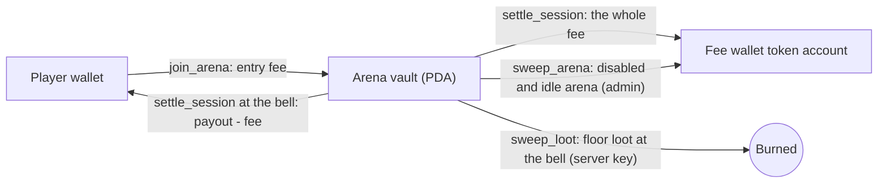

# Slana: the whole project on one page

Slana is a coin-themed, multiplayer Agar.io game on Solana. The money is on-chain and the game itself runs on a server.
This page explains how the game plays, how money moves, how the code is laid out and how you run and operate it. Each
section links to the detailed document where one exists.

> **Status (2026-10-17).** The program is deployed on Solana mainnet and the server runs at https://slana.io
> (section 7). The program is not initialized yet: the admin wallet signs `initialize` in `/admin`, then sets the
> $SLANA token and creates the arenas when the token exists. For now the game is admin-only and the public site is a landing
> page with the NFT allowlist (WL) and collab applications (section 8). The program has not been audited, and a game
> played with a token of real value may need a licence where you operate.

---

## 1. The game in 30 seconds

- You are a coin. Eat food and smaller coins to grow, and run from bigger ones.
- Practice is free. It needs no wallet and no token, you play with bots, nothing touches the chain, and there are
  two leagues, Rookie and Pro.
- Arenas are paid rooms with a fixed entry fee in $SLANA.
  - Your till starts at the entry fee.
  - Eat a player and their tokens move into your till.
- Rounds: an arena round lasts 5 minutes on the wall clock and is the same for every arena.
  - There is no cash-out.
  - When the bell rings, everyone still alive is paid their till on-chain, and a fee is taken from the profit only.
- Re-entry: if you are eaten, you can buy back in at the same fee while joins are open. Joins close in the last minute
  of a round.
- One simple model: no NFT, no seasons, no prizes. Four arenas, open to everyone, differ only by their entry fee, and
  the fee is a flat 5 % of profit.
- The token is set after deploy: until the admin sets the $SLANA mint on-chain (once), the arenas read "Opening
  soon" and only practice is open.

## 2. Game mechanics

### 2.1 Movement and eating

| Rule | Value (source: `packages/shared/src/constants.ts`, `RULES`) |
|---|---|
| Simulation and snapshot rate | 30 ticks per second, authoritative server |
| Start mass | 20 |
| Eating | needs at least 1.25 × the victim's mass and enough overlap (the victim must be mostly covered) |
| Speed | `1900 · r^-0.44`, so bigger coins are slower |
| Split (`Space`) | needs at least 35 mass; up to 16 cells; launch speed 1250; halves merge back after 12 s + 15 ms per unit of mass |
| Eject mass (`W`) | needs at least 35 mass; costs 18 and throws a 14-mass blob |
| Viruses (spiky cacti) | mass 100. A coin at least 1.33 × that size pops into as many as 15 pieces. Feeding a virus 198 mass makes it shoot a new one. |
| Decay | above 150 mass you lose 0.15 %/s, plus an extra term that grows with total mass, so giants melt faster |
| Maximum cell mass | 12,000 |
| Food | pastel coins (1 mass), gems (2), golden coins (8); refills at 60 per second |
| Power-ups | Magnet (10 s), Pump (6 s, × 1.4 speed), Shield (8 s), Bag (+15 % mass, at least 40) |
| Spawn shield | 3 s |
| Room sizes | Practice 5600², Arena 6400²; humans per instance: Practice 40, Arena 50 |

### 2.2 Controls

| Action | Desktop | Phone |
|---|---|---|
| Move | mouse | joystick |
| Split | `Space` | split button |
| Drop mass | `W` (can be held) | tip button |
| Chat / sticker | `Enter` / `1`–`8` | chat / sticker buttons |
| Next player while spectating | `Q` | |

### 2.3 Value inside an arena (off-chain ledger)

- A ticket's value starts at its entry fee.
- Eating a cell moves `floor(V · m / M)` of the victim's value to the eater: `V` is the victim's value, `m` the
  mass of the eaten cell and `M` the victim's total mass. The last cell moves whatever is left.
- Bots are worth 0. Eating a bot gives mass only.
- Loot: when a bot eats a player, that share of the player's value spills across the map as loot.
  - The value is split into `clamp(ceil(V / (fee × 0.25)), 3, 24)` pieces whose values add up exactly.
  - Only real players can pick loot up.
  - Loot stays on the floor until the round ends.

### 2.4 Rounds (paid arenas only)

| Rule | Value |
|---|---|
| Round length | 5 minutes, aligned to Unix time: round *n* runs `[n·300 s, (n+1)·300 s)` for every arena and instance |
| Joins | open in the first 4 minutes, closed in the final 60 s |
| A ticket bought while joins are closed | held; the client joins it automatically when the next round opens (0–1.5 s jitter, up to 5 attempts) |
| Eaten | you get 0 for that ticket; buy back in at the same fee while joins are open |
| Disconnect (AFK) | your cells stay in the arena until they are eaten or the bell rings, so leaving is not an early exit |
| The bell | every live ticket, connected or AFK, is settled at its current value; the world resets and a new round starts at once |
| Floor loot at the bell | collected and burned with `sweep_loot` |
| Exits that still settle at the current value | admin kick and server shutdown (operator actions, not player choices) |

On screen:

- Round chip: shows `m:ss`, switches to "Final minute" for the last 60 s and shows a large countdown in the last 10 s.
- Bell: the world freezes and the Round over receipt appears, with your till, the fee, the amount paid, your
  place, the top 5 and a PAID stamp.
- Lobby rows: each arena shows either "Round ends in 3:12" or "Joins closed · next round in 0:42".
- Death sheet: offers "Buy back in", or "Next round in" while joins are closed.
- Sound: a soft tick each second in the last 10 s and a bell at the end.
- Announcer: "One minute left.", "Ten seconds.", "Round over.".

### 2.5 Arenas

| Arena | Entry fee |
|---|---|
| Penny Pond | 1,000 $SLANA |
| Silver Creek | 10,000 $SLANA |
| Gold Lake | 50,000 $SLANA |
| Whale Bay | 250,000 $SLANA |

These are the defaults created by `pnpm admin create-arena --defaults`, and all four are open to everyone. Each arena can
hold 300 open tickets. A new 50-player instance opens on the same vault when the existing ones are full. Arenas can be
created only after the token is set; before that the lobby shows the four defaults as "Opening soon".

## 3. Money

### 3.1 Fees

The fee is charged on profit only, and the rate is fixed when you buy the ticket. It is a flat 5 % by default (500 bps; the
admin can change it, at most 10 %), and all of it is paid to the fee wallet, which defaults to the admin wallet. There
is no treasury vault, no season pool and no on-chain burn split; tokens are burned off-chain by hand (the plan is 75 %
burned, 25 % kept).

```
profit = max(0, payout - entry_fee)
fee    = floor(profit x bps / 10 000)        5 % (500 bps) by default; max 10 %
player = payout - fee
```

Example with a 1,000 ticket and a till of 2,000 at the bell: profit 1,000, fee 50 (to the fee wallet), the player gets
1,950.

### 3.2 Where tokens live



- **Two-phase settle.** If a player has no token account, or their account refuses the transfer, the payout stays in
  the vault as `owed`. The player collects it any time with "Collect payout". A loser cannot undo the result by closing
  their account.
- **Refund.** If the server never settles a ticket, the player can refund it themselves after 24 h. On-chain this pays
  `min(entry fee, vault)`.
- **Off-chain conservation.** Per arena, the total of live values, floor loot and pending payouts always equals the entry
  fees taken minus the payouts already settled. The server writes this to a crash-safe journal (write to a temp file, then
  rename).

### 3.3 The token

- The program is deployed and initialized without a token. The admin sets it once with
  `pnpm admin set-token --mint <CA>`; the same transaction creates the fee wallet's token account.
- Setting the token is final. The program has no way to change it; a wrong contract address means closing the program and
  redeploying.
- The server and the web read the token from the chain: no restart and no rebuild. Until it is set, the server reports
  `tokenReady: false` and plays practice only, and the arenas show "Opening soon".
- The fee wallet must keep its token account. If it is closed or unusable, the server holds every settlement (with a loud
  `!!!` log) until it is recreated.

## 4. Architecture

**Hybrid model.** The server runs the real-time physics. The Solana program enforces the money rules. The browser signs
its own transactions; the server key signs only `settle_session` and `sweep_loot`.

```
Browser (apps/web)  --WebSocket, binary 30 Hz-->  Game server (apps/server)  --settle / sweep-->  Solana program
       \__________________ signs join / refund / collect ___________________________/
```

### 4.1 Repository layout

| Path | What it is |
|---|---|
| `programs/slana-lean` | The deployed program (Pinocchio, `no_std`). The mainnet build is 36,408 bytes and locks ◎0.1858 of rent (the size varies a little with the platform-tools version; CI's size gate prints its own figure and fails above 71,000 bytes). |
| `programs/slana-ref` | Anchor reference program. It is never deployed; it is the source of the IDL and TypeScript types and the conformance oracle. The LiteSVM test suite runs against both programs (`SLANA_IMPL=ref\|lean`). |
| `packages/shared` | Game rules (`RULES`), the binary protocol (version 4), arena metadata, the round math, token formatting |
| `packages/sdk` | TypeScript client: PDAs, instruction builders, account readers, fee math, and the admin CLI (`pnpm admin`) |
| `packages/art` | The risograph coin drawing used by the web renderer |
| `apps/server` | Node 22 game server (see 4.3) |
| `apps/web` | Vite + React client in the "Paper Ticket" design system (see 4.4) |
| `scripts/` | build, deploy, close, localnet, demo, recorder, IDL sync, program tests |
| `brand/` | Social art: the X profile picture, banner, previews and the OG card, with their generator (section 9) |
| `media/` | Sources of the promo, gameplay and how-to-play videos (renders go to `out/videos/`, which git ignores) |
| `docs/` | This page, [ARCHITECTURE](ARCHITECTURE.md), [DEPLOY](DEPLOY.md), [OPERATIONS](OPERATIONS.md), and the design specs under `docs/specs/` |

### 4.2 On-chain program

**Instructions, by area:**

| Area | Instructions |
|---|---|
| Setup and admin | `initialize` (no token), `set_token_mint` (once), `update_config`, `create_arena`, `update_arena` |
| Players | `register_player`, `update_profile` |
| Tickets | `join_arena`, `settle_session` (server), `refund_session` (player: collect what is owed, or refund after 24 h) |
| Vault sweeps | `sweep_arena` (admin, arena disabled and idle: the vault goes to the fee wallet), `sweep_loot` (server: burns floor loot at each bell) |

**Accounts (PDAs):**

| Account | Seeds |
|---|---|
| Config | `config` |
| Arena | `arena` + id |
| Arena vault | `vault` + arena |
| Session | `session` + arena + player |
| Profile | `profile` + player |

**Main on-chain guarantees:**

- A payout can never exceed the vault.
- A player has at most one open ticket per arena.
- Payouts cannot be replayed: the session id is checked.
- The fee rate is fixed at join and capped at 10 %.
- The token mint is set once, after deploy, and cannot be changed; mints with a freeze authority and risky Token-2022 extensions are refused.
- The whole fee is paid to the fee wallet's token account, and a wrong account fails the settlement.
- Floor loot is only ever burned (`sweep_loot`), never moved to a wallet.
- A pause blocks joins only; settlements and refunds keep working.

### 4.3 Game server (`apps/server/src`)

| Folder | Role |
|---|---|
| `game/` | The world simulation: entities, spatial grid, eating, splitting, viruses, loot, power-ups |
| `bots/` | Bot brains, personalities and steering |
| `rooms/` | `manager.ts` (instances, matchmaking, the vault guard), `room.ts` (a room, round end, settlement), `round-clock.ts` (the single round clock), `visibility.ts` |
| `stake/` | `ledger.ts` (in-game value transfers, loot spill) and `journal.ts` (the crash-safe record of live values, loot, pending settlements and loot sweeps) |
| `chain/` | `solana.ts`: the token watcher (re-reads the config every 30 s until the token is set), the settlement and loot-burn worker (retries, a two-phase settle, a fee wallet account guard, a sweep resent only after its blockhash expires, and a sweeper that refunds stale tickets). `dev-fake.ts`: an in-memory chain for development. |
| `net/` | WebSocket gateway: sign-in, join and refusal codes such as `round_closed`, `round_ended`, `no_cashout` and `banned` |
| `integrity/` | Cheat and collusion detection: per-ticket telemetry, pure detectors, flags, bans, the optional payout auto-hold, `/api/admin/integrity/*` |
| `http.ts` | REST endpoints: `/api/health`, `/api/rooms`, `/api/leaderboard`, `/api/config`, `/api/auth/*` (nonce, login, me), `/api/pending`, the site API `/api/site/*` and the admin API `/api/admin/*` (section 8) |

Sign-in uses SIWS (Sign-In With Solana) with a nonce that the server issues and checks line by line.

### 4.4 Web client (`apps/web/src`)

| Folder | Role |
|---|---|
| `game/` | Engine, network, input, server clock offset, held-ticket auto-join |
| `render/` | Canvas renderer for the riso world, coins and effects |
| `ui/` | Screens: `lobby/`, `game/` (HUD, round chip, death sheet, Round over sheet), `profile/`, `news/` (standings), `docs/` (the in-app guide at `/docs`) |
| `design/` | The "Paper Ticket" design system and motion presets: ticket punch, paper wipe, page turn, stamps |
| `audio/` | Synthesized WebAudio: mixer buses (master, music, sfx, voice), sound effects, procedural lo-fi music, a speech-synthesis announcer |
| `solana/` | Wallet adapter and the transaction builders for tickets, refund and collect |
| `i18n/en.ts` | All UI copy. The project is English-only, and CI enforces it. |

## 5. Run, test, deploy, operate

```bash
corepack enable && pnpm install
pnpm demo                        # full stack on a fake chain: lobby, sign-in, tickets, rounds (token set)
DEV_FAKE_TOKEN=0 pnpm demo       # the same with the token unset: "Opening soon" until POST /api/dev/token
ROUND_SECONDS=90 pnpm demo       # same, with short rounds so you see the bell quickly
pnpm demo:localnet               # the same UI against a real local validator and the lean program
pnpm demo:record                 # regenerate the walkthrough video
pnpm typecheck && pnpm test      # every package
pnpm program:test                # LiteSVM suite on both programs, clippy, size gate
```

| Topic | Where |
|---|---|
| Keys, the deploy, `init`, `set-token`, `create-arena --defaults` order and the costs | [DEPLOY.md](DEPLOY.md) |
| Admin CLI, the fee wallet, monitoring, log lines, emergency pause and program close (`scripts/close-program.sh`) | [OPERATIONS.md](OPERATIONS.md) |
| Money flow, invariants, trust model, server internals | [ARCHITECTURE.md](ARCHITECTURE.md) |

The admin wallet is `D2Ts7yCiVjedo6uwqpkM44QA8J45NdVU1J3k5m6iWtvm` (`scripts/admin-wallet.conf`). It is the program's upgrade
authority and the Config admin. The program is never made immutable, so the admin can close it at any time and reclaim
its rent.

## 6. Trust model in one table

| Actor | Can | Cannot |
|---|---|---|
| Player | buy tickets, collect what is owed, refund an unsettled ticket after 24 h | settle a ticket, undo a result |
| Server key | settle tickets with any payout up to the vault balance; burn up to the vault balance of floor loot with `sweep_loot` | touch the fee wallet or the config, move tokens to a wallet |
| Admin | set the token once, fees (≤ 10 %), arenas, pause, the fee wallet, replace the server key | change the token after it is set, raise an open ticket's fee |
| Upgrade authority (the admin wallet) | replace or close the program | — |

The game outcome (who ate whom, and each player's value at the bell) trusts the authoritative server. The admin can
replace the server key, so trusting the server means trusting the admin. `sweep_loot` burns and is capped only by the
vault balance, the same trust as a payout, so the server key must be protected.


## 7. Live deployment

| Item | Value |
|---|---|
| Cluster | Solana mainnet-beta |
| Program id | `5skf5Twyqr8M84dJ8RLGfz1NU6fR3zPDRLUvGd5y7472` |
| ProgramData | `DXbwrkCGaqZK6mVLBCERoDSFrmbgFrQakpWgaHWeTPpL` (36,408 bytes, ◎0.1858 rent) |
| Deploy transaction | `4nHjc5fVNMfvopsWnr2LGZBpDLZsdqyKkoLMwfWH6hDeHwpBrtH8gWqJkftLvuAPzPqsBUmurEgR11LRgiVs4bnq` (slot 457,994,653) |
| Upgrade authority | the admin wallet `D2Ts7yCiVjedo6uwqpkM44QA8J45NdVU1J3k5m6iWtvm` (moved there right after the deploy) |
| Server key (`Config.server_authority` to be) | `FiXUZ8xUUGDhsvDLjdTLix6EoFrKTZkmhYJRYe4THBdh`, created by the server itself (`SERVER_KEYPAIR=auto`) and kept on the persistent disk; funded with ◎0.1 for settlement fees |
| Fee wallet | the admin wallet (default of `initialize`) |
| Config | not initialized yet: next step is `initialize` in `/admin` |
| Token | not set yet (`set_token_mint` once, when $SLANA exists) |

**Hosting.**

| Piece | Where |
|---|---|
| Game server + web (one Docker container) | a Render web service built from the `Dockerfile`; it auto-deploys on push |
| Persistent disk | 2 GB at `/data`: the server key, the money journal, standings and the site data (WL, collabs, tasks, settings). The Docker entrypoint makes the disk writable for the `node` user |
| RPC | a QuickNode Solana mainnet endpoint (URL only in the Render environment); the same endpoint is handed to browsers, so restrict it to the slana.io referrer in QuickNode |
| Domain | slana.io (and www.slana.io), pointed at the Render service; Render holds the custom domain and its TLS certificate |

**Render environment.** `NODE_ENV=production`, `SOLANA_CLUSTER=mainnet-beta`, `SOLANA_RPC_URL`, `PUBLIC_RPC_URL`,
`VITE_RPC_URL`, `PROGRAM_ID`, `SERVER_KEYPAIR=auto`, `DATA_DIR=/data`, `TOKEN_SYMBOL=$SLANA`,
`PUBLIC_URL=https://slana.io` (the sign-in domain). Optional: `ADMIN_WALLETS` (defaults to the admin wallet),
`GAME_PUBLIC=1` (opens the game to everyone), `ROUND_SECONDS` (demos only). A disk-backed Render service restarts briefly
on every deploy; the journal keeps every value, but players in a room reconnect, so deploy at quiet hours.

**Deploy notes.** The first deploy attempt failed on direct TPU sends; `--use-rpc` through the QuickNode endpoint
worked. A half-written buffer was closed and its SOL recovered. The temporary deployer key is empty and
retired; leftover SOL went back to the admin wallet.

## 8. Website, allowlist, collabs and the admin panel

Design source: `docs/specs/2026-10-17-slana-site-wl-collab-design.md`.

| Route | Who | What |
|---|---|---|
| `/` | everyone | Animated landing in the vivid Paper Ticket style: living coins, the wordmark, how a round works, the coin gallery, the NFT "coming soon" teaser, FAQ, X @slanaio. CTAs: Join the WL, Collab |
| `/wl` | everyone | NFT allowlist: a stepper of admin-defined tasks (follow @slanaio, post about Slana, like/repost/reply to the launch post, X handle, Solana wallet). The wallet is proven by a free sign-in signature; one entry per wallet and per X handle; a shareable riso ticket card |
| `/collab` | communities | fhecat-style flow: apply (community, type, members, community X, your X, Discord, role, post link, pitch) → in review → approved with spots and a deadline → raffle on X → add winners' Solana wallets (paste a list) → submit with the raffle link (locks) |
| `/play` | admin only (for now) | The game. The server refuses every room join from non-admin sessions with `game_closed` until `gamePublic` is switched on |
| `/admin` | admin wallet | Chain: status, `initialize`, set token, arenas, config, pause, sweep. Site: Play, WL review (approve/reject/bulk/notes/CSV), Tasks editor (add, edit, reorder, launch post link), Collabs (approve with spots and deadline, extend, unlock, wallets, duplicate flags, CSV), Integrity (flags, bans, held payouts, detector settings), Settings (`wlOpen`, `collabOpen`, `gamePublic`, X handle) |
| `/docs` | everyone | The player guide |

**Admin panel safety.** The program id is pinned in the bundle and signing is blocked if the server reports another one;
the cluster comes from the RPC's genesis hash, with a MAINNET banner; every transaction is shown before the wallet prompt;
the token address must be typed twice; an admin transfer needs the new address retyped and rejects obvious mistakes; a
double click cannot send twice. Site admin endpoints require a sign-in session whose wallet is in `ADMIN_WALLETS`.

**Integrity.** The **Integrity** tab of `/admin` shows cheat and collusion flags from arena play (repeated value between
the same wallets, eject and suicide feeding, several wallets on one IP or browser, bot-like input, round-bell patterns),
each with a score, its evidence and a timeline of value transfers. The admin can ban a wallet from paid arenas (error
`banned`; practice still works) and unban it. An optional auto-hold (off by default) keeps a high-risk payout in the
journal for review; the admin releases it or settles it at 0 with a reason, and the books stay balanced. Nothing on chain
changes. Details: [OPERATIONS.md](OPERATIONS.md#integrity-cheat-and-collusion-detection).

**Site data.** JSON files under `/data/site/` (written atomically). WL and collab tasks are verified by hand: there is no
X API. Rate limits, a honeypot field and strict link and address validation keep spam out.

## 9. Brand

- Look: the "Paper Ticket" style, riso print on bright paper, ink misregistration (pink and teal ghosts), halftone, tickets,
  stamps and tape, cute coin characters.
- Palette (`docs/design/palette.md`, single source `packages/shared/src/palette.ts`): ink `#1B1732`, paper
  `#FCF4DF`, card `#FFFDF6`, riso pink `#FB2F85`, riso teal `#01ACA4`, gold `#FFB413`, arena inks Penny Pond red
  `#F72E1C`, Silver Creek teal `#01ACA4`, Gold Lake gold `#FFB413`, Whale Bay blue `#3055FC`; night paper `#19142E`.
  Every text/background pair is at least 4.5:1 (tested).
- X (@slanaio): `brand/x/pfp.png` (400) and `pfp-1000.png`, `banner.png` (1500×500) and `banner@2x.png`, safe-area
  previews, and `og.png` (1200×630) for link cards. Re-generate with `node brand/x/generate.mjs`.
- Type: Bricolage Grotesque (display), DM Mono (labels and numbers).

## 10. Media

Three videos, sources in `media/` and renders in `out/videos/` (1920×1080, H.264 + AAC, −14 LUFS, a master plus a web
copy under 30 MB):

| Video | Length | Content |
|---|---|---|
| Promo | ~53 s | Studio-style film: wordmark, arenas, rounds and the bell, the Round over receipt, slana.io |
| Gameplay | ~64 s | A real round in Penny Pond: join mid-round, loot, buy back, final minute, the bell, PAID |
| How to play | ~2:40 | Narrated chapters: what Slana is, practice, controls, eat and avoid, arenas and tickets, rounds and payouts |

Voice: Kokoro TTS (`af_heart`); music and sound are synthesized. They are being re-cut for the vivid palette and the
simple model (no Pass, no seasons).

## 11. Launch checklist

| Step | State |
|---|---|
| Program deployed to mainnet, upgrade authority moved to the admin wallet | done |
| Server on Render with a persistent disk, server key funded | done |
| slana.io pointed at Render with TLS | done (add `www` in Render) |
| `initialize` in `/admin` (server authority prefilled) | next |
| New site (landing, WL, collab, admin tabs, admin-only game) | building |
| Videos re-cut | building |
| X art uploaded to @slanaio | ready to upload |
| $SLANA mint exists → **Set token** in `/admin` (once, check the CA twice) | later |
| **Create 4 arenas** in `/admin` | after the token |
| Test rounds in `/play` as admin, then switch `gamePublic` on | after the arenas |
| Restrict the QuickNode endpoint to slana.io | recommended |
| Security audit; legal review for a real-money game | recommended before opening |

## 12. Decision log

| Date | Decision |
|---|---|
| 2026-10-14 | v2: $SLANA token arenas, a Pass NFT, seasons, the Paper Ticket design |
| 2026-10-15 | v3: lean Pinocchio program (rent under ◎0.5), English-only project |
| 2026-10-15 | Motion and synthesized sound; one-command demo |
| 2026-10-15 | Paid arenas play 5-minute rounds: no cash-out, late join and buy-back, paid at the bell |
| 2026-10-16 | Slana Simple: no Pass, no seasons; flat 5 % fee to the fee wallet; floor loot burned; token set after deploy |
| 2026-10-17 | Mainnet deploy, Render hosting with `SERVER_KEYPAIR=auto`, browser-wallet admin panel, slana.io |
| 2026-10-17 | Vivid palette; X art; the site becomes a landing page with WL and collab applications; the game is admin-only for now |
