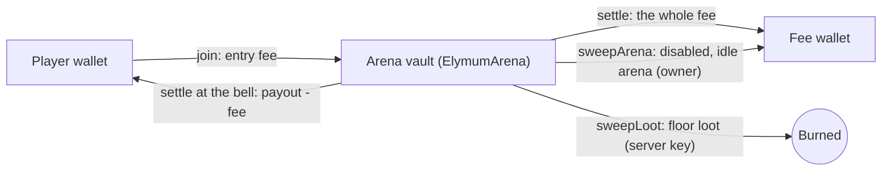

# Elymum: the whole project on one page

Elymum is a cute coin-eats-coin arena game on **Elysium**, Kinetiq's EVM L2 (Arbitrum Orbit, settles to HyperEVM,
gas token **HYPE**). The money rules live in two Solidity contracts, the game runs on an authoritative server, and an
**Elymum NFT** minted for **$1 in HYPE** opens the game. This page explains how the game plays, how money moves, how
the code is laid out and how it is run. The source of truth for everything is
[the spec](specs/2026-10-29-elymum-on-elysium.md).

> **Status (2026-10-29).** Elymum runs on Elysium: the contracts, the
> SDK, the server's EVM gateway, SIWE sign-in and the mint system are built, and the interface is being redrawn in the
> Ring Storybook language. The flow is **WL → Mint → Play**: for now the public site collects WL applications; the
> owner deploys every contract from their own wallet in `/admin`. Mainnet launches on Nov 9; until then everything
> runs on Elysium Testnet. The contracts have **not been audited**, and a game played with a token of real value may
> need a licence where you operate.

---

## 1. The game in 30 seconds

- You are a coin. Eat food and smaller coins to grow, and run from bigger ones.
- Practice rooms have bots, two leagues (Rookie and Pro) and touch nothing on chain.
- Arenas are paid rooms with a fixed entry fee in `$ELYMUM` (the game token the owner sets after deploy).
  - Your value starts at the entry fee; eat a player and their value moves to you.
- Rounds: 5 minutes on the wall clock, the same for every arena. No cash-out: at the bell everyone still alive is
  paid their value on chain, minus a fee on profit only.
- Re-entry: eaten? Buy back in at the same fee while joins are open (they close in the final minute).
- The NFT: the Elymum NFT (an emblem) mints for $1 in HYPE, allowlist first, then public. The owner decides who
  may play: admins only, NFT holders, or everyone.
- The token is set after deploy: until the owner sets it on the arena (once), the arenas read "Opening soon".

## 2. Game mechanics

### 2.1 Movement and eating

| Rule | Value (source: `packages/shared/src/constants.ts`, `RULES`) |
|---|---|
| Simulation and snapshot rate | 30 ticks per second, authoritative server |
| Start mass | 20 |
| Eating | needs at least 1.25 × the victim's mass and enough overlap (the victim must be mostly covered) |
| Speed | `1900 · r^-0.44`, so bigger coins are slower |
| Split (`Space`) | needs at least 35 mass; up to 16 cells; launch speed 1250; halves merge back after 12 s + 15 ms per unit of mass |
| Eject mass (`W`) | needs at least 35 mass; costs 18 and throws a 14-mass blob |
| Viruses (spiky cacti) | mass 100. A coin at least 1.33 × that size pops into as many as 15 pieces. Feeding a virus 198 mass makes it shoot a new one. |
| Decay | above 150 mass you lose 0.15 %/s, plus an extra term that grows with total mass, so giants melt faster |
| Maximum cell mass | 12,000 |
| Food | pastel coins (1 mass), gems (2), golden coins (8); refills at 60 per second |
| Power-ups | Magnet (10 s), Pump (6 s, × 1.4 speed), Shield (8 s), Bag (+15 % mass, at least 40) |
| Spawn shield | 3 s |
| Room sizes | Practice 5600², Arena 6400²; humans per instance: Practice 40, Arena 50 |

### 2.2 Controls

| Action | Desktop | Phone |
|---|---|---|
| Move | mouse | joystick |
| Split | `Space` | split button |
| Drop mass | `W` (can be held) | tip button |
| Chat / sticker | `Enter` / `1`–`8` | chat / sticker buttons |
| Next player while spectating | `Q` | |

### 2.3 Value inside an arena (off-chain ledger)

- A ticket's value starts at its entry fee.
- Eating a cell moves `floor(V · m / M)` of the victim's value to the eater: `V` is the victim's value, `m` the
  mass of the eaten cell and `M` the victim's total mass. The last cell moves whatever is left.
- Bots are worth 0. Eating a bot gives mass only.
- Loot: when a bot eats a player, that share of the player's value spills across the map as loot.
  - The value is split into `clamp(ceil(V / (fee × 0.25)), 3, 24)` pieces whose values add up exactly.
  - Only real players can pick loot up.
  - Loot stays on the floor until the round ends.

### 2.4 Rounds (paid arenas only)

| Rule | Value |
|---|---|
| Round length | 5 minutes, aligned to Unix time: round *n* runs `[n·300 s, (n+1)·300 s)` for every arena and instance |
| Joins | open in the first 4 minutes, closed in the final 60 s |
| A ticket bought while joins are closed | held; the client joins it automatically when the next round opens (0–1.5 s jitter, up to 5 attempts) |
| Eaten | you get 0 for that ticket; buy back in at the same fee while joins are open |
| Disconnect (AFK) | your cells stay in the arena until they are eaten or the bell rings, so leaving is not an early exit |
| The bell | every live ticket, connected or AFK, is settled at its current value; the world resets and a new round starts at once |
| Floor loot at the bell | collected and **burned** with `sweepLoot` |
| Exits that still settle at the current value | admin kick and server shutdown (operator actions, not player choices) |

On screen:

- Round chip: shows `m:ss`, switches to "Final minute" for the last 60 s and shows a large countdown in the last 10 s.
- Bell: the world freezes and the Round over receipt appears, with your till, the fee, the amount paid, your
  place, the top 5 and a PAID stamp.
- Lobby rows: each arena shows either "Round ends in 3:12" or "Joins closed · next round in 0:42".
- Death sheet: offers "Buy back in", or "Next round in" while joins are closed.
- Sound: a soft tick each second in the last 10 s and a bell at the end.
- Announcer: "One minute left.", "Ten seconds.", "Round over.".

### 2.5 Arenas

| Arena | Entry fee |
|---|---|
| Asphodel Meadow | 1,000 `$ELYMUM` |
| Lethe Shore | 10,000 `$ELYMUM` |
| Golden Bough | 50,000 `$ELYMUM` |
| Isles of the Blessed | 250,000 `$ELYMUM` |

Ids 1 to 4, created from `/admin` → Deploy (or `pnpm admin create-arena --defaults`) once the token is set, all open
to everyone, 300 open tickets each. A new 50-player instance opens on the same vault when the others are full.

## 3. Money

### 3.1 Fees

The fee is charged on profit only, at the rate fixed when the ticket was bought: a flat 5 % by default (500 bps; at
most 10 %), and **all of it goes to the fee wallet** (the owner's choice at deploy).

```
profit = max(0, payout - entryFee)
fee    = floor(profit x feeBps / 10 000)
player = payout - fee
```

Example: a 1,000 ticket worth 2,000 at the bell: profit 1,000, fee 50, the player gets 1,950.

### 3.2 Where tokens live



- Two-phase settle: if the payout transfer to a player fails, the session is finalized with what is `owed`, and the
  player collects it with `refund` at any time.
- Refund: a ticket the server never settled can be refunded by its player after 24 h (`min(entryFee, vault)`).
- Off-chain conservation: per arena, live values + floor loot + pending payouts = entry fees − payouts, kept in a
  crash-safe journal.

### 3.3 The token and the mint

- The arena is deployed without a token; the owner sets `$ELYMUM` once (`setToken`, typed twice in `/admin`). It can
  never change. Until then the server plays practice only and the arenas show "Opening soon"; when it is set the lobby
  opens the arenas without a reload.
- The NFT price is held in wei and kept at `MINT_USD_CENTS` (default $1) of HYPE: by the owner's Sync button, or by
  the server as price keeper inside the owner's bounds (every 5 minutes, only when off by more than 2 %).
- The allowlist is every approved WL wallet plus every wallet of a submitted collab list; the owner publishes its
  Merkle root.

## 4. Architecture

**Hybrid model.** The server runs the physics; the contracts enforce the money rules; the browser signs its own
transactions (approve, join, refund, mint); the server key signs only `settle`, `sweepLoot` and (as keeper)
`setPrice`. Details: [ARCHITECTURE.md](ARCHITECTURE.md).

| Path | What it is |
|---|---|
| `packages/contracts` | `ElymumArena`, `ElymumNFT`, `TestToken` (Hardhat 3, Solidity 0.8.28, OpenZeppelin 5.6.1, forge-std tests); `src/artifacts.ts` is committed and pins the runtime code hashes |
| `packages/sdk` | viem reads, call builders, deploy helpers, call previews, Merkle tree, HYPE price, the admin CLI (`pnpm admin`) |
| `packages/shared` | Rules (`RULES`), the binary protocol, the chains table, arenas, the SIWE message, the palette |
| `packages/art` | The coin drawing used by the web renderer and the films |
| `apps/server` | The game server: rooms, bots, rounds, ledger, journal, `chain/evm.ts`, the price keeper, the site, mint, NFT metadata and admin API, integrity |
| `apps/web` | The client: landing, `/wl`, `/collab`, `/mint`, `/play`, `/docs`, `/admin`; wallets via EIP-6963 + viem (`src/wallet`) |
| `scripts/` | `demo.mjs`, `localnet.mjs`, `localnet-fund.mjs`, `dev-browser.mjs`, `record-walkthrough.mjs`, the Dev Wallet (`lib/dev-wallet.mjs`) |
| `brand/` | The brand kit generator and its PNGs (section 9) |
| `media/` | Film pipelines (section 10) |
| `docs/` | This page, ARCHITECTURE, DEPLOY, OPERATIONS, the spec and the design reference |

**Contract guarantees, in short:** a payout never exceeds the vault; one open ticket per player per arena; a
settlement cannot replay (the session id must match); the fee rate is fixed at join and capped at 10 %; the token is
set once; floor loot is only burned; pause blocks joins only. On the NFT: allowlist proofs (Merkle), per-wallet limits,
excess payment refunded, the keeper prices only inside the owner's bounds, supply only goes down, metadata can be
frozen forever.

**Sign-in** is SIWE (EIP-4361): the statement is "Sign in to Elymum. This is free and sends no transaction."; smart
wallets are verified with ERC-1271 / 6492.

## 5. Run, test, deploy, operate

```bash
corepack enable && pnpm install
pnpm demo                        # full stack on a fake chain (token set)
DEV_FAKE_TOKEN=0 pnpm demo       # token unset: "Opening soon" until POST /api/dev/token
ROUND_SECONDS=90 pnpm demo       # short rounds
pnpm demo:localnet               # hardhat node + contracts deployed with the SDK + the production server
pnpm demo:record                 # the walkthrough video (fake chain)
pnpm typecheck && pnpm test      # every package
pnpm contracts:build && pnpm contracts:test
pnpm -F @elymum/server e2e       # real hardhat node + real server, the deploy order end to end
```

| Topic | Where |
|---|---|
| Elysium details, Render, env vars, the domain, the `/admin` deploy flow, mainnet | [DEPLOY.md](DEPLOY.md) |
| Server key gas, allowlist, $1 price, pausing, ownership, key rotation, backups, integrity | [OPERATIONS.md](OPERATIONS.md) |
| Money flow, invariants, trust model, server internals | [ARCHITECTURE.md](ARCHITECTURE.md) |

## 6. Trust model in one table

| Actor | Can | Cannot |
|---|---|---|
| Player | buy tickets, collect what is owed, refund an unsettled ticket after 24 h, mint | settle a ticket, undo a result |
| Server key | settle tickets with any payout up to the vault; burn floor loot up to the vault; re-price the NFT inside the bounds (if keeper) | move tokens to a wallet of its choice, touch the fee wallet or the config |
| Owner (Ownable2Step) | token once, fee (≤ 10 %), fee wallet, server authority, arenas, pause, sweeps; NFT phase, root, price, bounds, keeper, limits, metadata, royalty, withdraw | change the token once set, raise an open ticket's fee, take a vault directly |

The game outcome trusts the server, and the owner can replace the server key, so trusting the server means trusting
the owner. Protect the server key.

## 7. Deployment

| Item | Value |
|---|---|
| Chain | **Elysium Testnet** (chain id 99801, RPC `https://testnet-rpc.elysium.kinetiq.xyz`, faucet https://elysium.kinetiq.xyz/testnet-faucet) until mainnet (Nov 9; its RPC and explorer go into `EVM_RPC_URL` / `EXPLORER_URL` when Kinetiq publishes them) |
| Contracts | deployed by the owner from `/admin` → Deploy and registered with the server (`DATA_DIR/contracts.json`) |
| Server key | `SERVER_PRIVATE_KEY=auto`, on the persistent disk; pays gas in HYPE |
| Admins | `ADMIN_WALLETS` = the owner's 0x address (no default) |
| Hosting | one Docker container (game server + web) on Render with a persistent disk at `/data` |
| Domain | the site is served at `PUBLIC_URL` (your current domain); elymum.io can be set later by changing `PUBLIC_URL` / `VITE_PUBLIC_URL` and the DNS |

## 8. Website, allowlist, collabs and the admin panel

| Route | Who | What |
|---|---|---|
| `/` | everyone | The landing in the Ring Storybook style: the ring at dawn, the coins, how a round works, the NFT plate, the arenas, FAQ, X @elymumio. CTAs: Join the WL, Collab |
| `/wl` | everyone | "Three small chores": the admin-defined steps (follow @elymumio, repost the pinned post, connect an EVM wallet with a free SIWE signature), one entry per wallet and per X handle, a shareable boarding pass |
| `/collab` | communities | Apply → in review → approved with spots and a deadline → raffle on X → paste the winners' EVM wallets → submit (locks) |
| `/mint` | everyone | The mint after dark: phase, eligibility and proof, quantity, price in HYPE with its USD value; minted emblems and a Play button when the game is open to holders |
| `/play` | per `gameAccess` | The game: admins only, holders, or everyone |
| `/admin` | `ADMIN_WALLETS` | Launch, Deploy, Mint, Arena, Play, WL, Tasks, Collabs, Integrity, Settings (OPERATIONS.md) |
| `/docs` | everyone | The player guide |

**Admin panel safety:** the wallet must be on the server's chain and be the contract owner; every transaction is
previewed (function, arguments, value, network, signer) before the wallet prompt; the token address is typed twice;
double clicks cannot send twice; mainnet shows a red MAINNET banner.

**Integrity:** cheat and collusion flags from arena play (repeated value between wallets, feeding, shared IP or
browser, bot-like input, round-bell patterns), bans from paid arenas and an optional auto-hold of high-risk payouts.
Details: [OPERATIONS.md](OPERATIONS.md#integrity-cheat-and-collusion-detection).

## 9. Brand

- Look: "Ring Storybook" (spec section 6; reference `docs/design/storybook-reference.html`): a picture book of the
  ring habitat, ink outlines `#04181C`, flat cel colour with one shade, hard offset shadows, cream die-cut stickers,
  coins with faces; day = the plain at dawn, night = in orbit.
- Palette (`packages/shared/src/palette.ts`): teal `#2D7388`, cyan `#34B7DD`, sun `#F2C14E`, up `#3C9A87`, cream
  `#F6EEDA`, plain `#F8F7F4`, trench `#0F2A30`, and the rest of the spec's table.
- Type: Fraunces (display, SOFT 100), DM Sans (reading), Geist Mono (numbers and kickers).
- Kit: `node brand/generate.mjs` renders the X avatar and banner, the OG card (also `apps/web/public/og-elymum.png`),
  the favicons, posts (WL open, $1 mint, game live), stickers and arena posters into `brand/out/`
  ([brand/README.md](../brand/README.md)).

## 10. Media

Film sources in `media/`, renders in `out/videos/` (gitignored): the promo, gameplay, how-to-play, the mint film and
Roadmap Chomp. Their text, voice lines, handles and colours are rebranded; they **must be re-rendered after the new UI
lands** ([media/README.md](../media/README.md)).

## 11. Launch checklist

| Step | Who |
|---|---|
| Server on Render with a persistent disk, `ADMIN_WALLETS`, `SERVER_PRIVATE_KEY=auto`, testnet RPC | owner |
| Fund the server key with HYPE | owner |
| `/admin` → Deploy: Arena, NFT, register both (testnet first) | owner |
| WL open; review WL and collabs | owner |
| Publish the allowlist root; Sync to $1; open the mint (Allowlist) with "activate the game for holders" | owner |
| `$ELYMUM` exists → Set token (once) → create the four arenas | owner |
| Public mint; optional price keeper with bounds | owner |
| Mainnet (Nov 9): mainnet RPC and explorer, redeploy the contracts on mainnet | owner |
| Re-render the films, regenerate the screenshots, upload the X art | owner |
| Security audit; legal review for a real-money game | recommended before opening |

## 12. Decision log

| Date | Decision |
|---|---|
| 2026-10-14 | Token arenas, the coin characters, English-only project |
| 2026-10-15 | Paid arenas play 5-minute rounds: no cash-out, late join and buy-back, paid at the bell |
| 2026-10-16 | One simple model: flat 5 % fee on profit to the fee wallet; floor loot burned; the token set after deploy |
| 2026-10-17 | Browser-wallet admin panel; the site becomes a landing page with WL and collab applications |
| 2026-10-29 | The project becomes **Elymum on Elysium**: two Solidity contracts, EIP-6963 + viem wallets, SIWE, the Elymum NFT at $1 in HYPE, WL → Mint → Play, everything deployed from `/admin`, the Ring Storybook design |
