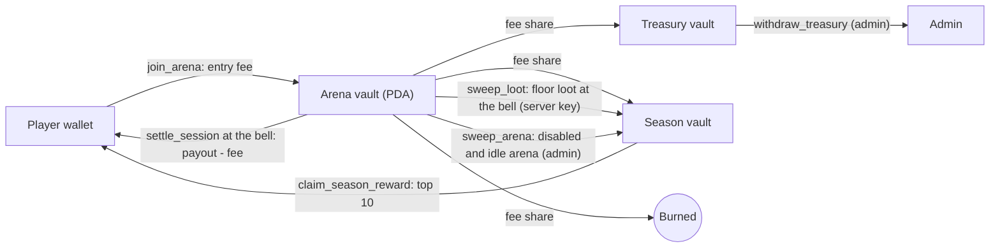

# Slana: the whole project on one page

Slana is a coin-themed, multiplayer Agar.io game on Solana. The money is on-chain and the game itself runs on a server.
This page explains how the game plays, how money moves, how the code is laid out and how you run and operate it. Each
section links to the detailed document where one exists.

> **Status.** The code is complete and tested, including on a local Solana validator. Nothing has been deployed to
> mainnet, and the program has **not been audited**. A game played with a token of real value may need a licence where
> you operate.

---

## 1. The game in 30 seconds

- You are a coin. Eat food and smaller coins to grow, and run from bigger ones.
- **Practice** is free. It needs no wallet and no token, you play with bots, nothing touches the chain, and there are
  two leagues, Rookie and Pro.
- **Arenas** are paid rooms with a fixed entry fee in $SLANA.
  - Your **till** starts at the entry fee.
  - Eat a player and their tokens move into your till.
- **Rounds:** an arena round lasts 5 minutes on the wall clock and is the same for every arena.
  - There is no cash-out.
  - When the bell rings, everyone still alive is paid their till on-chain, and a fee is taken from the profit only.
- **Re-entry:** if you are eaten, you can buy back in at the same fee while joins are open. Joins close in the last minute
  of a round.
- **Slana Pass:** a free-mint NFT. It opens the Pass arenas, lowers the fee from 5 % to 2 %, makes you eligible for
  season prizes and gives you +15 % start mass.

## 2. Game mechanics

### 2.1 Movement and eating

| Rule | Value (source: `packages/shared/src/constants.ts`, `RULES`) |
|---|---|
| Simulation and snapshot rate | 30 ticks per second, authoritative server |
| Start mass | 20 (with a Pass, × 1.15 in arenas) |
| Eating | needs at least **1.25 ×** the victim's mass and enough overlap (the victim must be mostly covered) |
| Speed | `1900 · r^-0.44`, so bigger coins are slower |
| Split (`Space`) | needs at least 35 mass; up to 16 cells; launch speed 1250; halves merge back after 12 s + 15 ms per unit of mass |
| Eject mass (`W`) | needs at least 35 mass; costs 18 and throws a 14-mass blob |
| Viruses (spiky cacti) | mass 100. A coin at least 1.33 × that size pops into as many as 15 pieces. Feeding a virus 198 mass makes it shoot a new one. |
| Decay | above 150 mass you lose 0.15 %/s, plus an extra term that grows with total mass, so giants melt faster |
| Maximum cell mass | 12,000 |
| Food | pastel coins (1 mass), gems (2), golden coins (8); refills at 60 per second |
| Power-ups | Magnet (10 s), Pump (6 s, × 1.4 speed), Shield (8 s), Bag (+15 % mass, at least 40) |
| Spawn shield | 3 s |
| Room sizes | Practice 5600², Arena 6400²; humans per instance: Practice 40, Arena 50 |

### 2.2 Controls

| Action | Desktop | Phone |
|---|---|---|
| Move | mouse | joystick |
| Split | `Space` | split button |
| Drop mass | `W` (can be held) | tip button |
| Chat / sticker | `Enter` / `1`–`8` | chat / sticker buttons |
| Next player while spectating | `Q` | |

### 2.3 Value inside an arena (off-chain ledger)

- A ticket's value starts at its entry fee.
- **Eating a cell** moves `floor(V · m / M)` of the victim's value to the eater: `V` is the victim's value, `m` the
  mass of the eaten cell and `M` the victim's total mass. The last cell moves whatever is left.
- **Bots are worth 0.** Eating a bot gives mass only.
- **Loot:** when a bot eats a player, that share of the player's value spills across the map as loot.
  - The value is split into `clamp(ceil(V / (fee × 0.25)), 3, 24)` pieces whose values add up exactly.
  - Only real players can pick loot up.
  - Loot stays on the floor until the round ends.

### 2.4 Rounds (paid arenas only)

| Rule | Value |
|---|---|
| Round length | 5 minutes, aligned to Unix time: round *n* runs `[n·300 s, (n+1)·300 s)` for every arena and instance |
| Joins | open in the first 4 minutes, closed in the final 60 s |
| A ticket bought while joins are closed | held; the client joins it automatically when the next round opens (0–1.5 s jitter, up to 5 attempts) |
| Eaten | you get 0 for that ticket; buy back in at the same fee while joins are open |
| Disconnect (AFK) | your cells stay in the arena until they are eaten or the bell rings, so leaving is not an early exit |
| The bell | every live ticket, connected or AFK, is settled at its current value; the world resets and a new round starts at once |
| Floor loot at the bell | collected and moved to the current season pool with `sweep_loot` |
| Exits that still settle at the current value | admin kick and server shutdown (operator actions, not player choices) |

On screen:

- **Round chip:** shows `m:ss`, switches to "Final minute" for the last 60 s and shows a large countdown in the last 10 s.
- **Bell:** the world freezes and the **Round over** receipt appears, with your till, the fee, the amount paid, your
  place, the top 5 and a PAID stamp.
- **Lobby rows:** each arena shows either "Round ends in 3:12" or "Joins closed · next round in 0:42".
- **Death sheet:** offers "Buy back in", or "Next round in" while joins are closed.
- **Sound:** a soft tick each second in the last 10 s and a bell at the end.
- **Announcer:** "One minute left.", "Ten seconds.", "Round over.".

### 2.5 Arenas

| Arena | Entry fee | Needs a Pass |
|---|---|---|
| Penny Pond | 1,000 $SLANA | no |
| Silver Creek | 10,000 $SLANA | no |
| Gold Lake | 50,000 $SLANA | yes |
| Whale Bay | 250,000 $SLANA | yes |

These are the defaults created by `pnpm admin create-arena --defaults`. Each arena can hold 300 open tickets. A new
50-player instance opens on the same vault when the existing ones are full.

## 3. Money

### 3.1 Fees

The fee is charged on profit only, and the rate is fixed when you buy the ticket.

```
profit   = max(0, payout - entry_fee)
fee      = floor(profit x bps / 10 000)        5 % (500 bps), 2 % (200 bps) with a Pass; max 10 %
treasury = 50 % of the fee, season pool = 30 %, burned = 20 %
player   = payout - fee
```

Example with a 1,000 ticket and a till of 2,000 at the bell:

| | Profit | Fee | Fee split | Player gets |
|---|---|---|---|---|
| Without a Pass | 1,000 | 50 | treasury 25, season 15, burn 10 | **1,950** |
| With a Pass | 1,000 | 20 | treasury 10, season 6, burn 4 | **1,980** |

### 3.2 Where tokens live



- **Two-phase settle.** If a player has no token account, or their account refuses the transfer, the payout stays in
  the vault as `owed`. The player collects it any time with "Collect payout". A loser cannot undo the result by closing
  their account.
- **Refund.** If the server never settles a ticket, the player can refund it themselves after 24 h. On-chain this pays
  `min(entry fee, vault)`.
- **Off-chain conservation.** Per arena, the total of live values, floor loot and pending payouts always equals the entry
  fees taken minus the payouts already settled. The server writes this to a crash-safe journal (write to a temp file, then
  rename).

### 3.3 Seasons

- **Points:** only Pass tickets earn season points. The program keeps the top 20 on-chain.
- **Prizes:** the top 10 share the season pool: 30 / 20 / 14 / 10 / 8 / 6 / 4.5 / 3 / 2.5 / 2 %.
- **Claiming:** winners have 30 days to claim, then the season can be rolled over.
- **Where the pool comes from:** the 30 % season share of every fee, `sweep_loot` (floor loot from each round),
  `sweep_arena`, and rollovers.

### 3.4 Slana Pass

- **The NFT:** a Metaplex Core NFT. Minting is free (you pay only rent and the network fee), the supply is 3,333 and
  each wallet can mint one.
- **Fair reveal (commit–reveal):**
  1. The admin commits a seed hash before the mint, and the supply is locked once the mint opens.
  2. After the mint ends, the admin reveals the seed.
  3. About 150 slots later, anyone can capture the hash of that slot (`capture_pass_entropy`).
  4. Traits come from `sha256(seed ‖ slot hash)`.
  5. Nobody, the team included, can know a Pass's traits while minting is still possible.
- **Perks:** the Pass arenas, a 2 % fee, season points and prizes, and +15 % start mass. These perks are stated on every
  ticket and in the guide.
- Art and traits are described in [PASS-ART.md](PASS-ART.md).

## 4. Architecture

**Hybrid model.** The server runs the real-time physics. The Solana program enforces the money rules. The browser signs
its own transactions; the server key signs only `settle_session` and `sweep_loot` (and, permissionlessly,
`capture_pass_entropy`).

```
Browser (apps/web)  --WebSocket, binary 30 Hz-->  Game server (apps/server)  --settle / sweep-->  Solana program
       \__________________ signs join / mint / claim / refund / collect ___________________________/
```

### 4.1 Repository layout

| Path | What it is |
|---|---|
| `programs/slana-lean` | **The deployed program** (Pinocchio, `no_std`). 59,896 bytes, which locks about ◎0.418 of rent; the CI gate fails above 71,000 bytes. |
| `programs/slana-ref` | Anchor reference program. It is **never deployed**; it is the source of the IDL and TypeScript types and the conformance oracle. The LiteSVM test suite runs against both programs (`SLANA_IMPL=ref\|lean`). |
| `packages/shared` | Game rules (`RULES`), the binary protocol (version 3), arena metadata, the round math, token formatting |
| `packages/sdk` | TypeScript client: PDAs, instruction builders, account readers, fee math, and the **admin CLI** (`pnpm admin`) |
| `packages/art` | Pass traits, risograph coin and Pass drawing, the `pnpm pass:*` generator |
| `apps/server` | Node 22 game server (see 4.3) |
| `apps/web` | Vite + React client in the "Paper Ticket" design system (see 4.4) |
| `scripts/` | build, deploy, close, localnet, demo, recorder, IDL sync, program tests |
| `media/` | Sources of the promo, gameplay and how-to-play videos (renders go to `out/videos/`, which git ignores) |
| `docs/` | This page, [ARCHITECTURE](ARCHITECTURE.md), [DEPLOY](DEPLOY.md), [OPERATIONS](OPERATIONS.md), [PASS-ART](PASS-ART.md), and the design specs and plans under `docs/superpowers/` |

### 4.2 On-chain program

**Instructions, by area:**

| Area | Instructions |
|---|---|
| Setup and admin | `initialize`, `update_config`, `create_arena`, `update_arena`, `withdraw_treasury` |
| Players | `register_player`, `update_profile` |
| Tickets | `join_arena` (and its Pass variant), `settle_session` (server), `refund_session` (player: collect what is owed, or refund after 24 h) |
| Vault sweeps | `sweep_arena` (admin, arena disabled and idle), `sweep_loot` (server, floor loot at each bell) |
| Seasons | `end_season`, `claim_season_reward`, `rollover_season` |
| Pass | `set_pass_collection`, `set_pass_seed_hash`, `mint_pass`, `close_pass_mint`, `reveal_pass`, `capture_pass_entropy` |

**Accounts (PDAs):**

| Account | Seeds |
|---|---|
| Config | `config` |
| Arena | `arena` + id |
| Arena vault | `vault` + arena |
| Session | `session` + arena + player |
| Pass lock | `pass_lock` + asset |
| Profile | `profile` + player |
| Season | `season` + id |
| Treasury vault | `treasury_vault` |
| Season vault | `season_vault` |

**Main on-chain guarantees:**

- A payout can never exceed the vault.
- A player has at most one open ticket per arena, and a Pass backs at most one open ticket.
- Payouts cannot be replayed: the session id is checked.
- The fee rate is fixed at join and capped at 10 %.
- The token mint is fixed at `initialize`, and risky Token-2022 extensions are refused.
- A pause blocks joins only; settlements and refunds keep working.

### 4.3 Game server (`apps/server/src`)

| Folder | Role |
|---|---|
| `game/` | The world simulation: entities, spatial grid, eating, splitting, viruses, loot, power-ups |
| `bots/` | Bot brains, personalities and steering |
| `rooms/` | `manager.ts` (instances, matchmaking, the vault guard), `room.ts` (a room, round end, settlement), `round-clock.ts` (the single round clock), `visibility.ts` |
| `stake/` | `ledger.ts` (in-game value transfers, loot spill) and `journal.ts` (the crash-safe record of live values, loot, pending settlements and loot sweeps) |
| `chain/` | `solana.ts`: the settlement and sweep worker (retries, a two-phase settle, a sweep resent only after its blockhash expires, and a sweeper that refunds stale tickets). `dev-fake.ts`: an in-memory chain for development. |
| `net/` | WebSocket gateway: sign-in, join and refusal codes such as `round_closed`, `round_ended` and `no_cashout` |
| `pass/` | Pass metadata and image endpoints |
| `http.ts` | REST endpoints: `/api/health`, `/api/rooms`, `/api/leaderboard`, `/api/season`, `/api/config`, `/api/auth/nonce`, `/api/pending`, `/pass/*` |

Sign-in uses SIWS (Sign-In With Solana) with a nonce that the server issues and checks line by line.

### 4.4 Web client (`apps/web/src`)

| Folder | Role |
|---|---|
| `game/` | Engine, network, input, server clock offset, held-ticket auto-join |
| `render/` | Canvas renderer for the riso world, coins and effects |
| `ui/` | Screens: `lobby/`, `game/` (HUD, round chip, death sheet, Round over sheet), `pass/`, `profile/`, `news/` (season claim), `docs/` (the in-app guide at `/docs`) |
| `design/` | The "Paper Ticket" design system and motion presets: ticket punch, paper wipe, page turn, stamps |
| `audio/` | Synthesized WebAudio: mixer buses (master, music, sfx, voice), sound effects, procedural lo-fi music, a speech-synthesis announcer |
| `solana/` | Wallet adapter and the transaction builders for tickets, mint, claim and collect |
| `i18n/en.ts` | All UI copy. The project is English-only, and CI enforces it. |

## 5. Run, test, deploy, operate

```bash
corepack enable && pnpm install
pnpm demo                        # full stack on a fake chain: lobby, sign-in, tickets, rounds, Pass mint
ROUND_SECONDS=90 pnpm demo       # same, with short rounds so you see the bell quickly
pnpm demo:localnet               # the same UI against a real local validator and the lean program
pnpm demo:record                 # regenerate the walkthrough video
pnpm typecheck && pnpm test      # every package
pnpm program:test                # LiteSVM suite on both programs, clippy, size gate
```

| Topic | Where |
|---|---|
| Keys, token, deploy and upgrade order (upgrade the program before rolling out a server that uses `sweep_loot`) | [DEPLOY.md](DEPLOY.md) |
| Admin CLI, monitoring, log lines, emergency pause and program close (`scripts/close-program.sh`) | [OPERATIONS.md](OPERATIONS.md) |
| Money flow, invariants, trust model, server internals | [ARCHITECTURE.md](ARCHITECTURE.md) |

The admin wallet is `D2Ts7yCiVjedo6uwqpkM44QA8J45NdVU1J3k5m6iWtvm` (`scripts/admin.env`). It is the program's upgrade
authority and the Config admin. The program is never made immutable, so the owner can close it at any time and reclaim
its rent.

## 6. Trust model in one table

| Actor | Can | Cannot |
|---|---|---|
| Player | buy tickets, collect what is owed, refund an unsettled ticket after 24 h, mint, claim | settle a ticket, undo a result |
| Server key | settle tickets with any payout up to the vault balance; sweep up to the vault balance into the season pool | touch the treasury, the config or the season vault's payouts |
| Admin | fees (≤ 10 %), arenas, pause, seasons, treasury, Pass setup and reveal, replace the server key | change the token, raise an open ticket's fee, change the Pass supply after the mint opened |
| Upgrade authority (the admin wallet) | replace or close the program | — |

The game outcome (who ate whom, and each player's value at the bell) trusts the authoritative server. The admin can
replace the server key, so trusting the server means trusting the admin.
